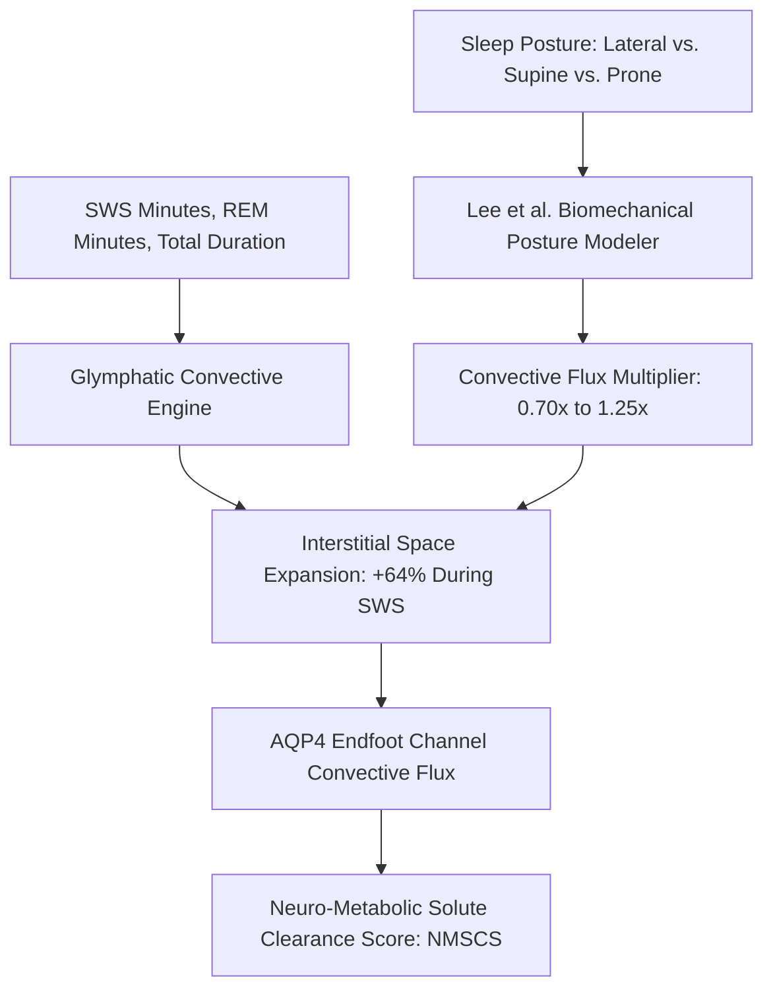

# Personal Agent Glymphatic Clearance Aquaporin-4 Sleep Skill

[](https://github.com/Alpha-Park)
[](https://github.com/alphaparkinc)
[](https://www.python.org/)
[](https://modelcontextprotocol.io/)
[](https://github.com/Alpha-Park)

Zero-dependency Nedergaard glymphatic brain clearance modeler, slow-wave sleep (SWS) interstitial volume expansion quantifier, and nocturnal sleep position optimizer.

## Architecture



## Quickstart

```python
from client import PersonalAgentGlymphaticClearanceAquaporin4Sleep

agent = PersonalAgentGlymphaticClearanceAquaporin4Sleep()
res = agent.model_nocturnal_glymphatic_flux(slow_wave_sleep_minutes=90.0, sleep_position="lateral_right")
print(f"NMSCS: {res['neuro_metabolic_solute_clearance_score_nmscs']}/100 | Clearance: {res['glymphatic_clearance_tier']}")
```
