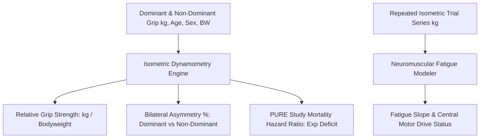

# Personal Agent Grip Strength Frailty Velocity Skill

[](https://github.com/Alpha-Park)
[](https://github.com/alphaparkinc)
[](https://www.python.org/)
[](https://modelcontextprotocol.io/)
[](https://github.com/Alpha-Park)

Zero-dependency isometric grip dynamometry modeler, PURE study mortality hazard quantifier, bilateral asymmetry indexer, and neuromuscular motor drive fatigue evaluator.

## Architecture



## Quickstart

```python
from client import PersonalAgentGripStrengthFrailtyVelocity

agent = PersonalAgentGripStrengthFrailtyVelocity()
res = agent.evaluate_grip_strength_and_frailty(dominant_hand_kg=51.0, non_dominant_hand_kg=47.0, age=42, bodyweight_kg=75.0)
print(f"RGS: {res['relative_grip_strength_rgs']} | Sarcopenia Risk: {res['clinical_sarcopenia_risk']}")
```
