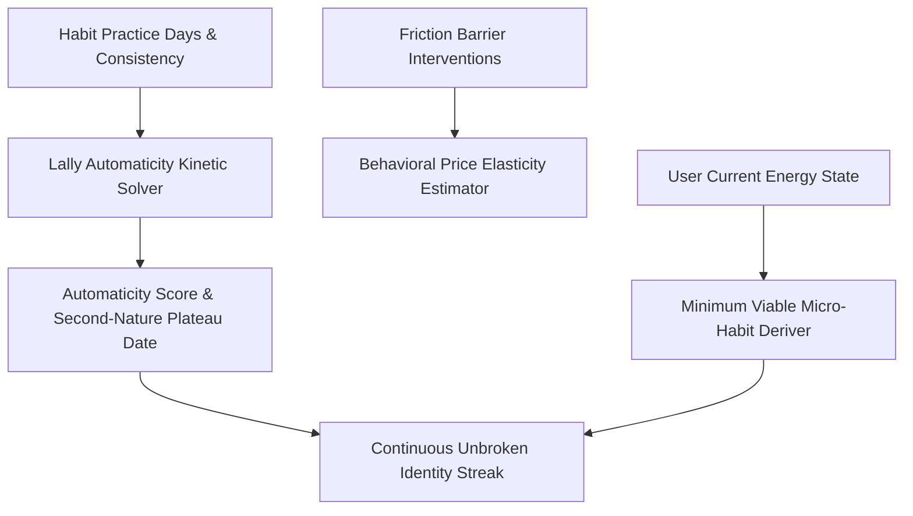

# genpark-personal-agent-habit-elasticity-tracker-skill


GenPark Personal Agent Habit Elasticity Tracker implements Phillippa Lally's habit automaticity curves and behavioral friction elasticity to build unshakeable personal routines.



## Features
- **Lally Automaticity Curve**: Forecasts days until a habit becomes effortless based on complexity tier.
- **Friction Elasticity Metric**: Quantifies how friction reductions directly multiply completion rates.
- **Streak Preserver Downscaling**: Protects habits on exhausting days with scientifically scaled micro-doses.

## Quickstart

```python
from client import PersonalAgentHabitElasticityTracker

tracker = PersonalAgentHabitElasticityTracker()
res = tracker.model_habit_automaticity_curve(45, 0.90)
print("Automaticity Level:", res["automaticity_score"])
```

## FastMCP Integration

```bash
python -m genpark-personal-agent-habit-elasticity-tracker-skill.mcp_server
```

## License
MIT
