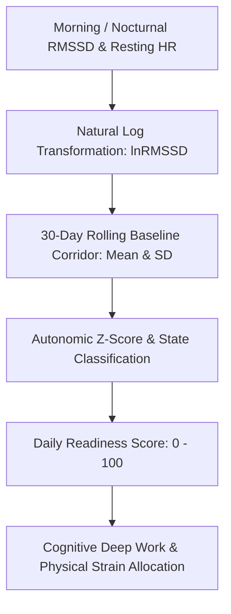

# Personal Agent HRV Autonomic Recovery Readiness Skill

[](https://github.com/Alpha-Park)
[](https://github.com/alphaparkinc)
[](https://www.python.org/)
[](https://modelcontextprotocol.io/)
[](https://github.com/Alpha-Park)

Zero-dependency Heart Rate Variability (HRV) RMSSD/lnRMSSD autonomic nervous system balance evaluator, 30-day rolling baseline corridor tracker, and daily cognitive/physical capacity allocation engine.

## Architecture



## Quickstart

```python
from client import PersonalAgentHrvAutonomicRecoveryReadiness

agent = PersonalAgentHrvAutonomicRecoveryReadiness()
res = agent.evaluate_daily_readiness(rmssd_ms=58.0, resting_hr_bpm=54.0)
print(f"Readiness Score: {res['daily_readiness_score']} | State: {res['autonomic_state']}")
```
