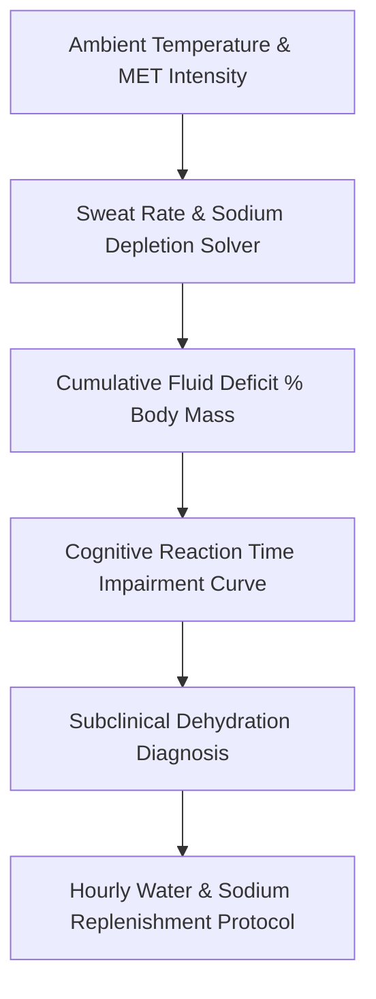

# genpark-personal-agent-hydration-osmolality-electrolyte-skill


GenPark Personal Agent Hydration Osmolality Electrolyte models physiological fluid dynamics, sweat sodium loss, and subclinical dehydration cognitive performance penalties.



## Features
- **Sweat Volume & Sodium Tracking**: Calculates fluid loss scaled by body mass and thermal workload.
- **Cognitive Impairment Model**: Quantifies working memory loss and reaction slowdown from dehydration.
- **Hourly Hydration Protocol**: Distributes daily fluid intake evenly across waking hours with wake-up boluses.

## Quickstart

```python
from client import PersonalAgentHydrationOsmolalityElectrolyte

hydration = PersonalAgentHydrationOsmolalityElectrolyte()
res = hydration.generate_personalized_hydration_schedule(16, 75.0)
print("Hourly Intake:", res["target_hourly_intake_ml"], "ml")
```

## FastMCP Integration

```bash
python -m genpark-personal-agent-hydration-osmolality-electrolyte-skill.mcp_server
```

## License
MIT
