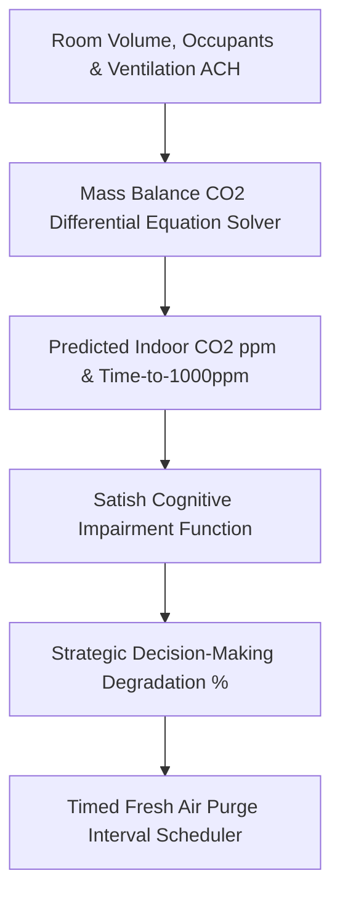

# genpark-personal-agent-indoor-co2-cognitive-ventilation-skill


GenPark Personal Agent Indoor CO2 Cognitive Ventilation models indoor air quality mass balances and Satish cognitive impairment curves to ensure workspaces maintain peak oxygenation.



## Features
- **Differential Mass Balance Engine**: Models dynamic CO2 accumulation curves based on human metabolic exhalation.
- **Cognitive Impairment Mapping**: Translates raw ppm numbers into executive function and decision-making penalties.
- **Smart Purge Prescriptions**: Calculates exact window-opening minutes needed to flush spaces back to outdoor baselines.

## Quickstart

```python
from client import PersonalAgentIndoorCO2CognitiveVentilation

vent = PersonalAgentIndoorCO2CognitiveVentilation()
res = vent.forecast_indoor_co2_accumulation(30.0, 1, 0.4)
print("Predicted CO2:", res["predicted_terminal_co2_ppm"], "ppm")
```

## FastMCP Integration

```bash
python -m genpark-personal-agent-indoor-co2-cognitive-ventilation-skill.mcp_server
```

## License
MIT
