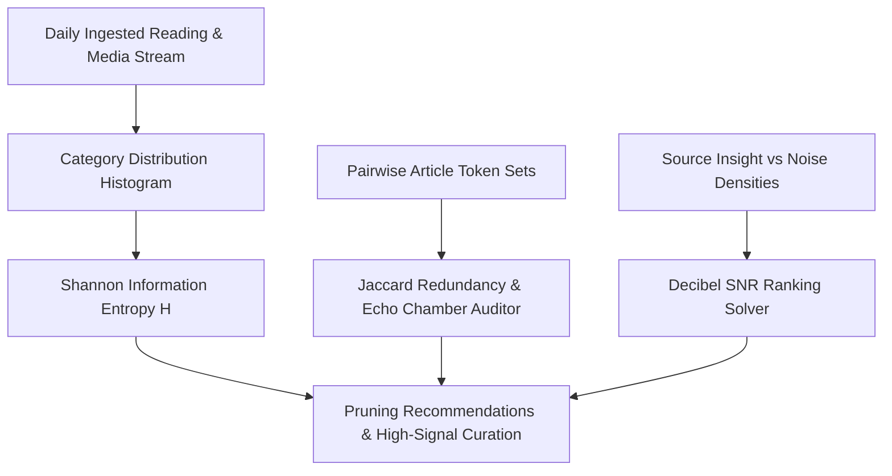

# genpark-personal-agent-information-diet-entropy-pruner-skill


GenPark Personal Agent Information Diet Entropy Pruner applies Shannon information theory, Jaccard lexical novelty metrics, and decibel SNR modeling to optimize personal reading diets.



## Features
- **Shannon Entropy Scoring**: Quantifies intellectual breadth and flags doomscroll concentration.
- **Echo Chamber Jaccard Metric**: Detects repackaged duplicate ideas across different media outlets.
- **Decibel SNR Filtering**: Surfaces high-density thought leadership while pruning low-signal noise.

## Quickstart

```python
from client import PersonalAgentInformationDietEntropyPruner

pruner = PersonalAgentInformationDietEntropyPruner()
res = pruner.rank_content_sources_snr([{"name": "Research", "insight_density": 0.9, "noise_density": 0.1}])
print("SNR:", res["sources_ranked"][0]["snr_db"], "dB")
```

## FastMCP Integration

```bash
python -m genpark-personal-agent-information-diet-entropy-pruner-skill.mcp_server
```

## License
MIT
