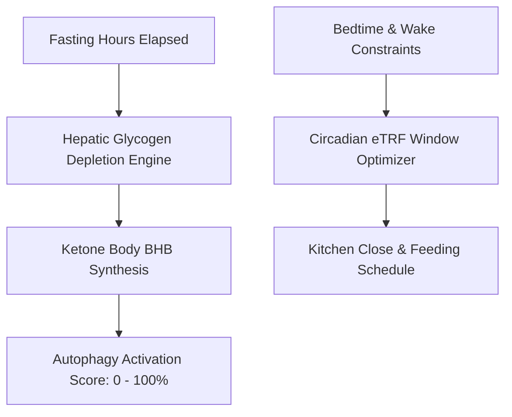

# Personal Agent Intermittent Fasting Autophagy Window Skill

[](https://github.com/Alpha-Park)
[](https://github.com/alphaparkinc)
[](https://www.python.org/)
[](https://modelcontextprotocol.io/)
[](https://github.com/Alpha-Park)

Zero-dependency hepatic glycogen depletion tracker, beta-hydroxybutyrate (BHB) kinetics estimator, cellular autophagy activation scorer, and circadian eating window optimizer.

## Architecture



## Quickstart

```python
from client import PersonalAgentIntermittentFastingAutophagy

agent = PersonalAgentIntermittentFastingAutophagy()
res = agent.calculate_autophagy_metabolic_phase(fasting_duration_hours=18.0)
print(f"Phase: {res['current_metabolic_phase']} | Autophagy: {res['autophagy_activation_index']}")
```
