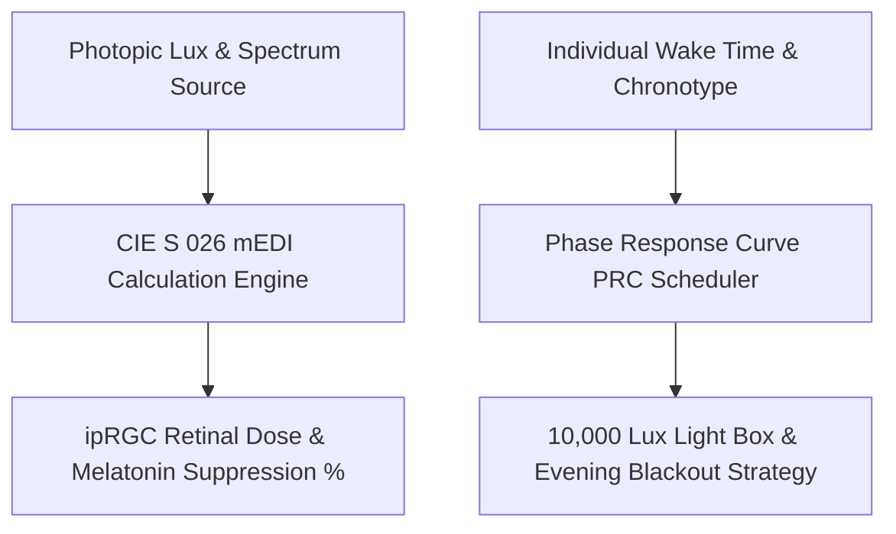

# Personal Agent Light Therapy Melatonin Suppression Skill

[](https://github.com/Alpha-Park)
[](https://github.com/alphaparkinc)
[](https://www.python.org/)
[](https://modelcontextprotocol.io/)
[](https://github.com/Alpha-Park)

Zero-dependency Melanopic Equivalent Daylight Illuminance (mEDI / CIE S 026) calculator, ipRGC melanopsin retinal phototransduction modeler, and circadian phototherapy scheduler.

## Architecture



## Quickstart

```python
from client import PersonalAgentLightTherapyMelatoninSuppression

agent = PersonalAgentLightTherapyMelatoninSuppression()
res = agent.calculate_melanopic_stimulus(photopic_lux=2500.0, light_source="sunlight")
print(f"mEDI: {res['melanopic_equivalent_daylight_illuminance_medi_lux']} lux | Melatonin Suppression: {res['pineal_melatonin_suppression_pct']}")
```
