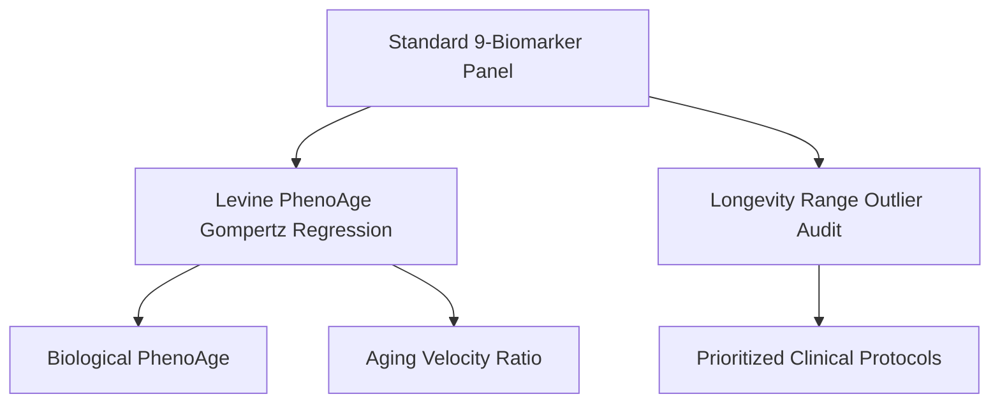

# Personal Agent Longevity Biomarker Velocity Skill

[](https://github.com/Alpha-Park)
[](https://github.com/alphaparkinc)
[](https://www.python.org/)
[](https://modelcontextprotocol.io/)
[](https://github.com/Alpha-Park)

Zero-dependency Levine PhenoAge biological age acceleration modeler, phenotypic aging velocity calculator, and targeted clinical intervention priority engine.

## Architecture



## Quickstart

```python
from client import PersonalAgentLongevityBiomarkerVelocity

agent = PersonalAgentLongevityBiomarkerVelocity()
result = agent.calculate_phenotypic_age(chronological_age=42.0, crp_mg_l=3.2, glucose_mg_dl=108.0)
print(f"Biological Age: {result['phenotypic_age']} yrs (Delta: {result['phenotypic_age_delta']:+} yrs)")
```
