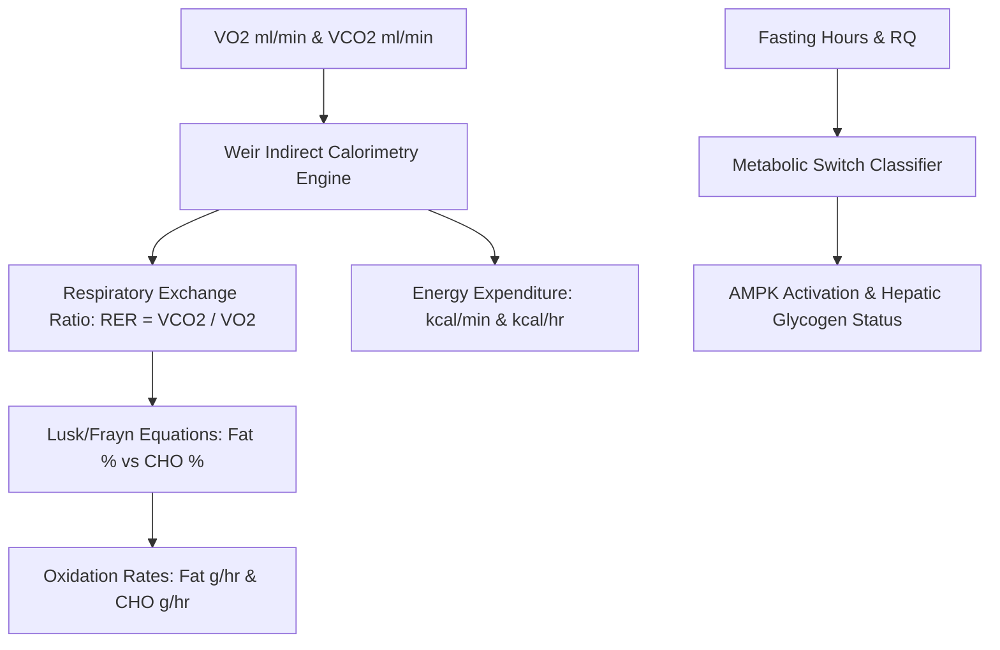

# Personal Agent Metabolic Flexibility Respiratory Quotient Skill

[](https://github.com/Alpha-Park)
[](https://github.com/alphaparkinc)
[](https://www.python.org/)
[](https://modelcontextprotocol.io/)
[](https://github.com/Alpha-Park)

Zero-dependency indirect calorimetry Respiratory Exchange Ratio (RER) partitioner, substrate oxidation modeler (fat vs carbohydrate grams/min), and metabolic switch evaluator.

## Architecture



## Quickstart

```python
from client import PersonalAgentMetabolicFlexibilityRespiratoryQuotient

agent = PersonalAgentMetabolicFlexibilityRespiratoryQuotient()
res = agent.calculate_substrate_oxidation_and_rer(vo2_ml_min=320.0, vco2_ml_min=240.0)
print(f"RER: {res['respiratory_exchange_ratio_rer']} | Fat: {res['fat_oxidation_percentage']} | CHO: {res['carbohydrate_oxidation_percentage']}")
```
