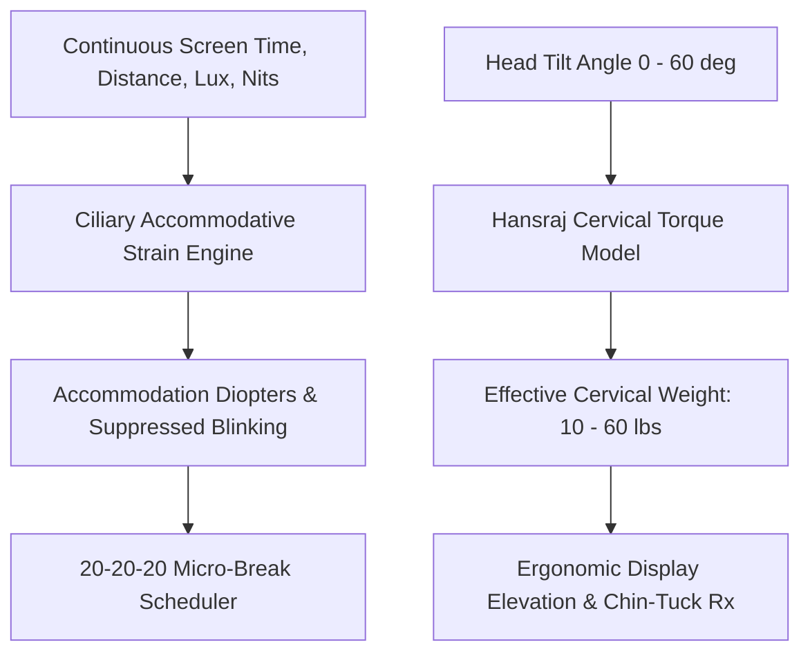

# Personal Agent Micro Break Ocular Strain Ergonomics Skill

[](https://github.com/Alpha-Park)
[](https://github.com/alphaparkinc)
[](https://www.python.org/)
[](https://modelcontextprotocol.io/)
[](https://github.com/Alpha-Park)

Zero-dependency ciliary accommodation spasm modeler, Hansraj cervical spine torque calculator, tear film break-up time estimator, and 20-20-20 micro-recovery scheduler.

## Architecture



## Quickstart

```python
from client import PersonalAgentMicroBreakOcularStrainErgonomics

agent = PersonalAgentMicroBreakOcularStrainErgonomics()
res = agent.calculate_cervical_spine_torque(head_tilt_angle_degrees=30.0)
print(f"Spinal Load: {res['effective_cervical_spine_load_lbs']} | Status: {res['biomechanical_posture_classification']}")
```
