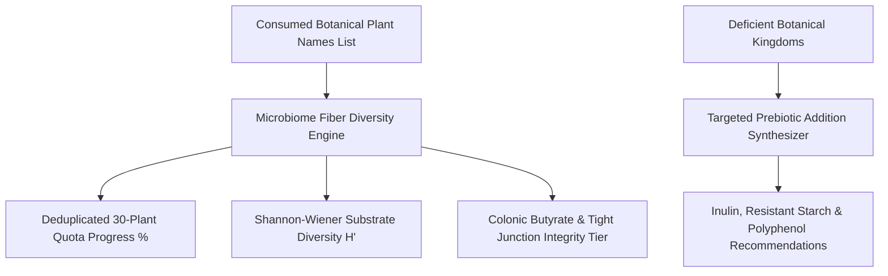

# Personal Agent Microbiome Fiber Diversity Index Skill

[](https://github.com/Alpha-Park)
[](https://github.com/alphaparkinc)
[](https://www.python.org/)
[](https://modelcontextprotocol.io/)
[](https://github.com/Alpha-Park)

Zero-dependency American Gut Project 30-plant species auditor, Shannon-Wiener prebiotic diversity calculator, short-chain fatty acid (SCFA) synthesizer, and gut barrier optimizer.

## Architecture



## Quickstart

```python
from client import PersonalAgentMicrobiomeFiberDiversity

agent = PersonalAgentMicrobiomeFiberDiversity()
res = agent.calculate_fiber_diversity_index(["garlic", "kale", "lentil", "oat", "blueberry", "walnut"])
print(f"Unique Plants: {res['unique_plant_species_count']} | Quota: {res['weekly_sonnenburg_quota_pct']}")
```
