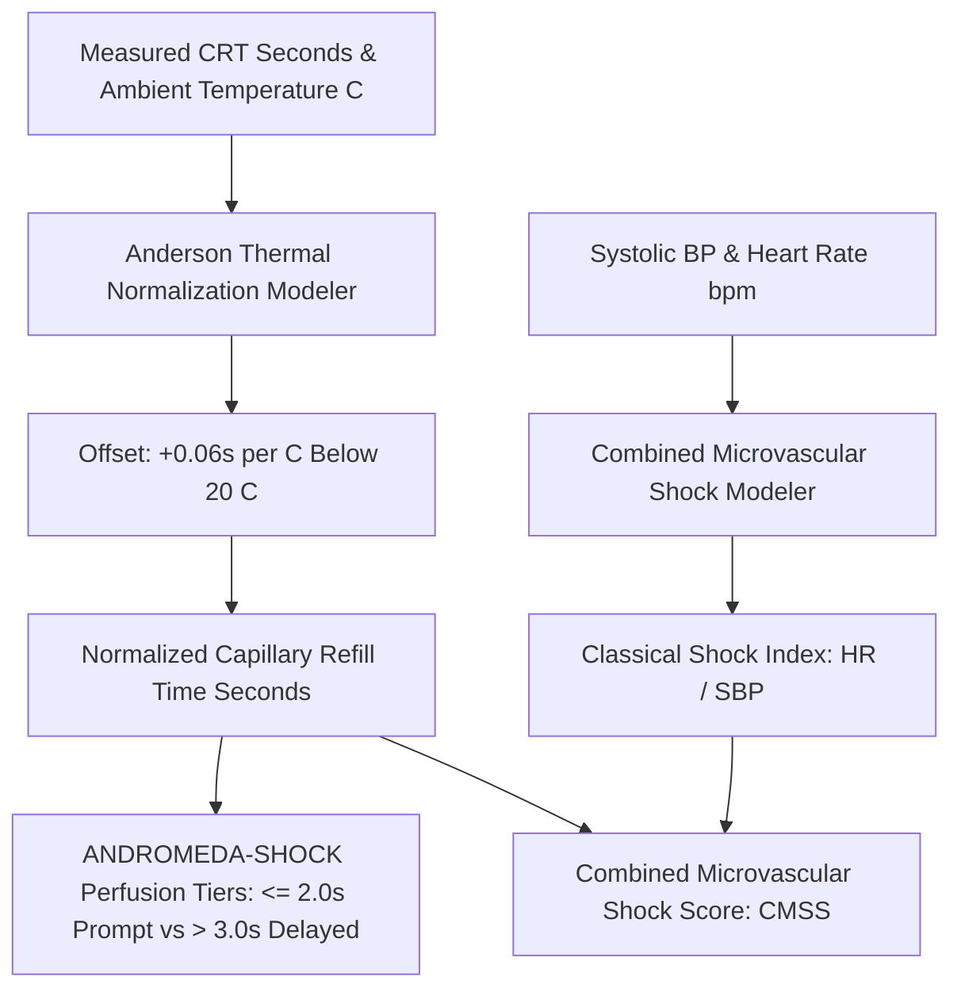

# Personal Agent Microvascular Capillary Refill Time Perfusion Skill

[](https://github.com/Alpha-Park)
[](https://github.com/alphaparkinc)
[](https://www.python.org/)
[](https://modelcontextprotocol.io/)
[](https://github.com/Alpha-Park)

Zero-dependency Capillary Refill Time (CRT) thermal normalization modeler, peripheral vasomotor tone indexer, and microvascular shock index calculator.

## Architecture



## Quickstart

```python
from client import PersonalAgentMicrovascularCapillaryRefillTimePerfusion

agent = PersonalAgentMicrovascularCapillaryRefillTimePerfusion()
res = agent.evaluate_capillary_refill_time(measured_crt_seconds=2.2, ambient_temperature_celsius=16.0)
print(f"Normalized CRT: {res['normalized_capillary_refill_time_seconds']} s | Tier: {res['microvascular_perfusion_tier']}")
```
