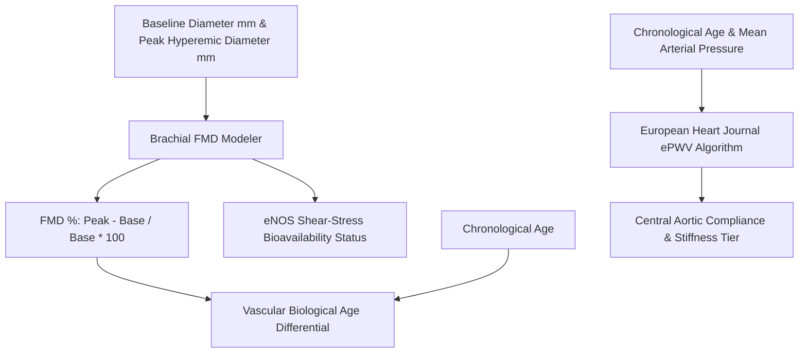

# Personal Agent Microvascular Endothelial FMD Elasticity Skill

[](https://github.com/Alpha-Park)
[](https://github.com/alphaparkinc)
[](https://www.python.org/)
[](https://modelcontextprotocol.io/)
[](https://github.com/Alpha-Park)

Zero-dependency Flow-Mediated Dilation (FMD) brachial shear stress modeler, endothelial nitric oxide bioavailability indexer, and estimated Pulse Wave Velocity (ePWV) calculator.

## Architecture



## Quickstart

```python
from client import PersonalAgentMicrovascularEndothelialFmdElasticity

agent = PersonalAgentMicrovascularEndothelialFmdElasticity()
res = agent.evaluate_brachial_fmd_and_vascular_age(baseline_diameter_mm=4.10, peak_hyperemic_diameter_mm=4.50, chronological_age=42)
print(f"FMD: {res['flow_mediated_dilation_fmd_pct']} | Vascular Age: {res['estimated_vascular_biological_age']} yrs")
```
