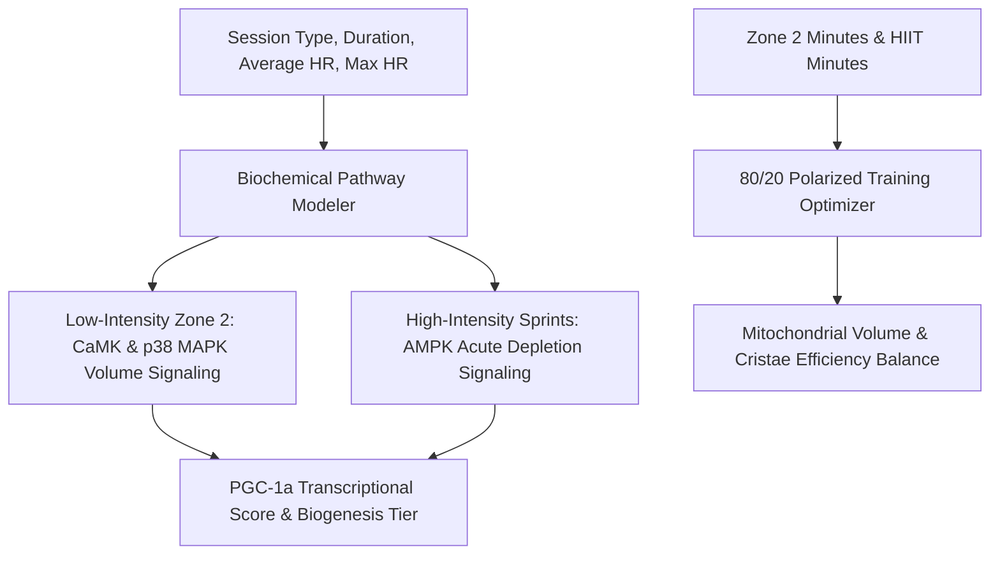

# Personal Agent Mitochondrial Biogenesis MET Flux Skill

[](https://github.com/Alpha-Park)
[](https://github.com/alphaparkinc)
[](https://www.python.org/)
[](https://modelcontextprotocol.io/)
[](https://github.com/Alpha-Park)

Zero-dependency PGC-1alpha transcriptional induction modeler, CaMK vs. AMPK pathway partitioner, and 80/20 polarized mitochondrial density training optimizer.

## Architecture



## Quickstart

```python
from client import PersonalAgentMitochondrialBiogenesisMetFlux

agent = PersonalAgentMitochondrialBiogenesisMetFlux()
res = agent.model_pgc1a_transcriptional_stimulus(session_type="zone2_endurance", duration_minutes=50.0)
print(f"PGC-1a Score: {res['pgc1a_transcriptional_score']} | Pathway: {res['biochemical_signaling_cascade']}")
```
