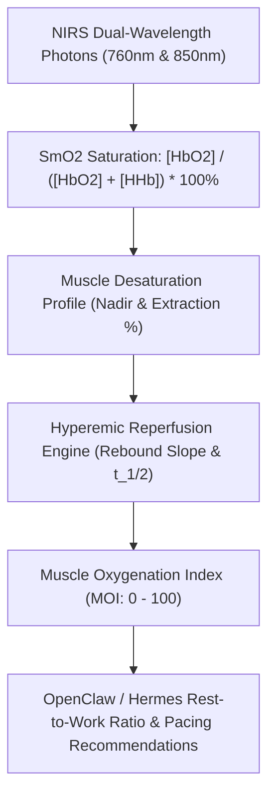

# Muscle Oxygenation (SmO2) & NIRS Reperfusion Kinetics Skill

[](https://opensource.org/licenses/MIT)
[](https://www.python.org/downloads/)
[](https://github.com/alphaparkinc/genpark-personal-agent-muscle-oxygenation-nirs-smo2-skill)
[](https://github.com/alphaparkinc/genpark-personal-agent-muscle-oxygenation-nirs-smo2-skill)
[](https://modelcontextprotocol.io/)

A sovereign personal agent capability for computational Near-Infrared Spectroscopy (NIRS) muscle oxygenation modeling, evaluating peripheral $SmO_2$ extraction capacity, and post-effort hyperemic reperfusion.

## Architecture



## Quickstart

```python
from client import MuscleOxygenationClient

client = MuscleOxygenationClient()

# Assess muscle desaturation profile during effort
res = client.evaluate_muscle_desaturation_profile(
    baseline_smo2_pct=72.0,
    nadir_smo2_pct=18.5,
    thb_arbitrary_units=13.2,
    workload_watts=320.0
)

print("Extraction Ratio:", res["muscle_o2_extraction_pct"], "%")
print("Extraction Tier:", res["extraction_tier"])
print("Interpretation:", res["physiological_interpretation"])
```

## MCP Server Integration

Add to your `claude_desktop_config.json` or OpenClaw tool registry:

```json
{
  "mcpServers": {
    "muscle-oxygenation": {
      "command": "python",
      "args": ["/path/to/genpark-personal-agent-muscle-oxygenation-nirs-smo2-skill/mcp_server.py"]
    }
  }
}
```

## License
MIT License.
