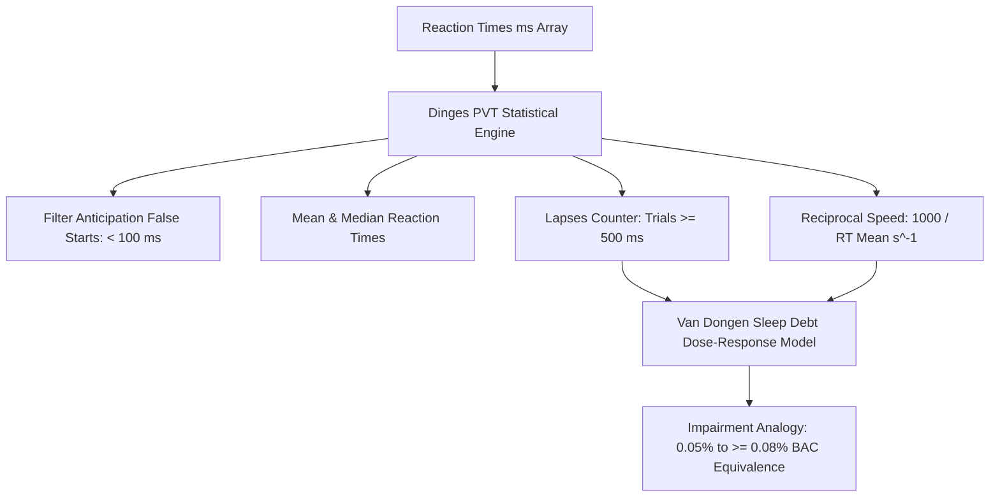

# Personal Agent Neuromuscular Reaction Time Psychomotor Skill

[](https://github.com/Alpha-Park)
[](https://github.com/alphaparkinc)
[](https://www.python.org/)
[](https://modelcontextprotocol.io/)
[](https://github.com/Alpha-Park)

Zero-dependency Psychomotor Vigilance Task (PVT) attentional lapse counter, reciprocal speed modeler, and cumulative sleep debt neurobehavioral impairment evaluator.

## Architecture



## Quickstart

```python
from client import PersonalAgentNeuromuscularReactionTimePsychomotor

agent = PersonalAgentNeuromuscularReactionTimePsychomotor()
res = agent.evaluate_pvt_attentional_performance([230.0, 245.0, 520.0, 240.0, 260.0])
print(f"Mean RT: {res['mean_reaction_time_ms']} ms | Lapses: {res['attentional_lapse_count_500ms']}")
```
