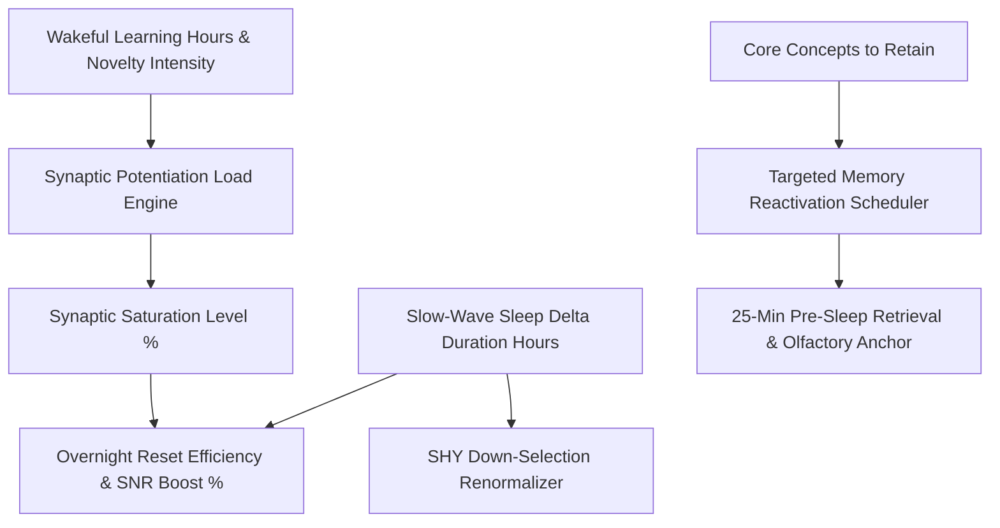

# Personal Agent Neuroplasticity Synaptic Pruning Sleep Skill

[](https://github.com/Alpha-Park)
[](https://github.com/alphaparkinc)
[](https://www.python.org/)
[](https://modelcontextprotocol.io/)
[](https://github.com/Alpha-Park)

Zero-dependency Tononi-Cirelli Synaptic Homeostasis Hypothesis (SHY) modeler, slow-wave sleep (SWS) down-selection renormalizer, and Targeted Memory Reactivation (TMR) scheduler.

## Architecture



## Quickstart

```python
from client import PersonalAgentNeuroplasticitySynapticPruning

agent = PersonalAgentNeuroplasticitySynapticPruning()
res = agent.model_synaptic_homeostasis_scaling(waking_learning_hours=14.0, slow_wave_sleep_hours=1.8)
print(f"Renormalization: {res['overnight_synaptic_renormalization_efficiency']} | SNR Boost: {res['signal_to_noise_ratio_boost']}")
```
