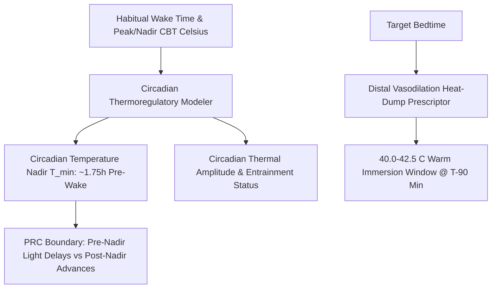

# Personal Agent Nocturnal Core Body Temperature Min Skill

[](https://github.com/Alpha-Park)
[](https://github.com/alphaparkinc)
[](https://www.python.org/)
[](https://modelcontextprotocol.io/)
[](https://github.com/Alpha-Park)

Zero-dependency circadian core body temperature (CBT) nadir modeler, distal-to-proximal vasodilation heat dump calculator, and phase response curve inflection timing scheduler.

## Architecture



## Quickstart

```python
from client import PersonalAgentNocturnalCoreBodyTemperatureMin

agent = PersonalAgentNocturnalCoreBodyTemperatureMin()
res = agent.model_circadian_temperature_curve(habitual_wake_time_24h=7.0, evening_peak_cbt_celsius=37.2, nocturnal_nadir_cbt_celsius=36.3)
print(f"T_min Nadir: {res['projected_t_min_nadir_time']} | Amplitude: {res['circadian_temperature_amplitude_celsius']} C")
```
