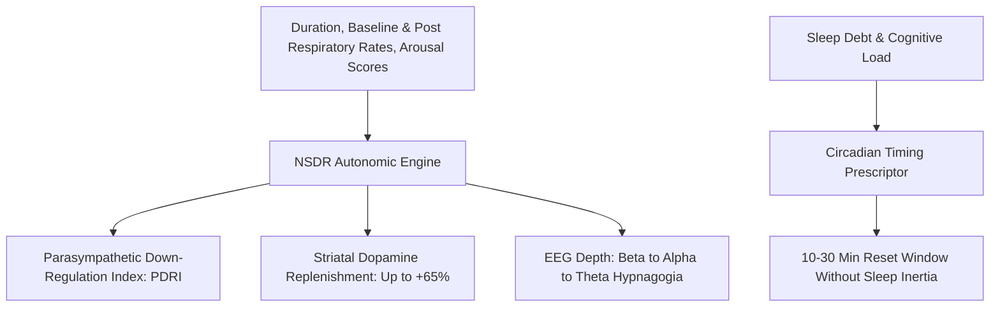

# Personal Agent Non-Sleep Deep Rest (NSDR) Protocol Skill

[](https://github.com/Alpha-Park)
[](https://github.com/alphaparkinc)
[](https://www.python.org/)
[](https://modelcontextprotocol.io/)
[](https://github.com/Alpha-Park)

Zero-dependency NSDR / Yoga Nidra neuro-autonomic state shift modeler, alpha/theta entrainment window projector, and striatal dopamine replenishment estimator.

## Architecture



## Quickstart

```python
from client import PersonalAgentNonSleepDeepRestNsdrProtocol

agent = PersonalAgentNonSleepDeepRestNsdrProtocol()
res = agent.evaluate_nsdr_state_shift(session_duration_minutes=20.0, baseline_respiratory_rate_bpm=16.0, post_session_respiratory_rate_bpm=8.0)
print(f"PDRI: {res['parasympathetic_down_regulation_index_pdri']} | Dopamine: {res['striatal_dopamine_replenishment_pct']}")
```
