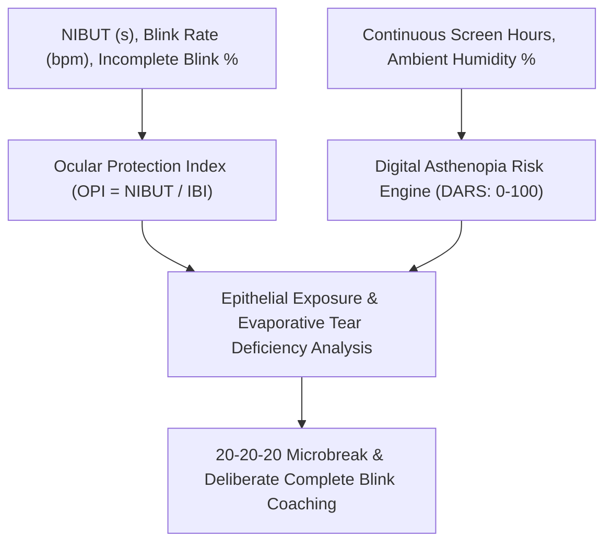

# Ocular Tear Film Breakup Dynamics & Digital Asthenopia Prevention Skill

[](https://opensource.org/licenses/MIT)
[](https://www.python.org/downloads/)
[](https://github.com/alphaparkinc/genpark-personal-agent-ocular-tear-film-breakup-ergonomics-skill)
[](https://github.com/alphaparkinc/genpark-personal-agent-ocular-tear-film-breakup-ergonomics-skill)
[](https://modelcontextprotocol.io/)

A sovereign personal agent capability for computational ophthalmic modeling of tear film breakup dynamics, Ocular Protection Index (OPI), and digital asthenopia prevention during extended screen work.

## Architecture



## Quickstart

```python
from client import OcularTearFilmClient

client = OcularTearFilmClient()

# Assess tear film stability during screen usage
assessment = client.evaluate_ocular_protection_index(
    nibut_seconds=7.0,
    blink_rate_per_min=5.5,
    incomplete_blink_fraction=0.25,
    continuous_screen_time_hours=3.5,
    ambient_humidity_pct=35.0
)

print("Effective OPI:", assessment["effective_opi"])
print("Corneal Exposure Present:", assessment["is_corneal_exposure_present"])
print("Digital Asthenopia Score:", assessment["digital_asthenopia_risk_score"], "/ 100")
print("Guidance:", assessment["ergonomic_recommendation"])
```

## MCP Server Integration

Add to your `claude_desktop_config.json` or OpenClaw tool registry:

```json
{
  "mcpServers": {
    "ocular-tear-film": {
      "command": "python",
      "args": ["/path/to/genpark-personal-agent-ocular-tear-film-breakup-ergonomics-skill/mcp_server.py"]
    }
  }
}
```

## License
MIT License.
