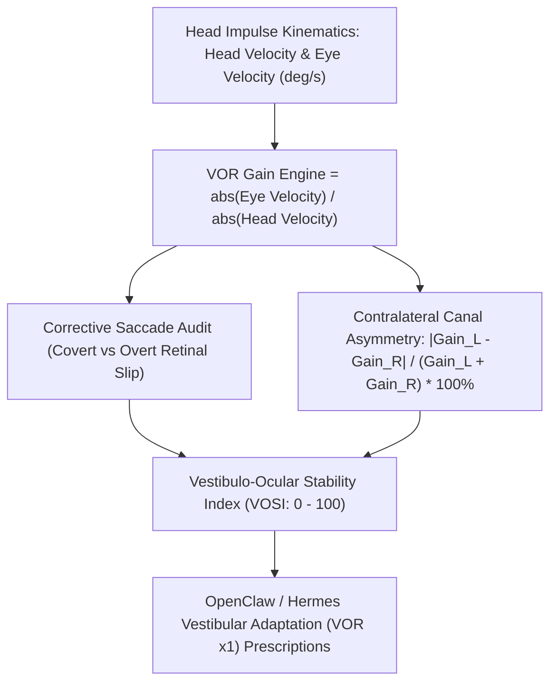

# Vestibulo-Ocular Reflex (VOR) Gain & Gaze Stabilization Skill

[](https://opensource.org/licenses/MIT)
[](https://www.python.org/downloads/)
[](https://github.com/alphaparkinc/genpark-personal-agent-ocular-vestibulo-ocular-reflex-vor-gain-skill)
[](https://github.com/alphaparkinc/genpark-personal-agent-ocular-vestibulo-ocular-reflex-vor-gain-skill)
[](https://modelcontextprotocol.io/)

A sovereign personal agent capability for computational neuro-otology, evaluating angular Vestibulo-Ocular Reflex (VOR) gain, bilateral semicircular canal asymmetry, and dynamic visual acuity.

## Architecture



## Quickstart

```python
from client import VestibuloOcularReflexClient

client = VestibuloOcularReflexClient()

# Assess horizontal canal head impulse test (vHIT)
res = client.evaluate_vor_gain(
    head_velocity_deg_s=195.0,
    eye_velocity_deg_s=184.0,
    canal_plane="horizontal_lateral",
    has_covert_saccade=False,
    has_overt_saccade=False
)

print("VOR Gain:", res["vor_gain"])
print("Stability Index:", res["vestibulo_ocular_stability_index"], "/ 100")
print("Status:", res["status"])
```

## MCP Server Integration

Add to your `claude_desktop_config.json` or OpenClaw tool registry:

```json
{
  "mcpServers": {
    "vor-gain": {
      "command": "python",
      "args": ["/path/to/genpark-personal-agent-ocular-vestibulo-ocular-reflex-vor-gain-skill/mcp_server.py"]
    }
  }
}
```

## License
MIT License.
