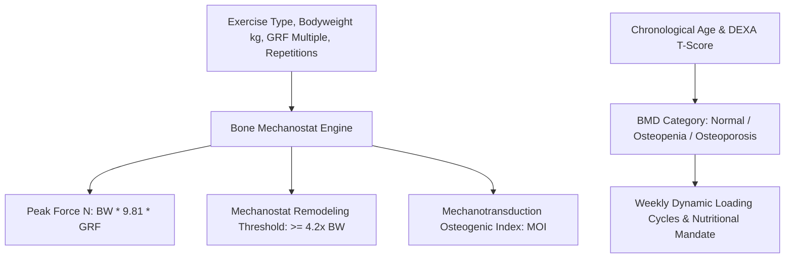

# Personal Agent Osteogenic Loading Bone Density Skill

[](https://github.com/Alpha-Park)
[](https://github.com/alphaparkinc)
[](https://www.python.org/)
[](https://modelcontextprotocol.io/)
[](https://github.com/Alpha-Park)

Zero-dependency Frost's Mechanostat bone mechanotransduction modeler, ground reaction force (GRF) osteogenic threshold indexer, and axial loading protocol prescriptor.

## Architecture



## Quickstart

```python
from client import PersonalAgentOsteogenicLoadingBoneDensity

agent = PersonalAgentOsteogenicLoadingBoneDensity()
res = agent.evaluate_osteogenic_stimulus(exercise_type="depth_jump_landing", bodyweight_kg=70.0, repetition_cycles=20)
print(f"MOI: {res['mechanotransduction_osteogenic_index_moi']} | Threshold Met: {res['mechanostat_osteogenic_threshold_met']}")
```
