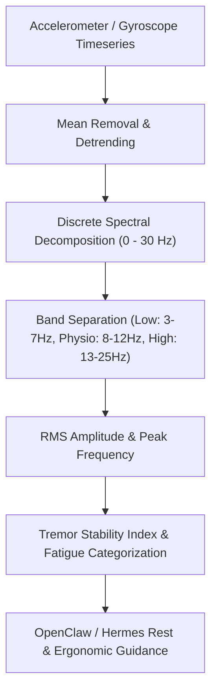

# Physiological Tremor & Neuromuscular Steadiness Skill

[](https://opensource.org/licenses/MIT)
[](https://www.python.org/downloads/)
[](https://github.com/alphaparkinc/genpark-personal-agent-physiological-tremor-stability-skill)
[](https://github.com/alphaparkinc/genpark-personal-agent-physiological-tremor-stability-skill)
[](https://modelcontextprotocol.io/)

A sovereign personal agent capability for deterministic spectral decomposition of physiological microtremor waveforms, 8-12 Hz central motor drive oscillation analysis, and neuromuscular fatigue detection.

## Architecture



## Quickstart

```python
from client import PhysiologicalTremorClient

client = PhysiologicalTremorClient()

# Analyze an acceleration stream (50 Hz)
samples = [0.08, 0.12, 0.05, -0.07, -0.11, 0.09, 0.13, -0.04]  # Extend to 200+ samples
result = client.analyze_tremor_timeseries(samples, sample_rate_hz=50.0)

print("Dominant Frequency:", result["dominant_peak_frequency_hz"], "Hz")
print("Tremor Stability Index:", result["tremor_stability_index"], "/ 100")
print("Status:", result["status"])
```

## MCP Server Integration

Add to your `claude_desktop_config.json` or OpenClaw tool registry:

```json
{
  "mcpServers": {
    "physiological-tremor": {
      "command": "python",
      "args": ["/path/to/genpark-personal-agent-physiological-tremor-stability-skill/mcp_server.py"]
    }
  }
}
```

## License
MIT License.
