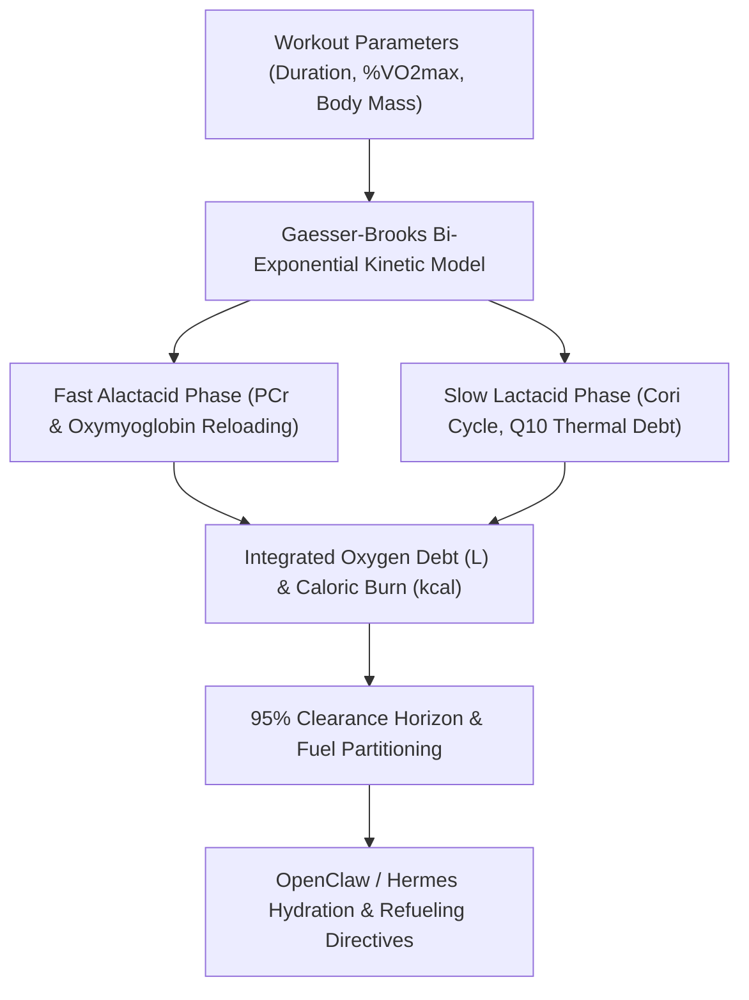

# Post-Exercise EPOC & Metabolic Recovery Kinetics Skill

[](https://opensource.org/licenses/MIT)
[](https://www.python.org/downloads/)
[](https://github.com/alphaparkinc/genpark-personal-agent-post-exercise-epoc-recovery-skill)
[](https://github.com/alphaparkinc/genpark-personal-agent-post-exercise-epoc-recovery-skill)
[](https://modelcontextprotocol.io/)

A sovereign personal agent capability for deterministic mathematical modeling of Excess Post-Exercise Oxygen Consumption (EPOC), bi-exponential recovery kinetics, and post-workout fuel replenishment timing.

## Architecture



## Quickstart

```python
from client import PostExerciseEpocClient

client = PostExerciseEpocClient()

# Model recovery following a 45-minute interval workout
epoc = client.calculate_epoc_trajectory(
    exercise_duration_min=45.0,
    vo2_max_ml_kg_min=50.0,
    exercise_intensity_pct_vo2max=82.0,
    body_mass_kg=72.0,
    post_exercise_time_min=30.0
)

print("Cumulative EPOC:", epoc["cumulative_epoc_o2_liters"], "L O2")
print("Calories Burned:", epoc["epoc_calories_expended_kcal"], "kcal")
print("Phase:", epoc["recovery_phase"])
```

## MCP Server Integration

Add to your `claude_desktop_config.json` or OpenClaw tool registry:

```json
{
  "mcpServers": {
    "post-exercise-epoc": {
      "command": "python",
      "args": ["/path/to/genpark-personal-agent-post-exercise-epoc-recovery-skill/mcp_server.py"]
    }
  }
}
```

## License
MIT License.
