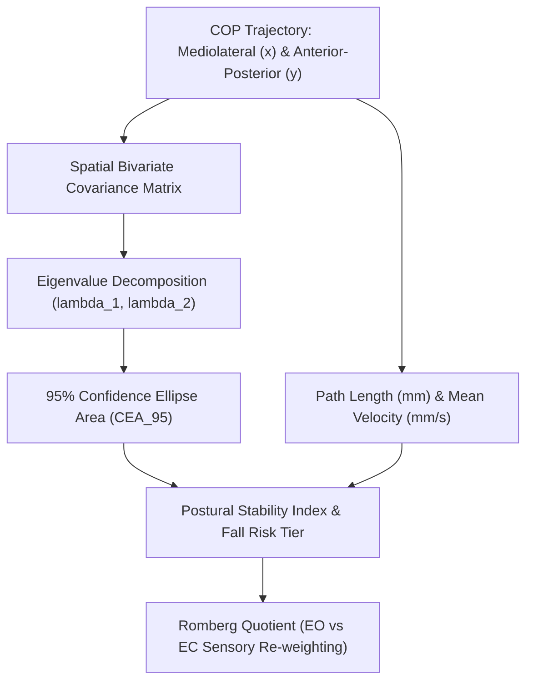

# Postural Sway & Center of Pressure (COP) Statokinesigram Skill

[](https://opensource.org/licenses/MIT)
[](https://www.python.org/downloads/)
[](https://github.com/alphaparkinc/genpark-personal-agent-postural-sway-center-of-pressure-skill)
[](https://github.com/alphaparkinc/genpark-personal-agent-postural-sway-center-of-pressure-skill)
[](https://modelcontextprotocol.io/)

A sovereign personal agent capability for computational posturography, processing 2D Center of Pressure (COP) statokinesigram trajectories, 95% confidence ellipse area, and Romberg Quotient.

## Architecture



## Quickstart

```python
from client import PosturalSwayClient

client = PosturalSwayClient()

# Analyze a series of COP displacements (mm)
x_ml = [0.2, 0.5, 0.8, 0.4, -0.1, -0.4, -0.2, 0.1]
y_ap = [1.2, 1.5, 1.1, 0.7, 0.3, -0.2, 0.4, 0.9]

sway = client.analyze_cop_sway(x_ml, y_ap, sample_rate_hz=50.0)

print("Mean Sway Velocity:", sway["mean_sway_velocity_mm_s"], "mm/s")
print("95% Ellipse Area:", sway["confidence_ellipse_area_95_mm2"], "mm²")
print("Postural Stability Index:", sway["postural_stability_index"], "/ 100")
```

## MCP Server Integration

Add to your `claude_desktop_config.json` or OpenClaw tool registry:

```json
{
  "mcpServers": {
    "postural-sway": {
      "command": "python",
      "args": ["/path/to/genpark-personal-agent-postural-sway-center-of-pressure-skill/mcp_server.py"]
    }
  }
}
```

## License
MIT License.
