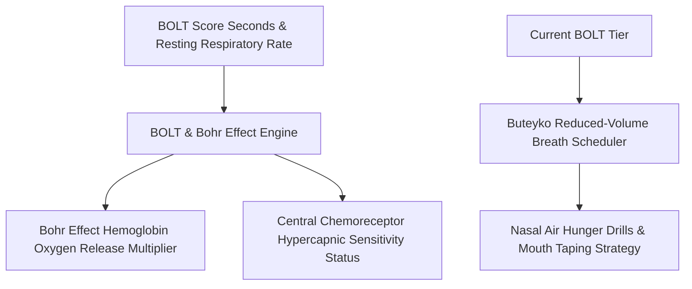

# Personal Agent Respiratory CO2 Tolerance BOLT Skill

[](https://github.com/Alpha-Park)
[](https://github.com/alphaparkinc)
[](https://www.python.org/)
[](https://modelcontextprotocol.io/)
[](https://github.com/Alpha-Park)

Zero-dependency Body Oxygen Level Test (BOLT) calculator, Bohr effect tissue oxygenation modeler, hypercapnic chemoreceptor sensitivity tracker, and Buteyko breathing scheduler.

## Architecture



## Quickstart

```python
from client import PersonalAgentRespiratoryCo2Tolerance

agent = PersonalAgentRespiratoryCo2Tolerance()
res = agent.evaluate_bolt_respiratory_efficiency(bolt_score_seconds=22.0)
print(f"Bohr Unloading: {res['bohr_effect_oxygen_unloading_multiplier']} | Status: {res['respiratory_functional_tier']}")
```
