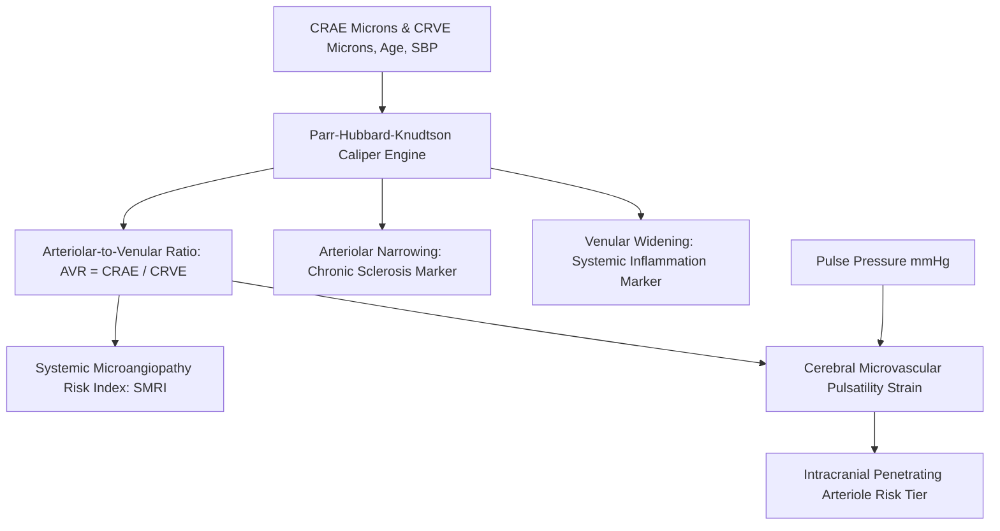

# Personal Agent Retinal Microvascular Caliper AR Ratio Skill

[](https://github.com/Alpha-Park)
[](https://github.com/alphaparkinc)
[](https://www.python.org/)
[](https://modelcontextprotocol.io/)
[](https://github.com/Alpha-Park)

Zero-dependency Central Retinal Arteriolar/Venular Equivalent (CRAE/CRVE) modeler, Arteriolar-to-Venular Ratio (AVR) calculator, and cerebral microangiopathy velocity evaluator.

## Architecture



## Quickstart

```python
from client import PersonalAgentRetinalMicrovascularCaliperArRatio

agent = PersonalAgentRetinalMicrovascularCaliperArRatio()
res = agent.calculate_retinal_avr_and_microvascular_risk(crae_microns=154.0, crve_microns=202.0)
print(f"AVR: {res['arteriolar_to_venular_ratio_avr']} | Tier: {res['microvascular_caliber_tier']}")
```
