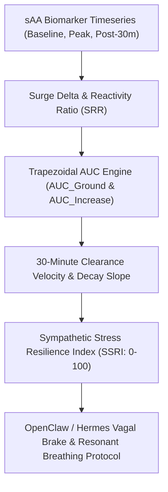

# Salivary Alpha-Amylase (sAA) Sympathetic Reactivity Skill

[](https://opensource.org/licenses/MIT)
[](https://www.python.org/downloads/)
[](https://github.com/alphaparkinc/genpark-personal-agent-salivary-alpha-amylase-sympathetic-skill)
[](https://github.com/alphaparkinc/genpark-personal-agent-salivary-alpha-amylase-sympathetic-skill)
[](https://modelcontextprotocol.io/)

A sovereign personal agent capability for computational neuroendocrine modeling of salivary alpha-amylase (sAA) noradrenergic surges, clearance velocity, and autonomic stress resilience scoring.

## Architecture



## Quickstart

```python
from client import SalivaryAlphaAmylaseClient

client = SalivaryAlphaAmylaseClient()

# Assess sympathetic surge and clearance kinetics
res = client.evaluate_acute_sympathetic_reactivity(
    baseline_saa_u_ml=38.5,
    peak_saa_u_ml=112.0,
    post30_saa_u_ml=49.0
)

print("Surge Delta:", res["delta_surge_u_ml"], "U/mL")
print("Reactivity Ratio:", res["sympathetic_reactivity_ratio"], "x")
print("Resilience Index (SSRI):", res["sympathetic_stress_resilience_index"], "/ 100")
print("Interpretation:", res["interpretation"])
```

## MCP Server Integration

Add to your `claude_desktop_config.json` or OpenClaw tool registry:

```json
{
  "mcpServers": {
    "salivary-alpha-amylase": {
      "command": "python",
      "args": ["/path/to/genpark-personal-agent-salivary-alpha-amylase-sympathetic-skill/mcp_server.py"]
    }
  }
}
```

## License
MIT License.
