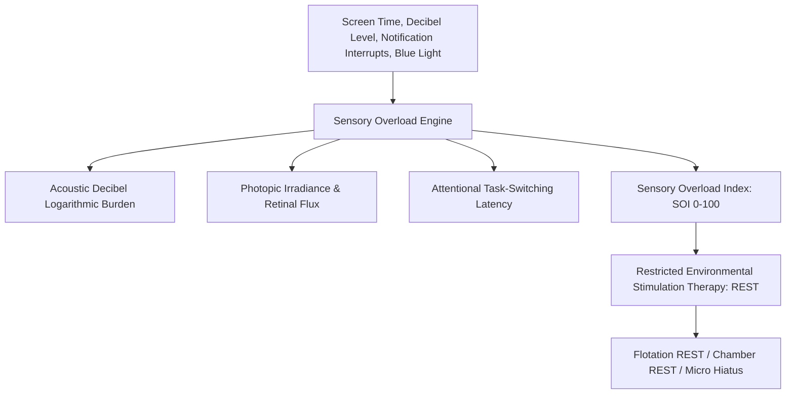

# Personal Agent Sensory Deprivation Auditory Visual Hygiene Skill

[](https://github.com/Alpha-Park)
[](https://github.com/alphaparkinc)
[](https://www.python.org/)
[](https://modelcontextprotocol.io/)
[](https://github.com/Alpha-Park)

Zero-dependency Sensory Overload Index (SOI) quantifier, thalamocortical sensory gating modeler, and Restricted Environmental Stimulation Therapy (REST) protocol prescriptor.

## Architecture



## Quickstart

```python
from client import PersonalAgentSensoryDeprivationAuditoryVisualHygiene

agent = PersonalAgentSensoryDeprivationAuditoryVisualHygiene()
res = agent.calculate_sensory_overload_burden(daily_screen_time_hours=8.0, average_ambient_decibels=65.0, daily_notification_interrupts=80)
print(f"SOI: {res['sensory_overload_index_soi']}/100 | Tier: {res['sensory_saturation_tier']}")
```
