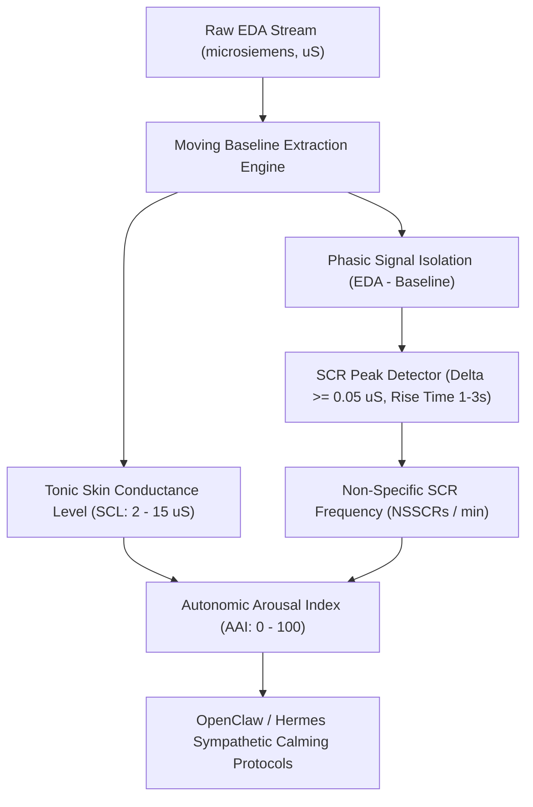

# Electrodermal Activity (EDA) & Skin Conductance Skill

[](https://opensource.org/licenses/MIT)
[](https://www.python.org/downloads/)
[](https://github.com/alphaparkinc/genpark-personal-agent-skin-conductance-electrodermal-eda-skill)
[](https://github.com/alphaparkinc/genpark-personal-agent-skin-conductance-electrodermal-eda-skill)
[](https://modelcontextprotocol.io/)

A sovereign personal agent capability for computational psychophysiology, decomposing Electrodermal Activity (EDA/GSR), tracking tonic SCL, and quantifying phasic SCR sudomotor bursts.

## Architecture



## Quickstart

```python
from client import ElectrodermalActivityClient

client = ElectrodermalActivityClient()

# Analyze an EDA stream (10 Hz)
samples = [4.1, 4.15, 4.22, 4.58, 4.82, 4.70, 4.45, 4.25, 4.20]  # Example series
res = client.analyze_eda_stream(samples, sample_rate_hz=10.0)

print("Mean Tonic SCL:", res["mean_tonic_scl_us"], "uS")
print("NSSCR Frequency:", res["nsscr_frequency_per_min"], "bursts/min")
print("Arousal Index:", res["autonomic_arousal_index"], "/ 100")
print("Status:", res["status"])
```

## MCP Server Integration

Add to your `claude_desktop_config.json` or OpenClaw tool registry:

```json
{
  "mcpServers": {
    "electrodermal-activity": {
      "command": "python",
      "args": ["/path/to/genpark-personal-agent-skin-conductance-electrodermal-eda-skill/mcp_server.py"]
    }
  }
}
```

## License
MIT License.
