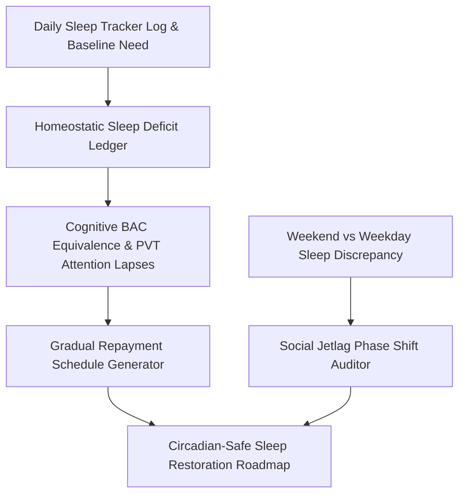

# genpark-personal-agent-sleep-debt-repayment-planner-skill


GenPark Personal Agent Sleep Debt Repayment Planner amortizes homeostatic sleep deficits using Van Dongen psychomotor vigilance kinetics and circadian-safe sleep scheduling.



## Features
- **Sleep Deficit Ledger**: Computes rolling cumulative debt against physiological baseline needs.
- **Cognitive BAC Equivalence**: Translates sleep debt into concrete attention lapse and intoxication equivalents.
- **Circadian-Safe Amortization**: Generates earlier bedtime increments that protect morning alertness.

## Quickstart

```python
from client import PersonalAgentSleepDebtRepaymentPlanner

planner = PersonalAgentSleepDebtRepaymentPlanner()
res = planner.generate_gradual_sleep_repayment_plan(6.0)
print("Days Needed to Clear Debt:", res["repayment_days_needed"])
```

## FastMCP Integration

```bash
python -m genpark-personal-agent-sleep-debt-repayment-planner-skill.mcp_server
```

## License
MIT
