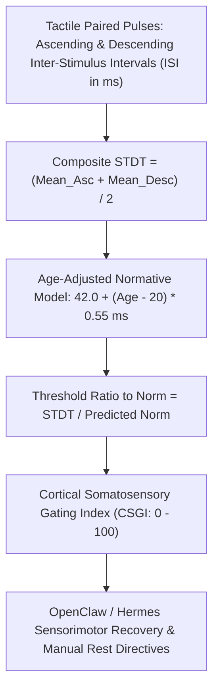

# Somatosensory Temporal Discrimination Threshold (STDT) Skill

[](https://opensource.org/licenses/MIT)
[](https://www.python.org/downloads/)
[](https://github.com/alphaparkinc/genpark-personal-agent-somatosensory-temporal-discrimination-skill)
[](https://github.com/alphaparkinc/genpark-personal-agent-somatosensory-temporal-discrimination-skill)
[](https://modelcontextprotocol.io/)

A sovereign personal agent capability for computational somatosensory psychophysics, evaluating tactile temporal discrimination thresholds (STDT in ms), age-adjusted ratios, and cortical sensory gating.

## Architecture



## Quickstart

```python
from client import SomatosensoryTemporalDiscriminationClient

client = SomatosensoryTemporalDiscriminationClient()

# Evaluate STDT staircase test (ms)
asc = [45.0, 50.0, 48.0]
desc = [52.0, 48.0, 50.0]

res = client.evaluate_stdt_staircase(asc, desc, reference_age_years=32.0)

print("Composite STDT:", res["composite_stdt_ms"], "ms")
print("Predicted Norm:", res["predicted_age_norm_ms"], "ms")
print("Gating Index:", res["somatosensory_gating_index"], "/ 100")
print("Clinical Tier:", res["clinical_tier"])
```

## MCP Server Integration

Add to your `claude_desktop_config.json` or OpenClaw tool registry:

```json
{
  "mcpServers": {
    "stdt-temporal-discrimination": {
      "command": "python",
      "args": ["/path/to/genpark-personal-agent-somatosensory-temporal-discrimination-skill/mcp_server.py"]
    }
  }
}
```

## License
MIT License.
