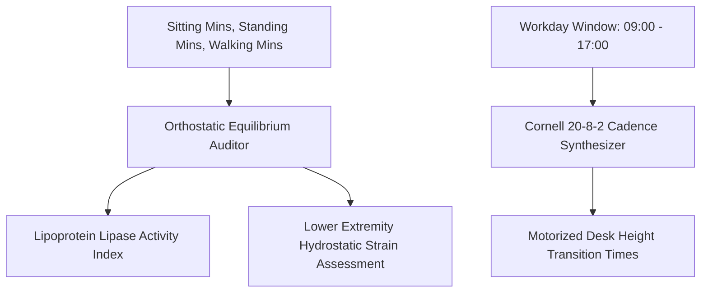

# Personal Agent Standing Desk Orthostatic Balancer Skill

[](https://github.com/Alpha-Park)
[](https://github.com/alphaparkinc)
[](https://www.python.org/)
[](https://modelcontextprotocol.io/)
[](https://github.com/Alpha-Park)

Zero-dependency Cornell 20-8-2 sit-stand-walk ergonomic ratio modeler, lower limb hydrostatic venous pooling auditor, and dynamic motorized desk cadence scheduler.

## Architecture



## Quickstart

```python
from client import PersonalAgentStandingDeskOrthostaticBalancer

agent = PersonalAgentStandingDeskOrthostaticBalancer()
res = agent.calculate_sit_stand_orthostatic_strain(sitting_minutes_daily=360.0, standing_minutes_daily=90.0)
print(f"Equilibrium: {res['orthostatic_equilibrium_score']} | LPL: {res['lipoprotein_lipase_metabolic_state']}")
```
