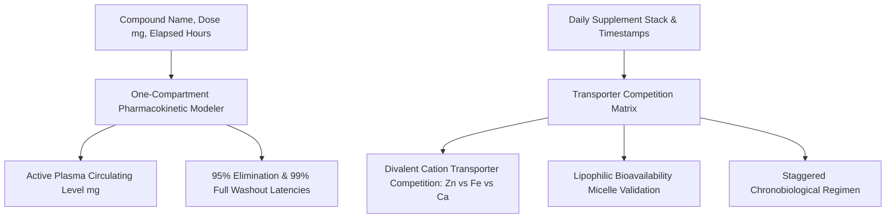

# Personal Agent Supplement Pharmacokinetic Halflife Skill

[](https://github.com/Alpha-Park)
[](https://github.com/alphaparkinc)
[](https://www.python.org/)
[](https://modelcontextprotocol.io/)
[](https://github.com/Alpha-Park)

Zero-dependency supplement pharmacokinetics modeler, elimination half-life decay tracker, competitive absorption conflict matrix evaluator, and optimal ingestion scheduler.

## Architecture



## Quickstart

```python
from client import PersonalAgentSupplementPharmacokineticHalflife

agent = PersonalAgentSupplementPharmacokineticHalflife()
res = agent.model_compound_clearance_curve(compound_name="caffeine", dose_mg=200.0, time_elapsed_hours=6.0)
print(f"Active Plasma Dose: {res['active_circulating_dose_mg']} mg | 95% Clear: {res['hours_until_95pct_clearance']} hrs")
```
