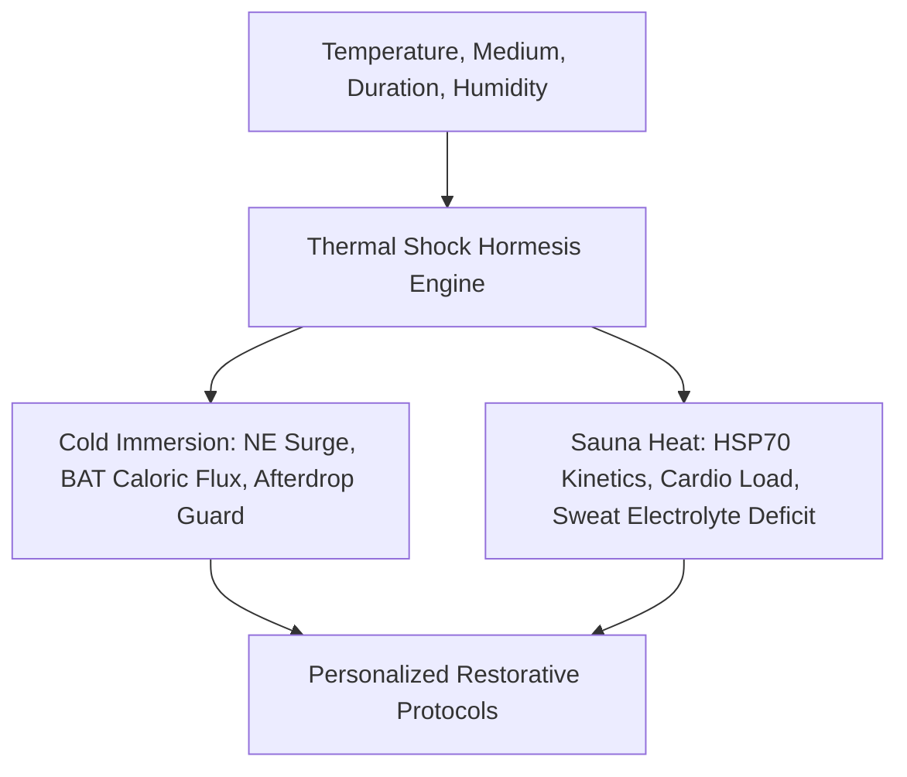

# Personal Agent Thermal Shock Hormesis Dose Skill

[](https://github.com/Alpha-Park)
[](https://github.com/alphaparkinc)
[](https://www.python.org/)
[](https://modelcontextprotocol.io/)
[](https://github.com/Alpha-Park)

Zero-dependency deliberate cold exposure (cryo/cold plunge) and deliberate heat exposure (sauna) hormesis dose calculator, HSP70 induction modeler, and thermoregulation safety guard.

## Architecture



## Quickstart

```python
from client import PersonalAgentThermalShockHormesisDose

agent = PersonalAgentThermalShockHormesisDose()
cold_res = agent.calculate_cold_exposure_dose(water_temp_c=8.0, duration_minutes=3.0)
print(f"NE Surge: {cold_res['norepinephrine_multiplier']} | BAT: {cold_res['bat_thermogenesis_kcal']} kcal")
```
