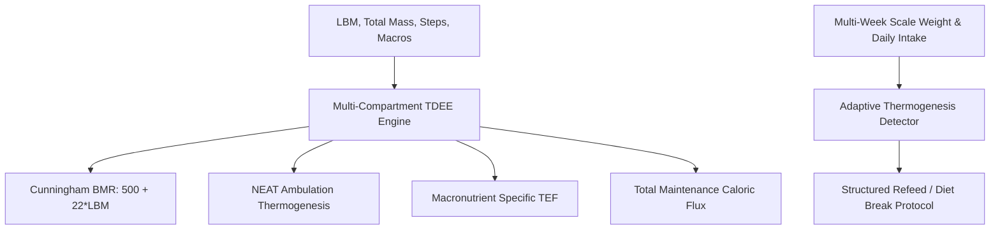

# Personal Agent Total Daily Energy Expenditure Skill

[](https://github.com/Alpha-Park)
[](https://github.com/alphaparkinc)
[](https://www.python.org/)
[](https://modelcontextprotocol.io/)
[](https://github.com/Alpha-Park)

Zero-dependency precision TDEE modeler, Cunningham lean body mass BMR calculator, macronutrient TEF partitioner, and adaptive thermogenesis plateau detector.

## Architecture



## Quickstart

```python
from client import PersonalAgentTotalDailyEnergyExpenditure

agent = PersonalAgentTotalDailyEnergyExpenditure()
res = agent.calculate_precision_tdee(lean_mass_kg=62.0, total_mass_kg=75.0, daily_steps=10000)
print(f"Maintenance TDEE: {res['calculated_tdee_maintenance_kcal']} kcal/day")
```
