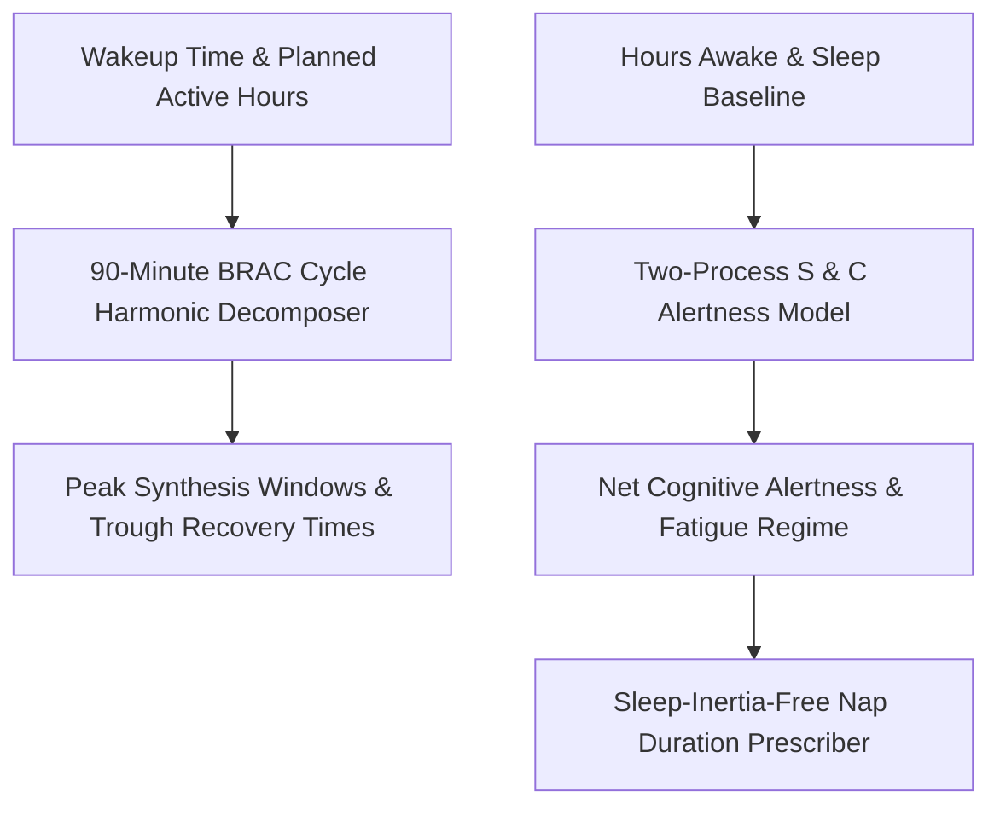

# genpark-personal-agent-ultradian-rhythm-phase-forecaster-skill


GenPark Personal Agent Ultradian Rhythm Phase Forecaster models 90-minute human biological oscillations and Borbely's classic Two-Process Sleep Regulation framework to predict alertness peaks, post-prandial energy dips, and optimal nap durations.



## Features
- **90-Minute Cycle Decomposition**: Maps continuous workdays into biological basic rest-activity cycles.
- **Borbely Two-Process Sleep Pressure**: Models homeostatic sleep debt accumulation vs circadian phase drive.
- **Sleep Inertia Prevention**: Strictly guides naps to 20 minutes (pre-SWS) or 90 minutes (full cycle).

## Quickstart

```python
from client import PersonalAgentUltradianPhaseForecaster

forecaster = PersonalAgentUltradianPhaseForecaster()
res = forecaster.forecast_ultradian_energy_windows("07:00", 12)
print("First Peak Window:", res["cycles"][0]["peak_phase_time"])
```

## FastMCP Integration

```bash
python -m genpark-personal-agent-ultradian-rhythm-phase-forecaster-skill.mcp_server
```

## License
MIT
