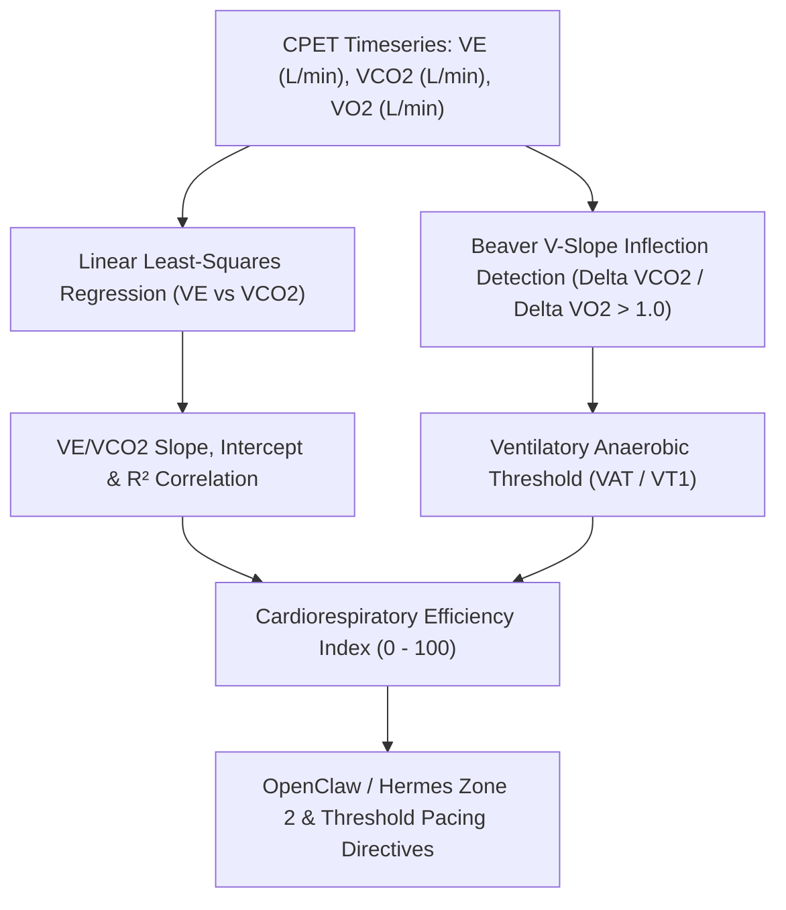

# Ventilatory Efficiency & VE/VCO2 Slope Cardiorespiratory Skill

[](https://opensource.org/licenses/MIT)
[](https://www.python.org/downloads/)
[](https://github.com/alphaparkinc/genpark-personal-agent-ventilatory-equivalent-ve-vco2-efficiency-skill)
[](https://github.com/alphaparkinc/genpark-personal-agent-ventilatory-equivalent-ve-vco2-efficiency-skill)
[](https://modelcontextprotocol.io/)

A sovereign personal agent capability for computational CPET analysis, calculating the $\dot{V}_E / \dot{V}CO_2$ ventilatory equivalent slope, pulmonary dead space fraction, and V-slope anaerobic threshold.

## Architecture



## Quickstart

```python
from client import VentilatoryEfficiencyClient

client = VentilatoryEfficiencyClient()

# Incremental exercise gas exchange series
vco2 = [0.65, 0.95, 1.30, 1.70, 2.15, 2.60, 3.10]
ve = [18.2, 25.5, 34.0, 44.5, 56.0, 68.5, 82.0]

slope_res = client.calculate_ve_vco2_slope(ve, vco2)

print("VE/VCO2 Slope:", slope_res["ve_vco2_slope"])
print("Efficiency Index:", slope_res["cardiorespiratory_efficiency_index"], "/ 100")
print("Status:", slope_res["status"])
```

## MCP Server Integration

Add to your `claude_desktop_config.json` or OpenClaw tool registry:

```json
{
  "mcpServers": {
    "ventilatory-efficiency": {
      "command": "python",
      "args": ["/path/to/genpark-personal-agent-ventilatory-equivalent-ve-vco2-efficiency-skill/mcp_server.py"]
    }
  }
}
```

## License
MIT License.
