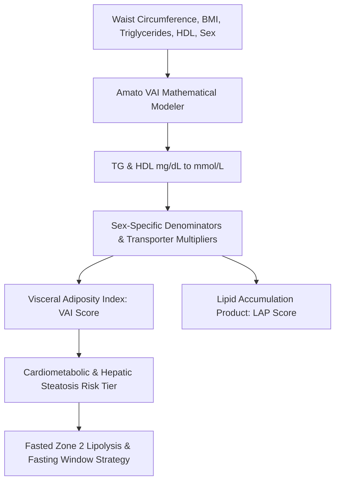

# Personal Agent Visceral Adiposity Index Metabolic Skill

[](https://github.com/Alpha-Park)
[](https://github.com/alphaparkinc)
[](https://www.python.org/)
[](https://modelcontextprotocol.io/)
[](https://github.com/Alpha-Park)

Zero-dependency Amato Visceral Adiposity Index (VAI) calculator, Lipid Accumulation Product (LAP) modeler, and visceral adipose tissue (VAT) ectopic dysfunction risk evaluator.

## Architecture



## Quickstart

```python
from client import PersonalAgentVisceralAdiposityIndexMetabolic

agent = PersonalAgentVisceralAdiposityIndexMetabolic()
res = agent.calculate_visceral_adiposity_index(waist_circumference_cm=88.0, bmi=24.5, triglycerides_mg_dl=110.0, hdl_mg_dl=52.0)
print(f"VAI: {res['visceral_adiposity_index_vai']} | Tier: {res['visceral_fat_risk_tier']}")
```
