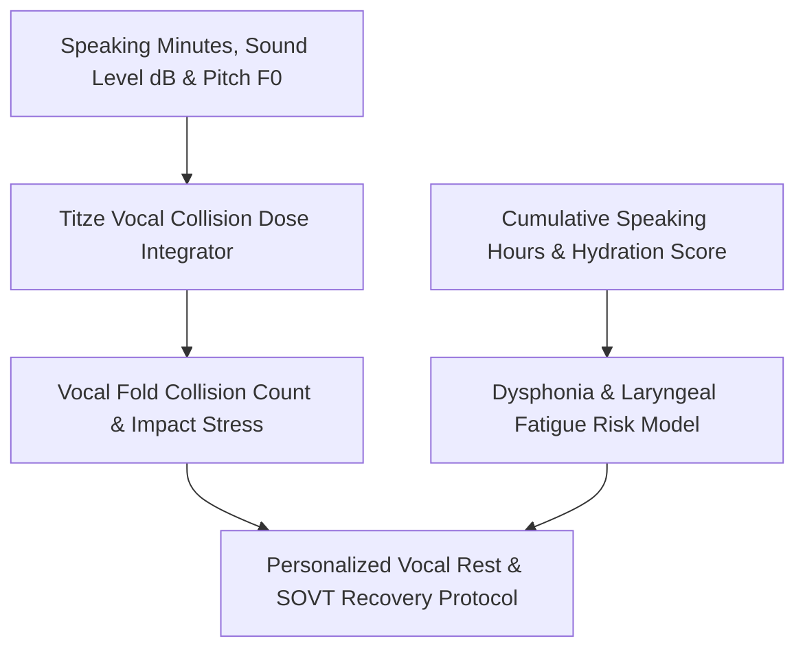

# genpark-personal-agent-vocal-fatigue-acoustic-strain-skill


GenPark Personal Agent Vocal Fatigue Acoustic Strain quantifies vocal fold collision doses and prescribes restorative SOVT protocols using Ingo Titze's vocal biomechanics framework.



## Features
- **Vocal Collision Dose Tracking**: Models hundreds of thousands of physical vocal fold impacts during continuous speech.
- **Dysphonia Risk Scoring**: Estimates hoarseness vulnerability incorporated with mucosal hydration.
- **Restorative SOVT Prescriptions**: Recommends straw phonation, lip trills, and timed silent buffers.

## Quickstart

```python
from client import PersonalAgentVocalFatigueAcousticStrain

vocal = PersonalAgentVocalFatigueAcousticStrain()
res = vocal.evaluate_dysphonia_and_vocal_fatigue_risk(4.0, 0.75)
print("Fatigue Risk Score:", res["vocal_fatigue_risk_score"])
```

## FastMCP Integration

```bash
python -m genpark-personal-agent-vocal-fatigue-acoustic-strain-skill.mcp_server
```

## License
MIT
