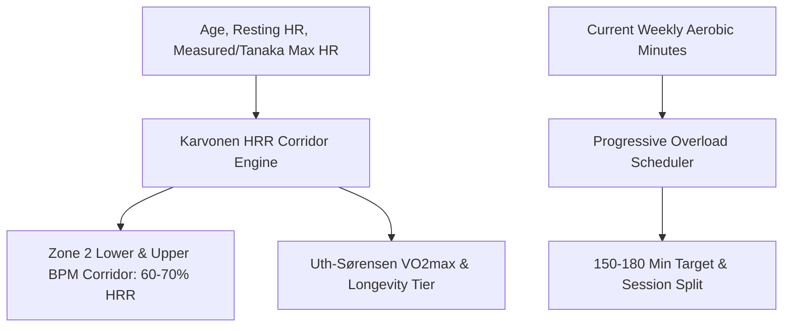

# Personal Agent Zone 2 Cardiorespiratory Fitness Skill

[](https://github.com/Alpha-Park)
[](https://github.com/alphaparkinc)
[](https://www.python.org/)
[](https://modelcontextprotocol.io/)
[](https://github.com/Alpha-Park)

Zero-dependency Karvonen Heart Rate Reserve (HRR) metabolic corridor calculator, Uth-Sørensen VO2max estimator, and weekly mitochondrial longevity load scheduler.

## Architecture



## Quickstart

```python
from client import PersonalAgentZone2CardiorespiratoryFitness

agent = PersonalAgentZone2CardiorespiratoryFitness()
res = agent.calculate_zone2_metabolic_corridor(age=38.0, resting_hr=54.0)
print(f"Zone 2: {res['zone2_corridor_bpm']['lower_bound_60pct_hrr']} - {res['zone2_corridor_bpm']['upper_bound_70pct_hrr']} bpm | VO2max: {res['estimated_vo2_max_ml_kg_min']}")
```
