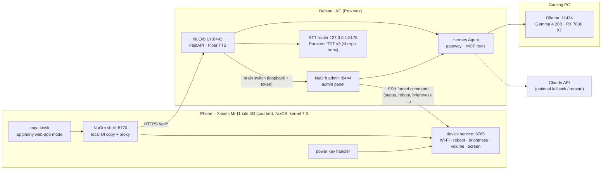

# NuOrb

**Your own private voice assistant – self-hosted in one Docker container, used from your phone.**

**→ [Install guide](INSTALL.md) · [Installationsanleitung](INSTALL.de.md) · [▶ Video tutorial](https://youtu.be/NO66dwKtCvg) · [▶ Video-Anleitung (DE)](https://youtu.be/xUsvfRHpvc8) · [Contributing](CONTRIBUTING.md) · [AI declaration](AI_DECLARATION.md)** – one command:
`curl -fsSL https://raw.githubusercontent.com/Anarki-LNX/nuorb/main/install.sh | bash`

**NuOrb** (say "Nu-Orb") is the assistant you get: on first start it introduces itself – *"My creator named me NuOrb.
If that's too complicated, just tell me what you'd like to call me"* – and you can rename it any time ("From now on you're Max").
The NuOrb server is open source. It runs a complete voice assistant on your own hardware: an agent ([Hermes Agent](https://github.com/NousResearch/hermes-agent)),
a web UI with an animated orb, an admin panel, local speech recognition and local speech synthesis.
The "brain" is your own [Ollama](https://ollama.com) (e.g. a gaming PC), the Claude API, or both with a switch.
Audio is processed on your server; nothing is sent anywhere unless you choose a cloud model.

<p align="center">
  
  
  
</p>

---

## Get started in ~10 minutes

| Step | What |
|---|---|
| **1. Server** | Run the Docker container on any Proxmox VM/LXC, home server or PC (amd64 or arm64): **[`docker/README.md`](docker/README.md)** |
| **2. Brain** | In the setup wizard choose your Ollama (≥ 64k context) and/or enter a Claude API key |
| **3. App** | Install the **NuOrb** Android app (Google Play release coming soon) – or just use any browser in your home network |
| **4. Pair** | Admin panel → *Pair device* → scan the QR code with the app. Done. |

```bash
curl -fsSL https://raw.githubusercontent.com/Anarki-LNX/nuorb/main/install.sh | bash
# checks Docker and the firewall, asks 2–3 questions, starts NuOrb and shows the admin address + setup code
```

**You need:** Docker with Compose v2, ~4 GB free RAM, ~8 GB disk, internet once for the speech models (~530 MB),
and either an Ollama server or an [Anthropic API key](https://console.anthropic.com).
Phone and server in the same network – or connected via VPN (WireGuard, Tailscale). **Never expose the ports to the internet.**

### Features

- **Talk to it** – tap to talk with automatic end-of-speech detection, or hold to talk; answers are spoken back.
- **Brain switch** – *local* (only your Ollama, nothing leaves your network), *auto* (Ollama, Claude as fallback), *remote* (Claude Haiku/Sonnet/Opus).
- **German and English** – full UI in both languages, speech recognition (NVIDIA Parakeet-TDT v3, on CPU), voices (Piper).
- **Your assistant, your name** – NuOrb greets you, learns your name and answers to whatever name you give it.
- **Safe by design** – confirmation cards before risky actions, pairing with certificate pinning, no telemetry.
- **Admin panel** – model & fallback, persona, memory, skills, schedules, MCP servers (connect e.g. Home Assistant), keys, logs, backups.

**Upgrading from v0.3.x or older?** Since v0.4.0 the compose project, service and container are called `nuorb`.
Stop the old one with `docker compose -p jarvis-lnx down` (**without** `-v`), take the new `docker/compose.yaml`, then
`docker compose pull && docker compose up -d` – it keeps using your existing data volumes, so password and paired
devices stay. See [`docker/README.md`](docker/README.md#umstieg-von-einer-älteren-installation-bis-v03x).

**Status:** early release. A custom wake word "Hey NuOrb" for the app is in training. See [`docker/README.md`](docker/README.md) for details, security notes and troubleshooting.

---

# NuOrb on an old Xiaomi phone (bonus for tinkerers)

Where this project started: an old **Xiaomi Mi 11 Lite 4G (`courbet`)**, wiped and reborn with
**NixOS and a mainline Linux 7.3 kernel** – no Android left. A `cage` kiosk shows only the NuOrb orb UI, it listens
for a **wake word** (openWakeWord, on-device) and executes device commands (Wi-Fi, reboot, brightness, volume)
only after a confirmation tap. **This part is specific to that phone model and wipes it – read the safety notes.**

<p align="center">
  
</p>

### What it does

- **Talk to it in German.** Push-to-talk (hold) or tap-to-talk (hands-free with end-of-speech detection).
  Answers are spoken back by a local Piper voice; the orb reacts to listening / thinking / speaking.
- **Local brain first.** [Hermes Agent](https://github.com/NousResearch/hermes-agent) on a small Debian LXC talks to
  [Ollama](https://ollama.com) on the gaming PC (Gemma 4 26B-A4B QAT, 64k context, on an RX 7800 XT 16 GB).
- **Brain switch: local / auto / remote.** *Local* = only Gemma, everything stays in the house. *Auto* = Gemma while
  the PC is on, otherwise Claude. *Remote* = Claude only (Haiku / Sonnet / Opus), the PC's GPU is freed. Switch from
  the phone (tap the badge, or say "NuOrb, wechsel auf Sonnet") or the admin panel – effective from the next question.
- **Device control with confirmation.** Wi-Fi on/off, reboot, power off, brightness, volume, screen on/off – via an
  MCP tool on the backend that only expresses the *intent*; the phone executes it locally after you tap "Ja" on a
  confirmation card (real touch required, synthetic clicks are ignored). Simple commands like "heller" / "Lautstärke
  30 Prozent" are matched locally in the UI without asking the LLM.
- **Admin web panel** (desktop/tablet): model & fallback, persona, memory, skills, schedules, MCP servers,
  approvals, API keys (masked), voice, phone status, services, logs, backups/undo for every change.
- **Survives being offline.** The phone keeps a local copy of the UI (`jarvis-shell`); without Wi-Fi it shows a
  "Wi-Fi on / reboot" emergency page and returns to NuOrb automatically.

### Architecture



Audio never leaves your network: recording happens on the phone, STT and TTS run on the LXC's CPU. Only in *auto*
(when the PC is off) or *remote* mode are the **text** transcripts sent to Anthropic.

### Hardware & software

| Part | What |
|---|---|
| Phone | Xiaomi Mi 11 Lite 4G (`courbet`, M2101K9AG), Snapdragon 732G (SM7150), Adreno 618, 6 GB RAM, 128 GB UFS |
| Phone OS | NixOS (unstable, `stateVersion 26.11`) via [ElXreno/nixos-courbet](https://github.com/ElXreno/nixos-courbet), kernel [ElXreno/linux](https://github.com/ElXreno/linux) branch `courbet-7.3` |
| Phone UI | `cage` Wayland kiosk + Epiphany (WebKitGTK) in web-app mode, PipeWire/WirePlumber |
| Backend | Proxmox LXC, Debian 13, 6 cores, 12 GB RAM; Python 3.13, FastAPI/uvicorn |
| Agent | [Hermes Agent](https://github.com/NousResearch/hermes-agent) (NousResearch, MIT), manual approvals |
| LLM (local) | [Ollama](https://ollama.com) on a Ryzen 9 5950X + Radeon RX 7800 XT 16 GB; Gemma 4 26B-A4B QAT, 64k ctx, ~33 tok/s |
| LLM (cloud, optional) | Claude Haiku / Sonnet / Opus via the Anthropic API |
| STT | NVIDIA Parakeet-TDT-0.6B-v3 (int8) via [sherpa-onnx](https://github.com/k2-fsa/sherpa-onnx), ~1.5 s per 5 s utterance on CPU |
| TTS | [Piper](https://github.com/OHF-Voice/piper1-gpl) with the [Thorsten](https://www.thorsten-voice.de) voice `de_DE-thorsten-medium`, first audio after 45–240 ms |

### Status (honest)

**Works (tested on the device):**
- NixOS boots from `boot` + `userdata`; display, touch, buttons, speaker + microphone, GPU (with the zap shader),
  Wi-Fi, battery with a 60–80 % charge limit for 24/7 operation on a USB power supply.
- Kiosk comes up full-screen after every reboot (~55 s), NuOrb is the only UI.
- Voice loop speaker → mic → STT → Hermes → TTS, about 3 s for simple questions in local mode.
- Brain switch from phone and admin panel; Claude fallback when the PC is off.
- **Wake word** on the phone ([openWakeWord](https://github.com/dscripka/openWakeWord), RAM ring buffer only, nothing stored or sent before detection), tap-to-talk and a conversation mode (keeps listening after an answer).
- Confirmation cards for device actions (local patterns and the decline path tested on the device; the full
  reboot-through-the-card path is still in final testing).

**Work in progress / planned:**
- **Own voice:** recording tools and a 1000-sentence corpus are in `voice/`; a Piper fine-tune is in training.
- Device commands through Gemma without "thinking" are hit-and-miss (local pattern matching in the UI is the main path).
- Occasional `dpu frame done timeout` display hang observed once; suspend, modem/telephony, sensors untested.

### Repository layout

```
docker/    the self-hosted server as one container (start here)  → docker/README.md
nixos/     phone NixOS configuration (flake, kiosk, device service, restricted SSH entry)  → nixos/README.md
ui/        NuOrb UI: FastAPI server + orb web UI (static/), phone shell (phone/), test tools
admin/     NuOrb admin: admin panel server + UI, privileged helper (ctl/) for service restarts
scripts/   setup, build, deploy and test scripts (backend-*, handy-* = phone, sprache-* = voice, steuerung-* = control/MCP)
voice/     own-voice recording tools + sentence corpus (WIP)
docs/      screenshots
```

Comments and most docs inside the code are in German.

### Configuration

All private LAN addresses were replaced by placeholders: `JARVIS_HOST` (backend LXC), `PHONE_HOST`,
`OLLAMA_HOST` (GPU PC), `PROXMOX_HOST`, `APT_CACHE_HOST`. See **[`config.env.example`](config.env.example)** for
where each one is used. Shell scripts read them from the environment; for the phone build edit `nixos/site.nix`.

Nothing secret is in this repository. You create your own: SSH keys, the home CA (`ui/make-certs.sh`),
the user password hash, the admin password (set on first login with a one-time code), API keys (entered in
the admin panel, stored in `~/.hermes/.env` on the backend).

### Installation overview

> This is a hobby build log made reusable, not a one-click installer. Expect to adapt paths and names.

1. **Backend LXC** (Debian 13): `scripts/jarvis-lxc-base.sh` (base packages, user `jarvis`), install Hermes Agent
   as user `jarvis`, point it at Ollama. Optionally restrict Ollama's port to the LXC: `scripts/backend-ollama-firewall.sh`.
2. **Voice chain:** `scripts/sprache-jarvis-setup.sh` (Piper + Parakeet), `scripts/sprache-stt-router.py` +
   `.service` (OpenAI-compatible STT endpoint for Hermes on 127.0.0.1:8178).
3. **Certificates:** `ui/make-certs.sh` on the LXC → home CA + server certs for :8443/:8444.
4. **UI:** `ui/deploy.sh` (rsync to the LXC, venv, `jarvis-ui.service`). Has a demo mode (`JARVIS_MODE=demo`).
5. **Admin panel:** `admin/deploy.sh` (+ `admin/ctl/` path-unit helper for restarts). First login asks for a
   one-time setup code printed on the server.
6. **MCP tools for Hermes:** `scripts/steuerung-geraet-install.sh` (device intents), optional
   `scripts/steuerung-claude-*` (Claude fallback, "ask Claude" project tool, limited budget).
7. **Phone:** unlock the bootloader, build and flash NixOS – see [`nixos/README.md`](nixos/README.md). Later updates:
   `scripts/handy-deploy.sh` over Wi-Fi.

Note: the Hermes gateway unit name (`hermes-gateway-<id>.service`) is instance-specific; adjust it in
`admin/server.py` and `admin/ctl/jarvis-admin-ctl.sh`.

### Safety notes – read before touching your phone

- **This wipes the phone.** `userdata` becomes the NixOS root filesystem, `boot` is overwritten and `dtbo` erased.
  Android will not start any more. Back up everything first, including the critical partitions such as `persist`,
  `modemst1/2`, `fsg`, `boot`, `dtbo`, `vbmeta*` (see `scripts/handy-backup.sh`) – keep them safe, they contain
  device-unique calibration data, and the original `boot`/`dtbo` are your way back.
- **Bootloader unlock** is required (Xiaomi's official unlock procedure with a Mi account and waiting period).
  Unlocking voids warranty-related trust states and erases data.
- **Anti-rollback:** this device reported anti-rollback index **3** (`fastboot getvar anti`). **Never flash a MIUI /
  HyperOS fastboot ROM with a lower rollback index** – that can hard-brick the phone. Check your own value first.
  The way back to Android is a ROM/firmware with index ≥ your device's.
- `fastboot boot` (RAM boot) does not work on courbet; testing means flashing.
- Proprietary firmware blobs (GPU zap shader, IPA, Wi-Fi/modem firmware) are **not** included; extract them from
  your own device.
- Ollama has no authentication – do not expose port 11434 beyond the hosts that need it.
- Everything here is provided as-is, without warranty. You can brick your phone. Your responsibility.

## Credits & licenses

NuOrb's own code is [MIT](LICENSE). Every third-party component keeps its license; the full list with versions and
obligations is in **[THIRD_PARTY_LICENSES.md](THIRD_PARTY_LICENSES.md)** and, inside the Docker image, in
`/usr/share/doc/nuorb/`. The most important points:

- [Hermes Agent](https://github.com/NousResearch/hermes-agent) by Nous Research – the agent and base image (MIT).
- [Piper](https://github.com/OHF-Voice/piper1-gpl) with eSpeak NG – text-to-speech, **GPL-3.0**. It runs inside the
  NuOrb container; whoever passes the image on must also pass on the GPL and its sources (links in the license file).
- [sherpa-onnx](https://github.com/k2-fsa/sherpa-onnx) (Apache-2.0) and NVIDIA
  [Parakeet-TDT-0.6B-v3](https://huggingface.co/nvidia/parakeet-tdt-0.6b-v3) – speech recognition, model under
  **CC-BY-4.0** (attribution).
- Voices from [rhasspy/piper-voices](https://huggingface.co/rhasspy/piper-voices):
  [Thorsten](https://www.thorsten-voice.de) by Thorsten Müller (German) and Joe from
  [OHF-Voice/voice-datasets](https://github.com/OHF-Voice/voice-datasets) (English), both CC0 – free to use, also
  commercially.
- Orb shader noise: [webgl-noise](https://github.com/stegu/webgl-noise) by Ashima Arts and Stefan Gustavson (MIT).
- Fonts: [Inter](https://github.com/rsms/inter), [JetBrains Mono](https://github.com/JetBrains/JetBrainsMono),
  [Space Grotesk](https://github.com/floriankarsten/space-grotesk) – SIL OFL 1.1, license files in `ui/static/fonts/`.
- [Mozilla Common Voice](https://commonvoice.mozilla.org) – German sentences for the voice corpus (CC0).
- Phone port: [ElXreno/nixos-courbet](https://github.com/ElXreno/nixos-courbet) and
  [ElXreno/linux](https://github.com/ElXreno/linux) (`courbet-7.3`) – huge thanks; [NixOS](https://nixos.org),
  [cage](https://github.com/cage-kiosk/cage), [Epiphany / WebKitGTK](https://webkitgtk.org).
- Brains you connect yourself – [Ollama](https://ollama.com), llama.cpp, vLLM, LM Studio, the models you run there
  (e.g. Google [Gemma](https://ai.google.dev/gemma)) and [Claude](https://www.anthropic.com) by Anthropic – are not
  part of NuOrb; their own licenses and terms apply.

## License

Code: [MIT](LICENSE) © 2026 Anarki-LNX. Third-party files keep their own licenses (see
[THIRD_PARTY_LICENSES.md](THIRD_PARTY_LICENSES.md)).

## Disclaimer

The project was renamed to NuOrb. Old repository URLs redirect here; technical names such as the `JARVIS_*`
settings, `/opt/jarvis` paths and the `jarvis-lnx_data` / `jarvis-lnx_models` volume names are kept so existing
installations keep working.
Xiaomi, Snapdragon, Claude, Gemma and other names are trademarks of their respective owners.

---

## Kurzfassung (Deutsch)

**NuOrb** ist ein privater Sprachassistent zum Selbsthosten: **ein Docker-Container** (Proxmox, Heimserver
oder PC) mit Agent, Orb-Oberfläche, Admin-Panel, lokaler Spracherkennung und Sprachausgabe. Gedacht wird mit dem
eigenen **Ollama** oder **Claude** (oder beidem, umschaltbar). Bedient wird per **Android-App** (bald im Play Store)
oder Browser im Heimnetz. Der Assistent heißt **NuOrb** („Nu-Orb“), stellt sich beim ersten Start vor
(„Mein Schöpfer hat mich NuOrb getauft …“) und lässt sich jederzeit umbenennen. Container starten, Einrichtung im Admin-Panel, Smartphone per QR-Code koppeln – fertig.
Umstieg von v0.3.x: `docker compose -p jarvis-lnx down` (ohne `-v`), neue `compose.yaml` holen, `docker compose up -d` – Daten bleiben.
Installation mit einem Befehl: `curl -fsSL https://raw.githubusercontent.com/Anarki-LNX/nuorb/main/install.sh | bash -s -- --lang de` – Anleitung: [INSTALL.de.md](INSTALL.de.md).

**Für Bastler:** Das Projekt begann mit einem alten **Xiaomi Mi 11 Lite 4G**, auf dem jetzt **NixOS** läuft und
NuOrb die einzige Oberfläche ist (mit Weckwort und Gerätesteuerung). Das ist gerätespezifisch und löscht das
Smartphone: Bootloader-Entsperrung nötig, **niemals MIUI mit niedrigerem Anti-Rollback-Index flashen**. Alle privaten
Adressen sind durch Platzhalter ersetzt (`config.env.example`).
