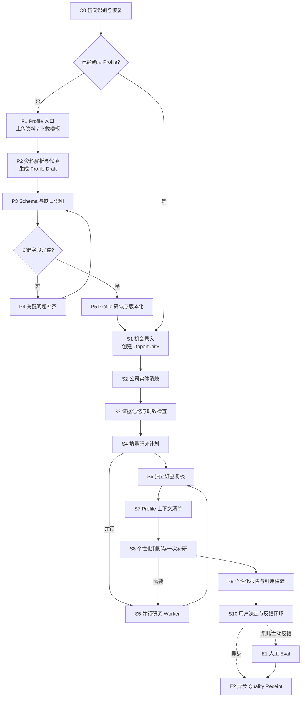

<div align="center">

# ⚓ Captain · AI 职业航行导师

**DeepSeek Harness 上的一次「勇敢去航」——让 AI 帮你把人生方向看明白。**

> **_It’s not just about living forever, the trick is living with yourself forever._**
>
> 真正难的不是活到永恒，而是永远能坦然面对自己。Captain 想陪你做的，正是这件事。

</div>

---

## 为什么叫 Captain

灵感来自《加勒比海盗》里的 **杰克船长**：一个披着潦草外衣、却在风浪里从不肯低头的人。他荒诞、不羁、全身狼狈，偏偏最清楚自己要驶向哪里，也最敢在别人都劝他「算了」的时候把船开进风暴。

毕业后的我们，就像一个人站在茫茫大海上——没有地图、没有灯塔、没有风向。**Captain 就是这个粗糙却有力的形象：**

- 它不替你决定航向，但会陪你在迷雾里把罗盘擦亮。
- 它不回避现实的冷酷——萧条、不确定、竞争——而是告诉你要勇敢、要习惯磨难、要斗争、要反抗。
- 它在意的是**「活出自我」**，而不是按照别人的航道走完一生。

> 这几年职场环境说不景气，恰恰是需要一个「船长」的时刻。Captain 不给你灌鸡汤，它给你的是能落地的判断力：**这家公司到底适不适合你，为什么，以及你能做什么。**

---

## 它解决什么问题

面对一份工作机会，你真正需要回答的不是「这家公司好不好」，而是——

1. **我和这家公司、这个岗位，到底匹配吗？**（不是凭感觉）
2. **哪些是真的，哪些只是传闻？**（证据而不是搜索摘要）
3. **它符合我的底线和优先级吗？**（城市、薪资、制度、价值观）
4. **有什么我不知道、但会改变决定的东西？**（诚实面对未知）

Captain 把这一切做成一个**可恢复、可验收、可复现**的 Agent 工作流：从「求职偏好 Profile」出发，经过证据严格审查的多智能体研究、个性化匹配判断，最终产出**逐项可追溯**的报告，并把决策权交还给你。

---

## 截图

### 控制台与实时航程节点

上传资料后，航程轨道会**随真实任务实时推进**：C0 与先行节点标记完成，当前节点点亮「当前」，进度一目了然。

<p align="center">
  
</p>

### 切入对话：让对话框掌控全局

对话开始后，首屏引导自动收起，对话框真正拥有整个列；右侧航程轨道持续跟随状态机。

<p align="center">
  
</p>

### 从宿主入口进入

通过 DeepSeek Harness 侧栏的「Captain 控制台」动作开启。

<p align="center">
  
</p>

---

## 🧭 工作流全景：一次完整的航行

> 这是一条有状态的业务闭环，不是一次性对话。系统从不在聊天里猜进度，而是从持久化的 `current_node` 恢复。**只有真实任务才推进状态机**，普通闲聊不会无谓地「点亮节点」。



**读懂这张图**：左边是「先认识你自己」——把求职偏好变成一份被确认的 Profile；右边是「再看清这家公司」——用证据研究匹配到一份可追溯的报告。每一个箭头都是一次有产出的状态转移，中途退出可从检查点恢复，绝不重复解析已保存的文件或反复问已回答的问题。

---

## 📋 节点详细说明书

以下按阶段逐个展开。每个节点都会告诉你：**它做什么、吃什么、吐什么、卡在哪里、体现什么能力。**

### 入口阶段

#### 🧭 C0 · 航向识别与恢复

> 类型：`ROUTER`（Agent 意图识别 + Function 幂等检查 + Store 检查点）

**它做什么**：一次航行的「值班台」。用户一开口，Captain 先判断你到底想干什么——是在建立 Profile、提交新机会、补充旧机会、恢复中断任务、查历史，还是改个人偏好？判断完之后，它创建或恢复唯一一次运行（`run_id`）。

**关键守门**：
- 永远优先恢复一个「正在等你」的既有航程，而不是新开一条平行的。
- 同一消息重复到达时复用相同的 idempotency key，绝不重复开航。
- 意图实在说不清时，只问**一个**澄清问题，并让航程保持暂停。
- 如果用户想要公司筛查、但还没有确认的 Profile，先保存这次机会的引用，再统一路由到 P1——**不用让用户先主动去找 Profile 功能**。

**体现的能力**：Agentic Workflow · Context Engineering · CLI 同一入口

---

### Profile 阶段（先认识你自己）

#### 📥 P1 · Profile 入口

> 类型：`AGENT`（Agent 引导 + Tool 文件接收 + Store Profile 状态）

**它做什么**：用最低摩擦拿到你的求职偏好材料，同时保留可回溯的原始来源。给你两条路：

1. **上传**已有材料（简历、求职偏好、职业规划、自由文档），让 Agent 帮你代填；
2. **下载标准模板**，自己填好后重新上传。

它还接受你在对话里直接说出的相关事实。

**关键守门**：
- 简历只能支撑职业事实，**不能**自动推导薪资底线、工作制度、领导偏好。
- 文件不可读、被密码保护、关键页缺失时，说清问题并给最安全的下一步。
- 敏感文件内容绝不写进日志或消息，只引用不透明的来源引用（`profile_source_refs`）。

**体现的能力**：Agent Skill · Tool/MCP · Human-in-the-loop · 隐私 Guardrail

#### 📝 P2 · 资料解析与代填

> 类型：`AGENT`（Agent 结构化抽取 + Tool 文件读取 + Function 来源绑定）

**它做什么**：把任何格式的材料映射到统一 Profile Schema，变成一份 **Draft**，并给每一条内容打上来源与证据状态。

**每条内容都带 4 个标签**：

| 字段 | 含义 |
|---|---|
| `status` | `stated`(你亲口说的) / `extracted`(文档里的事实) / `hypothesis`(合理推断) / `unsupported`(找不到来源) |
| `importance` | `hard` / `high` / `medium` / `low` |
| `source_ref` | 精确到 `source_01#p12` 的来源定位 |
| `needs_confirmation` | 是否待你确认 |

**关键守门**：
- 这个节点**只能**生成 Draft，永远不能写 confirmed Profile。
- Agent 的推断必须标成 `hypothesis`，绝不伪装成你的原话。
- 无法定位来源的内容标为 `unsupported`。
- **绝不**从一份简历就推导出薪资底线、工时容忍度、领导偏好或风险偏好。

**体现的能力**：LLM 非结构化理解 · 结构化输出 · Prompt Engineering · 来源追踪

#### 🔍 P3 · Schema 与缺口识别

> 类型：`FUNCTION`（Function Schema 校验 + Agent 语义冲突检查）

**它做什么**：这是**确定性程序**与**模型语义审查**分工的地方。代码先做硬校验（必填维度、重复、状态、版本），模型再判断哪些是语义冲突、哪些是过度推断，并给出**会真正影响公司判断**的最小追问集合。

**必查的硬维度**：目标岗位、城市、薪资口径、工作制度、硬性排除项、公司阶段倾向、岗位职责偏好、当前最高权重因素。这些维度可以明确标成 `unknown`，但不能缺失。

**关键守门**：
- `coverage_status` 判断为「完成」的标准是**所需的维度已确认或明确为 unknown**，而不是把所有字段都填满。
- 硬性条件缺失时，不能进入正式个性化报告。
- 冲突不能由 Agent 擅自替你选边。
- 可选的缺口不阻断流程。

**体现的能力**：Guardrails · Evals · Agent 与确定性程序的边界 · 状态路由

#### 💬 P4 · 关键问题补齐

> 类型：`HUMAN`（Agent 自适应提问 + Human 回答 + Checkpoint 暂停）

**它做什么**：用**最少**的问题，补齐那些会明显影响公司判断的字段。它不会问一堆无关问题。

**提问策略**：
- 默认问 1 个；只在两个问题紧密相关且容易一起回答时才问 2 个。
- 优先问**硬性排除项**，再问会改变「值不值得投入」的条件。
- 问完后讲清楚「为什么这个问题重要」。
- 接受「不知道 / 不确定 / 以后再说」为**有效答案**。
- 用户中途退出，保存已完成维度和下一个问题，下次恢复。

**关键守门**：
- 从不重复问已回答的内容，除非要指出具体的矛盾。
- **绝不**逼你编一个偏好。
- 不超出运行轮次上限。
- 这个节点**不确认 Profile**（那是 P5 的事）。

**体现的能力**：Agentic Workflow · 动态规划 · Human-in-the-loop · 检查点恢复

#### ✅ P5 · Profile 确认与版本化

> 类型：`HUMAN`（Human 确认 + Function Diff/Hash + Store Version）

**它做什么**：把 Draft 变成一份**权威的、不可变的长期状态**。这是「认识你自己」的临门一脚。

- 按维度分组展示：已确认候选 / 待你决策的 hypothesis / 明确 unknown。
- 来源以紧凑形式呈现，Agent 的推断用视觉区分。
- 允许你逐项修改、拒绝一条推断、标记 unknown，或退回 P4。

**关键守门**：
- **打开、浏览、离开、或只说「看起来可以」都不算批准**；只有绑定显示的 Draft 哈希的「确认并提交」才算。
- 相同内容必须复用已有版本，绝不生成重复版本。
- **绝不**就地修改旧的已确认版本。
- 只有明确提交才生成新版本；提交后恢复之前保存的待处理机会。

**体现的能力**：Human-in-the-loop · 版本化长期记忆 · 权限 Guardrail · 幂等

---

### 筛查阶段（再看清这家公司）

#### 🎯 S1 · 机会录入

> 类型：`AGENT`（Agent 抽取 + Tool 文件/图片读取 + Function 指纹去重）

**它做什么**：把你丢过来的公司名、JD、截图、链接、招聘者消息，转成一个稳定的 `Opportunity` 业务对象——但**还没决定**它对应哪家法律实体。

**关键守门**：
- 区分 JD 声称 / 招聘者声称 / 你的观察，分别作为不同 Source 保留。
- 用运行时指纹复用或新建 Opportunity；同公司但岗位不同 = 分开的机会。
- 原始材料只追加版本，不静默覆盖。
- **不**在这里解决公司身份；那是 S2 的事。
- 没有岗位时问一个澄清；仅当用户明确要「只研究公司」时，才允许无岗位继续。

**体现的能力**：LLM · 多模态 · Tool/MCP · 业务建模

#### 🏢 S2 · 公司实体消歧

> 类型：`HUMAN`（Agent 候选生成 + Function 实体匹配 + Human Gate）

**它做什么**：把「品牌 / 产品 / 招聘者给的名字」解析到正确的公司实体上——避免把同名公司、母子公司、品牌主体搞混，导致后面全研究错。

**关键守门**：
- 只有当唯一主体被证据明确支持、且无实质性母子公司歧义时才自动解析。
- 出现两个以上合理候选时，暂停并展示简短对比，让你选或提供线索。
- **绝不**只凭「同名里最有名的那家」就下结论。
- 用户确认只是**选择了一个候选**，不代表验证了那个候选的所有事实。
- `company_id` 未确认前，**不能**进入研究 Fan-out（S3/S4）。

**体现的能力**：Human-in-the-loop · Entity Resolution · Guardrail · MCP 查询

#### 🕰 S3 · 证据记忆与时效检查

> 类型：`FUNCTION`（Store Evidence + Function Freshness Policy）

**它做什么**：一个**确定性复用**节点。把这台公司已存的事实按新鲜度分类——哪些还能复用、哪些要复核、哪些已过期——从而只做增量研究。

**关键守门**：
- 只按确认的 `company_id` 检索，绝不按显示名。
- 管理层、融资、招聘、定价、团队等不同证据各有**不同的有效期**；融资、岗位、团队规模、产品定位不能用同一套有效期。
- 复用公司事实，**绝不**复用旧的个性化建议或旧结论。
- 模型**不能**延长证据过期时间。
- 「缺近期证据」= unknown / 需要研究，**不等于**没有风险。

**体现的能力**：Tool/MCP · 长期记忆 · 时间感知 · 确定性规则

#### 🧠 S4 · 增量研究计划

> 类型：`ORCHESTRATOR`（Agent Planner + Function DAG/预算校验）

**它做什么**：把还没解决的疑问，拆成一个**代码能安全执行的小型研究 DAG**。这是「动态多智能体但不失控」的关键一环。

**每个任务都有契约**：`goal`、`question`、`dependencies`、`required_source_types`、`allowed_tools`、`output_schema`、`budget`、`stop_conditions`。

**关键守门**：
- 生成 1–6 个任务；每个任务只问**一个可回答的事实问题**，并说明为什么重要。
- **独立的**任务才能并行；有依赖的任务保持有序。
- 官方/权威来源优先用于法律身份、融资、产品、政策等；独立报道和员工/用户来源只用于它们适合的观察。
- 已被接受、可复用的证据不再重复研究，除非需要复核。
- `max_workers` 由真实的独立性和总预算决定，**不是**为了显示数量。
- 「理解整个公司」或「决定用户该不该去」这类任务是**无效的**。

**体现的能力**：Multi-Agent Orchestration · Agentic Workflow · 预算 Guardrail

#### 🕵️ S5 · 并行研究 Worker

> 类型：`ORCHESTRATOR`（Orchestrator Fan-out + Subagents + Web/MCP/CLI Tools）

**它做什么**：让**最少数量的专职 Worker** 并行调查，各自在**最小上下文**下完成一个任务，只产出结构化 `EvidenceDraft`，不写结论、不给建议。

**标准工具顺序**：搜索用于**发现来源** → 读取**原文** → 保存带支持与定位的 Evidence Draft。

**关键守门**：
- **搜索摘要、生成的总结、复制粘贴的新闻通稿，都不是独立的一手 Evidence**。
- Worker 只读本任务、确认的公司实体、最小机会事实、相关可复用证据和工具预算；**看不到你的完整 Profile，也看不到其他 Worker 的结论**。
- 每份 Evidence 拆分到「一条独立可评审的断言」。
- 支持程度标为 `direct / partial / inference / unknown`；引用最少、原文通过 Source 引用保存。
- Worker 只有 Draft 写权限，**不能审核自己的结果**。
- 任务失败不取消已成功的任务；超预算就停止扩展，报告失败 URL 与未知。

**体现的能力**：Multi-Agent Orchestration · Agent 任务契约 · 并发 · Tool/MCP · 最小上下文

#### 🧾 S6 · 独立证据复核

> 类型：`AGENT`（Agent Reviewer + Function 去重/冲突检查）

**它做什么**：一个**与你偏好无关的独立审查者**。它看不到你的 Profile，所以**无法为了迎合某个推荐而挑选事实**。它决定每条 Draft 的审核状态。

**审核状态**：`accepted`（接受）、`downgraded`（降级但要写明限定条件）、`conflicting`（冲突）、`insufficient`（不足）、`rejected`（拒绝）。

**关键守门**：
- 从确定性检查（URL、实体、日期、定位、去重）出发，**绝不覆盖硬失败**。
- 读完引用原文再对照确切断言；只有原文直接支持、且针对确认公司和相关时间，才标 `accepted`。
- 对融资、薪资、股权、法律状态、重大风险，应用配置的**高级别来源规则**。
- 多条转载同一公告 = **一个来源谱系**，不算多个来源。
- **来源权威度不能替代文本支持**；「证据缺失」不能变成「没有风险」。
- Reviewer 不能评审以自己身份产出的 Evidence。
- 只有 `accepted` 和明确 `downgraded` 的可用断言，才会进入 S7/S8。

**体现的能力**：Evals · Guardrail · 生成/审核隔离 · 多 Agent 权限设计 · Evidence Grounding

#### 🎛 S7 · Profile 上下文清单

> 类型：`FUNCTION`（Function Context Selector + Store ContextManifest）

**它做什么**：只把**本次判断真正需要的**个人信息交给下一步的 Fit Analyst，同时保证硬约束绝不遗漏。这是「个性化不是塞入完整 Profile」的地方。

**始终召回**：当前目标、薪资、城市/通勤、工作制度、硬性排除项、Profile 版本。

**关键守门**：
- Selector 只能从候选 Item IDs 中选择，**不能创造、合并、拆分或改写** Profile 条目。
- 被拒绝的 / 仅 Draft 的 / 版本不符的条目**不能**进入上下文。
- **不**为了「更全面」而塞入整个 Profile。
- 每个被选中的条目和每个被排除的候选，都要给**一个简洁理由**。
- 敏感项除非本次判断必需且有授权，否则不进入。
- 运行时校验必选召回、版本与 token 预算。

**体现的能力**：Prompt & Context Engineering · 最小权限 · 混合检索 · Context Manifest

#### ⚖️ S8 · 个性化判断与一次补研

> 类型：`AGENT`（Agent Fit Analyst + Router Targeted Research）

**它做什么**：对照「已复核的公司证据」与「选中的人 Profile 上下文」，产出匹配 / 缺口 / 取舍 / 未知项，并决定是否值得做**一次**限定范围的公开数据补研。

**关键守门**：
- 一个「匹配」需要**同时**有一个被支持的机会事实 + 一个相关的已确认偏好或能力。
- 一个「缺口」需要被支持的冲突；**未知不等于缺口**。
- 只识别**会改变投入建议**的缺口。
- 只请求公开来源可能回答、且会改变结论的**一个**问题；每次运行**最多一次**定向补研（由运行时强制）。
- 只能由招聘方/面试官回答的问题，转成**具体的面试问题**，而不是研究任务。
- **未知的薪资、权限、文化、稳定性，绝不获得匹配评分或契合加分**。
- 若没有新证据会改变结论，直接路由到报告。

**体现的能力**：Agentic Workflow · 动态路径 · 有限循环 · Multi-Agent 按需启动 · 诚实处理未知

#### 📄 S9 · 个性化报告与引用校验

> 类型：`AGENT`（Agent Synthesizer + Function Claim Validator）

**它做什么**：把已校验的匹配结论，变成一个**简洁、条件化**的决策报告。有用，但绝不制造确定性。

**报告四选一**：**投入 / 先聊 / 观望 / 放弃**，并写明让它成立的条件。

**关键守门**：
- 每个重要的公司事实都引用被接受/降级的 Evidence；每个个性化判断都引用已确认的 Profile 条目。
- **未知信息绝不表述成「基本符合 / 大概率没问题」**。
- 不添加超出已复核证据范围的「常识性」公司事实。
- 不把高影响未知藏在总分底下。
- 若用数值评分，只按已评分的已知维度计算，并披露未评分的未知维度。
- 先做确定性引用/Schema 校验；**最多只做一次只改结构、不加事实的修正**。
- 失败时产出 Draft/partial，而不是正式报告。

**体现的能力**：LLM · 多源聚合 · Evals · Guardrail · 可解释性 · 版本化

#### 🧭 S10 · 用户决定与反馈闭环

> 类型：`HUMAN`（Human Decision + Store Notes + Function Proposal）

**它做什么**：记录你**真正**决定了什么、学到了什么。关闭反馈闭环，但**不**把一次经历擅自做成一条永恒的 Profile 规则。

**关键守门**：
- 只有你能创建/编辑自己的决定与备注（通过绑定 UI 或明确消息）。
- 记录 投入/先聊/观望/放弃/未定 + 可选理由 + 下一步行动；保留你的原话，**不**静默改写。
- 把你的真实决定与报告对比，识别可能改变的偏好或新增约束；有需要时创建**独立的 ProfileChangeProposal**（含 diff、支持的用户事实、受影响的未来判断）。
- 提案在 Profile 维护流程中确认前**不生效**。
- **绝不**在这个工作流里修改已确认的 Profile。
- 与 Captain 的意见分歧是**有价值的反馈**，不是需要纠正的错误。

**体现的能力**：Human-in-the-loop · 反馈闭环 · 跨工作流提案 · 长期记忆

---

### 评测阶段（让这次航行可复现、可进步）

#### 📊 E1 · 人工 Eval

> 类型：`EVAL`（Human Rubric + Store EvalCase）

**它做什么**：让一个真人按固定评分表，对一份**冻结**的 Captain 报告做一致评审，把你的判断与理由保存成可复现、可比较的评测记录。

**五维评分（1–5，每条都要理由）**：
1. 是否真正结合了已确认的 Profile；
2. 公司事实是否可信、能否追溯到原始来源；
3. 建议是否有充分且明确的理由；
4. 未知是否诚实、没有获得虚假契合加分；
5. 面试问题是否具体、能改变决定。

**关键守门**：
- 评分绑定具体的 case / Profile 版本 / Workflow 与 Skill 版本 / Report Snapshot。
- 保留评分者原话；缺失分数或理由仍为 Draft，**不**替你编造。
- **不**让生成报告的那个模型给自己打分，也**不**暴露隐藏推理链。
- 不把重大的事实或「未知诚实性」失败平均掉。
- 保存 Eval 不修改被评审的报告。

**体现的能力**：Human-in-the-loop · Evals · 将主观判断转成结构化产品数据

#### 🧮 E2 · 异步 Quality Receipt 与离线回归

> 类型：`EVAL`（Function 指标 + Agent Judge + Regression CLI）

**它做什么**：报告交给你之后，再给整次航行做一份**不阻塞**的「体检报告」，把「这次看起来不错」转换成可记录、可比较、可发现退化的质量证据。E2 **绝不延迟或撤回**已交付的报告，最多标记为 `needs_review`。

**确定性指标**（权威）：Schema 有效性、结论证据覆盖率、Profile 引用覆盖率、被拒证据泄漏、未知表述违规、预算/Worker 数/重复副作用/重试与恢复行为、版本绑定。

**Eval Judge**（只评主观维度）：个性化、理由充分度、面试问题具体性，且必须附简明理由。

**关键守门**：
- E2 不再次分析公司，也不替代 S9 的同步质量门。
- 接收的必须是**匿名化**报告 + 最小必要证据/Profile 摘录。
- 不把私人原始 Profile/Source 文本写进 recept。
- **发布门**一旦发现关键引用泄漏、虚假未知、重复副作用，无论平均分多高都失败。
- 兼容 CLI：对一组固定案例批量重跑，比较 Prompt / 模型 / Skill / 代码版本是否变好。

**体现的能力**：Evals · Guardrail · CLI · 可观测性 · 版本回归

---

## 它能展示什么能力

- **动态但不失控**：Planner 按缺口启动 1–6 个 Worker，代码控制预算、依赖、权限与停止条件。
- **证据不是搜索摘要**：Worker 读原文，Reviewer 能拒绝看似合理但原文不支持的结论。
- **个性化不是塞入完整 Profile**：Context Selector 只选必要条目，保存 Context Manifest。
- **人是决策者**：主体歧义、Profile 确认、最终选择都由你决定，流程能暂停与恢复。
- **状态由代码拥有**：运行时不靠模型猜进度，事务式状态机 + 检查点 + 乐观版本控制。

---

## 技术栈与架构

- **运行时**：DeepSeek Harness（Cordis 插件体系）
- **语言**：TypeScript（ESM）+ React
- **状态**：Node `node:sqlite` 事务式业务 Store + 乐观版本控制（`checkpoint_version`）
- **多智能体**：独立 Planner / Worker / Reviewer / Selector / Synthesizer，按角色隔离与授权
- **工具契约**：窄契合作业工具 + 可选的 Web / MCP 检索
- **交付**：单包 npm bundle（Host + Web Client），`bin/captain` CLI
- **质量**：JSON Schema 结构化输出 + 运行时 Guardrail + 38 个通过的单测 + Eval

数据是 **local-first 的**：资料、备注默认只保存在本机，不进入公开日志、Quality Receipt 或默认 Excel 导出。

`bin/captain` CLI 与 Web 共用同一套 Store 与 Workflow，用于复现、调试与回归：

```
captain history export <output.xlsx>
captain run inspect <run_id>
captain profile template <output.md>
captain profile import <file>
```

---

## 快速开始

```bash
# 依赖
pnpm install

# 类型检查 + 构建 + 测试（38 个用例）
pnpm verify

# 打包为 npm bundle
pnpm pack
```

安装到 DeepSeek Harness Web：

```bash
dsh plugin --profile web add ./captain-dsh-plugin-0.1.0.tgz
dsh web
```

需要 DeepSeek Harness `0.1.2-rc.1` 及以上、Node.js 22 及以上。

---

## 一句话

**Captain 不替你做决定，它只是那个在风暴里对你说「别怕、看清方向、你自己来」的老朋友。**

> 愿你在人生的航程里，既能乘风破浪，也能在平静时坦然地面对自己。

---

<div align="center">
  <sub>MIT License · 由 Angel 打造 · 面向那些不肯停在原地的人</sub>
</div>
