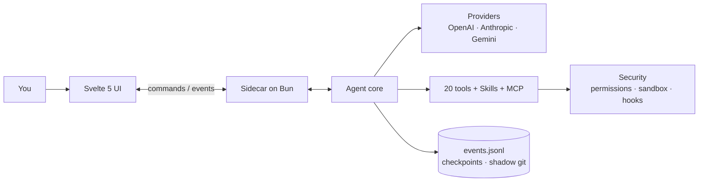

<div align="center">


# Flecten

**The desktop workspace for coding agents.**
Conversations, files, tools, and changes in one window.

[](https://github.com/AnnenkovLabs/flecten/actions/workflows/ci.yml)
[](LICENSE)
[](https://bun.sh)
[](https://www.typescriptlang.org)
[](https://svelte.dev)
[](https://www.electronjs.org)
[](CONTRIBUTING.md)

[English](README.md) · [简体中文](docs/i18n/README.zh-Hans.md) · [Português (Brasil)](docs/i18n/README.pt-BR.md) · [Español](docs/i18n/README.es.md) · [日本語](docs/i18n/README.ja.md) · [Українська](docs/i18n/README.uk.md) · [Русский](docs/i18n/README.ru.md)

</div>


<p align="center"><sub>Preview running on a local demo provider.</sub></p>

> [!WARNING]
> **Alpha.** Flecten is early: there are a lot of bugs and a lot of unfinished pieces right now. Over the coming days I'm putting maximum effort into polishing and tightening everything up. Expect fast changes, and please [report what breaks](https://github.com/AnnenkovLabs/flecten/issues).

## ⚡ Why Flecten

The agent loop is table stakes. Flecten fixes what breaks after the demo.

| The problem you already know | What Flecten does |
|---|---|
| 🔇 Conversation and coding in one chat degrade both, and steering means interrupting | **Talker and Worker** run as separate sessions: keep talking, steer mid-task, stop the worker alone |
| 💭 Every new chat forgets your project and your corrections | **Project memory** backed by your own words, carried across sessions |
| 📖 It misreads your project terms and jargon | A **dictionary** hands the model your exact definitions before it answers |
| 🔌 Wiring a provider is JSON archaeology | Paste a **base URL and API key**; Flecten sets up the provider and imports every model from the API |
| 🧱 A substantial result is a wall of markdown | **Interactive HTML answers**: sortable tables, tabs, charts, buttons |
| 🪞 It works like a generic assistant, not like you | A **Twin** that learns your voice and rejects work that is not yours |

<p align="center">
<b>20</b> built-in tools &nbsp;·&nbsp; <b>4</b> provider protocols &nbsp;·&nbsp; <b>7</b> interface languages &nbsp;·&nbsp; <b>85%</b> coverage gate
</p>

## 🚀 Quick start

Requires [Bun](https://bun.sh) 1.4 or newer.

```bash
bun install
export OPENAI_API_KEY=...
bun run app:dev
```

`bun run app:dev` starts Vite, launches the core on Bun, and opens an Electron window with hot reload. The current directory is the project root; set `FLECTEN_CWD` to work elsewhere.

```bash
# or another provider
FLECTEN_PROVIDER=anthropic FLECTEN_MODEL=claude-sonnet-4-6 bun run app:dev
```

To inspect the UI in a browser without the core, run `bun run dev:ui`.

## ✨ What makes Flecten different

### 🗣️ Talk while it works

**Keep talking while the Worker runs.**
New chats split into a Talker in your language and a Worker on a focused assignment. Steer mid-task, ask questions, or stop just the Worker. Every call is a live card with its own log and stop button.

### 🖥️ A full IDE, one toggle away

**Agent and IDE in the same window.**
Flip the header to IDE: file tree, editor tabs, project search and replace, go to line, source control, terminal. The conversation stays available as an island.

### 🩹 Diffs you can trust

**Review every edit. Undo without git surgery.**
Each change lands as a reviewable diff; accept or discard per file. Saving checks the on-disk version, so a conflict never clobbers your draft. Checkpoints and a shadow git power `/undo` and `/redo`.

### 🧠 Memory that survives the chat

**Your project, remembered across sessions.**
The model decides what to keep: preferences, lessons, decisions. Each entry is backed by your own words, versioned, and organized by topic. Stale entries invalidate themselves.

### 📖 A dictionary for your terms

**Your vocabulary, resolved before the model is called.**
A public design and AI dictionary syncs from GitHub; local project terms win. Fuzzy matching even fixes layout typos: `мшиусщвштп` → `vibecoding`. Your message stays word for word.

### 🔌 Providers in one click

**Pick from a catalog, not a JSON file.**
Add a known service with logos and model lists, or point at your own server. Flecten probes the connection and discovers models. Four protocols, with visible failover when one drops.

### 📊 Answers that are live HTML

**A result you can interact with, not just read.**
Final answers can be sandboxed HTML: sortable tables, tabs, charts, and buttons that open settings or a file. Rendered as it streams, with no network and no external scripts.

### 🪞 It learns your voice

**A Twin that works like you, not like a generic assistant.**
It learns from your past sessions and sources, writes specs in your terms, and rejects work that is not yours. Memory and a profile close the loop.

## ✅ And everything else you would expect

| | Area | What you get |
|---|---|---|
| 🛠️ | Tools | 20 built-in: `read`, `write`, `edit`, `apply_patch`, `delete`, `move`, `todo`, `task`, `grep`, `glob`, `ask`, `web_fetch`, `web_search`, `git`, `lsp`, `terminal`, `bash`, `jobs`, `memory`, `done`; plus `skill` and `module` |
| 🛡️ | Safety | `deny` / `auto` / `ask` / `allow` permissions, a bubblewrap / seatbelt sandbox, command hooks, and approvals that wait inside the call |
| 💻 | Terminal | A persistent PTY per session, background `jobs` with logs and `wait`, and process-tree cancellation |
| 🔁 | Runs | Parallel tasks, a queue that survives reloads, steering, recovery after a core crash, and per-run token, cost, and time budgets |
| 🧩 | Extensions | Agent Skills, MCP over stdio and HTTP with OAuth, hooks, and modules that bundle tools, instructions, and services |
| 📎 | Input | Images, PDFs, and audio; `@` references to files, symbols, tasks, and public GitHub PRs; a slash menu; voice input |
| 📝 | Output | Markdown, Mermaid, and a built-in file and log viewer |
| 🌍 | Reach | 7 interface languages, signed auto-update, and opt-in telemetry |

## 🏗️ Architecture

The UI never reads files or calls models. It sends commands to a Bun sidecar over a JSONL protocol and receives typed events back. The core never imports Electron or the UI.



Events carry `seq`, `ts`, and `schemaVersion`, so a reopened window rebuilds the task from `events.jsonl` and catches up with the live stream from its cursor.

## 🔗 Connect your stack

The default provider is `openai` with `gpt-5.1`. Keys come from environment variables: `OPENAI_API_KEY`, `ANTHROPIC_API_KEY`, `OPENROUTER_API_KEY`, `DEEPSEEK_API_KEY`. Any compatible service can be added in the window or in `flecten.config.json`:

```json
{
  "provider": "local",
  "model": "qwen3-coder",
  "providers": {
    "local": {
      "protocol": "openai-chat",
      "baseUrl": "http://127.0.0.1:11434/v1"
    }
  }
}
```

A provider without a key works without authentication, which suits local servers. Advanced fields set `headers`, `proxy`, and `transportTimeoutMs`; a key can come from `apiKeyEnv` or an `auth.command`. Pick a reasoning level in the composer: `auto`, `low`, `medium`, `high`.

- 🧩 **Skills** load from `~/.agents/skills` and the project's `.agents/skills`; the model sees a catalog and opens a full `SKILL.md` on demand.
- 🔌 **MCP** servers expose their tools, resources, and prompts, with OAuth discovery and PKCE.
- 🪝 **Hooks** can block startup, a prompt, or a tool; a `failClosed` hook blocks the action when it crashes.
- 📦 **Modules** bundle tools, instructions, hooks, and services, activated per task after content review.

```json
{
  "mcp": {
    "servers": {
      "docs": { "command": "bun", "args": ["mcp/docs-server.ts"] }
    }
  },
  "hooks": {
    "preToolUse": [
      { "command": "bun .agents/hooks/guard.ts", "matcher": "bash" }
    ]
  }
}
```

> ⚠️ Project configuration with MCP, hooks, or skills launches processes. Only open it in a repository you trust.

Full contract: [docs/EXTENSIONS.md](docs/EXTENSIONS.md).

## ⌨️ Commands

| Command | What it does |
|---|---|
| `bun run app:dev` | Open an Electron window with hot reload |
| `bun run app` | Build the UI and core, then open the window |
| `bun run dev:ui` | Run the UI in a browser without Electron |
| `bun run build:ui` | Build `ui/dist` |
| `bun run build:agent` | Build the core binary at `dist/flecten-agent` |
| `bun test` | Run tests for the core and pure UI logic |
| `bun run check` | Run `tsc` and `svelte-check` |
| `bun run lint` | Run Biome and project rules (file size, regex, dead modules) |
| `bun run verify` | Tests, types, lint, docs checks, and both builds |
| `bun run test:e2e` | Playwright E2E in Electron, with visual regression at 1480x940 and 1180x640 |
| `bun run coverage` | Check line coverage against the 85% threshold |
| `bun run package` | Create an unpacked Electron package in `release/` |
| `bun run release` | Create an installer for the current platform |

A change is not ready until it passes `bun run verify`.

## 📚 Documentation

- 🏗️ [Architecture](docs/ARCHITECTURE.md) · 🗣️ [Talker and Worker](docs/TALKER-WORKER.md) · 🧠 [Memory](docs/MEMORY.md) · 📖 [Dictionary](docs/DICTIONARY.md)
- 🧩 [Extensions](docs/EXTENSIONS.md) · 📦 [Modules](docs/MODULES.md) · 🎙️ [Voice](docs/VOICE.md)
- 🗂️ [Structure](docs/STRUCTURE.md) · 🎨 [Design](design.md) · 📐 [Conventions](docs/CONVENTIONS.md)
- 🚢 [Release](docs/RELEASE.md) · 📝 [Changelog](CHANGELOG.md) · 🖼️ [UI guidelines](ui/README.md) · 🐚 [Shell guidelines](shell/README.md)

## 🚦 Status

The agent foundation works and is covered by tests and snapshots. Still in progress: release signing, the Windows sandbox, per-command resource isolation, and native platform acceptance testing. Windows PTY uses ConPTY from Bun 1.4.2.

Auto-update uses `FLECTEN_UPDATE_URL` and verifies an Ed25519 manifest with an embedded public key before downloading the installer.

## 🤝 Contributing

Before opening a PR, read [CONTRIBUTING.md](CONTRIBUTING.md) and [CODE_OF_CONDUCT.md](CODE_OF_CONDUCT.md). Report vulnerabilities according to [SECURITY.md](SECURITY.md), not in a public issue.

## 📄 License

AGPL-3.0. See [LICENSE](LICENSE). Free to use, modify, and share; community norms live in [ETHICS.md](ETHICS.md) and the [Code of Conduct](CODE_OF_CONDUCT.md).

---

<p align="center"><sub>Flecten was previously called Liquid Harness. Existing <code>liquid.config.json</code> files, <code>LIQUID_*</code> variables, <code>liquid-harness://</code> links, and saved profiles still work. The primary names are now <code>flecten.config.json</code>, <code>FLECTEN_*</code>, and <code>flecten://</code>. The <code>.liquid/</code> folder keeps sessions, attachments, and checkpoints without a data migration.</sub></p>

<p align="center"><sub>The interface starts in English. Choose a language in <b>Settings → General → Interface language</b>. The choice is saved on this device and is separate from the language of agent replies.</sub></p>
