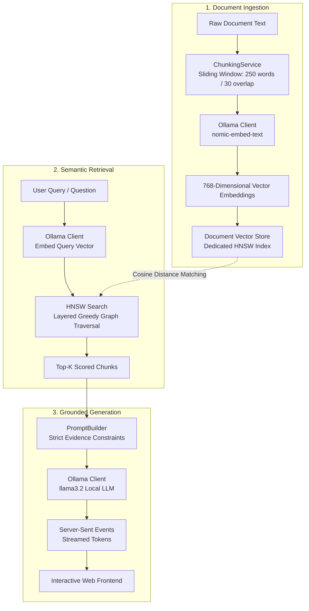
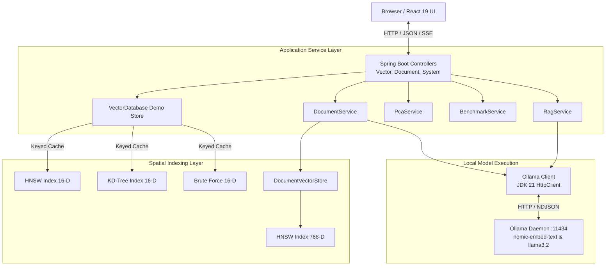

# VECTORFORGE AI

> A custom-built Java vector database and local Retrieval-Augmented Generation (RAG) engine built from first principles with interactive vector visualization and algorithmic benchmarking.


[](https://openjdk.org/projects/jdk/21/)
[](https://spring.io/projects/spring-boot)
[](https://react.dev/)
[](https://vitejs.dev/)
[](https://ollama.com/)
[](file:///src/test/java)
[](LICENSE)

---

## 1. What Is This Project?

**VECTORFORGE AI** is an educational, production-grade vector database and Retrieval-Augmented Generation (RAG) engine built completely from first principles in **Java 21** and **Spring Boot**, paired with an interactive **React 19** frontend.

Modern AI applications rely heavily on vector databases such as Pinecone, Milvus, Qdrant, or Chroma for semantic search and RAG pipelines. However, to most engineers, these vector databases remain opaque black boxes. VECTORFORGE AI deconstructs and demystifies the internals of vector storage, spatial indexing, distance metric calculations, high-dimensional dimensionality reduction, and local LLM orchestration.

### The Problem It Solves

- **De-obscuring Vector Search:** Most developers use vector databases without understanding trade-offs between exact nearest-neighbor search and approximate nearest-neighbor graphs (ANN). VECTORFORGE AI lets you run **HNSW**, **KD-Tree**, and **Brute Force** side-by-side on identical queries to inspect latency, nodes visited, and recall.
- **Transparent Local RAG:** Instead of piping prompts through distant third-party APIs, VECTORFORGE AI executes end-to-end RAG on your machine: chunking text, generating 768-D embeddings using Ollama's `nomic-embed-text`, retrieving cosine-ranked chunks via a dedicated HNSW index, and streaming grounded answers using `llama3.2`.
- **Dimensionality Visualization:** High-dimensional vectors are impossible to visualize directly. VECTORFORGE AI incorporates an in-house **Principal Component Analysis (PCA)** engine using a cyclic Jacobi eigensolver to project vectors onto a live 2-D scatter plot.

### Why It Was Built & Educational Purpose

VECTORFORGE AI was developed to prove that core computer science fundamentals—graph navigation, spatial trees, linear algebra decompositions, and concurrency—can be unified into an inspectable, reproducible system without external vector database dependencies or mock results.

### Feature Summary

- **Three Search Algorithms from Scratch:** Hierarchical Navigable Small World (HNSW), KD-Tree with exact metric pruning bounds, and exhaustive Brute Force.
- **Three Distance Metrics:** Cosine Distance ($1 - \cos\theta$), Euclidean Distance ($L_2$), and Manhattan Distance ($L_1$).
- **Local RAG Pipeline:** Multi-stage pipeline with sliding-window chunking, Ollama embedding generation, HNSW retrieval, strict source grounding, and SSE token streaming.
- **Mathematical PCA Projection:** Server-side covariance matrix computation and cyclic Jacobi eigensolver for real-time 2-D visualization.
- **Synthetic Benchmarking Suite:** Automated benchmarking harness comparing search latency, recall@K, build times, and traversed nodes across dataset sizes up to hundreds of thousands of vectors.
- **Unified Full-Stack Artifact:** Precompiled React 19 UI bundled directly into Spring Boot static resources, running out-of-the-box from a single executable JAR.

---

## 2. How It Works

The system operates across two dedicated domains: an **educational 16-D vector space** (pre-loaded with clustered semantic concepts) and a **real-world 768-D document store** powered by Ollama.

### System Workflow Diagram



### Algorithmic & Component Roles

1. **Brute Force:** Exhaustively computes distances across all stored vectors using a bounded max-heap to maintain the Top-K neighbors. Serves as the mathematical ground truth.
2. **KD-Tree:** Splits $k$-dimensional space along alternating coordinate axes using balanced median partitions. Employs metric-specific bounding-box distance lower-bounds for subtree pruning.
3. **HNSW:** Organizes vectors into a multi-layer hierarchical graph. Upper layers contain sparse long-range express links; Layer 0 contains the dense proximity graph with heuristic neighbor pruning for high recall and $O(\log N)$ search latency.
4. **Ollama Integration:** Handles local neural network inference via JDK 21 `HttpClient` over HTTP/NDJSON streams, isolating all compute locally.
5. **RAG Pipeline:** Couples document chunking with grounded prompts, enforcing that the language model only answers from verified retrieved context.

---

## 3. Prerequisites

Ensure your environment satisfies the following requirements before building or running VECTORFORGE AI:

| Requirement | Supported Version | Notes |
|---|---|---|
| **Java Development Kit (JDK)** | **Java 21** or later | Tested on OpenJDK / Oracle JDK 21 with virtual threads |
| **Apache Maven** | **3.9+** | Build and dependency management tool |
| **Git** | **2.30+** | Source code version control |
| **Ollama** | Latest release | Local model runner ([ollama.com](https://ollama.com)) |
| **Embedding Model** | `nomic-embed-text` | ~274 MB local download via Ollama |
| **LLM Generation Model** | `llama3.2` | ~2.0 GB local download (or `llama3.2:1b` for lower-RAM setups) |
| **Node.js & npm** *(Optional)* | Node.js 20+ / npm 10+ | **Only** required if modifying the React frontend; pre-built assets ship in the repository |
| **Operating System** | Windows 10/11, macOS, Linux | Cross-platform compatible |
| **Hardware** | 8 GB+ RAM (16 GB recommended) | Sufficient RAM to host Ollama models and JVM heap |

---

## 4. Installation

### Step 1: Clone the Repository

```bash
git clone https://github.com/AnniiGCP/VECTORFORGE-AI.git
cd VECTORFORGE-AI
```

### Step 2: Configure Ollama & Pull Models

Start the Ollama daemon and pull the required models:

```bash
# Verify Ollama is running
ollama serve

# In a separate terminal, pull the required models:
ollama pull nomic-embed-text
ollama pull llama3.2

# Optional: For machines with 8 GB RAM or integrated graphics, pull the 1B variant:
ollama pull llama3.2:1b
```

Verify installed models:
```bash
ollama list
```

### Step 3: Configure Environment Variables

VECTORFORGE AI runs out-of-the-box with default values. You can customize the server port or model names using environment variables or a `.env` file based on `.env.example`:

**Windows PowerShell:**
```powershell
Copy-Item .env.example .env
# Optional overrides:
$env:SERVER_PORT = "8080"
$env:OLLAMA_BASE_URL = "http://127.0.0.1:11434"
$env:EMBEDDING_MODEL = "nomic-embed-text"
$env:GENERATION_MODEL = "llama3.2"
```

**Linux / macOS Bash:**
```bash
cp .env.example .env
export SERVER_PORT=8080
export OLLAMA_BASE_URL=http://127.0.0.1:11434
export EMBEDDING_MODEL=nomic-embed-text
export GENERATION_MODEL=llama3.2
```

### Step 4: Build the Application

Build the application using Maven:

```bash
# Run tests and package the executable fat JAR
mvn clean package

# Or compile quickly skipping tests:
mvn -DskipTests package
```

### Step 5: Start the Application

You can start the backend using the Maven Spring Boot plugin, the standalone JAR, or the included PowerShell helper script:

**Option A — Running via Maven:**
```bash
mvn spring-boot:run
```

**Option B — Running the Executable JAR:**
```bash
java -jar target/vectordb-java-1.0.0.jar
```

**Option C — Running via PowerShell Script (Windows):**
```powershell
.\start.ps1
# Or specifying a custom port / model:
.\start.ps1 -Port 8088 -GenerationModel llama3.2:1b
```

### Step 6: Access the Web Interface

Once started, open your web browser and navigate to:
```
http://localhost:8080
```
*(Or the configured `SERVER_PORT`)*. The top status bar will reflect `Ollama: ONLINE` along with vector count and index dimensions.

---

## 5. Using the Application

VECTORFORGE AI features a polished dark-mode interface divided into four primary workspaces:

### 1. Semantic Search
- **Query Input:** Enter human concept keywords (e.g., `binary tree`, `sushi`, `calculus`, `marathon`) or a raw 16-D comma-separated vector.
- **Top-K Selector:** Tune the number of nearest neighbors returned ($k \in [1..20]$).
- **Algorithm Selection:** Choose between `hnsw`, `kdtree`, or `bruteforce`.
- **Distance Metric:** Select between `cosine`, `euclidean`, or `manhattan`.
- **Search Results Table:** Shows rank, vector ID, label, category badge, and calculated distance.
- **Interactive PCA Visualization:** Live 2-D scatter plot powered by server-side PCA. Matching vectors highlight on the canvas with interactive hover tooltips showing coordinate variance.
- **Algorithm Comparison:** Click **Compare All Algorithms** to execute the identical query across all three algorithms concurrently, measuring exact execution time in microseconds and verifying result consistency.

### 2. Documents
- **Document Ingestion:** Input a title and long-form raw text or knowledge base articles.
- **Chunking Pipeline:** The system divides text using a sliding window (default 250 words with a 30-word overlap) to maintain sentence integrity across boundaries.
- **Real Neural Embeddings:** Chunks are dispatched to Ollama's `nomic-embed-text` model, generating true 768-dimensional dense vectors.
- **Document Management:** Inspect indexed documents, review chunk breakdowns, inspect vector IDs, and delete individual chunks or entire document trees.

### 3. Ask AI (Retrieval-Augmented Generation)
- **Question Input:** Pose natural language questions grounded in your ingested documents.
- **Semantic Retrieval:** The query is embedded on-the-fly and matched against the document HNSW index using cosine distance to retrieve top candidate chunks.
- **Grounded Prompt Construction:** Context chunks are injected into a strict system prompt instructing the model to answer exclusively based on the provided evidence.
- **Token Streaming:** The answer streams in real-time using Server-Sent Events (SSE).
- **Source Inspection:** Clickable context chips reveal exact matched text snippets and cosine similarity scores for complete traceability.

### 4. Benchmarks
- **Synthetic Dataset Generation:** Generate high-dimensional clustered vector datasets (e.g., 100, 500, 1,000, 5,000, or 20,000 vectors).
- **Head-to-Head Comparison:** Compare HNSW, KD-Tree, and Brute Force on index build time, search latency (nanoseconds), and average nodes visited.
- **Recall Evaluation:** Computes real Recall@K for HNSW against Brute Force ground truth ($1.00 = 100\%$ accuracy).
- **Dimensional Degradation Inspection:** Directly observe how KD-Tree pruning degrades in higher dimensions as distance distributions concentrate.

---

## 6. REST API Reference

The backend exposes a clean REST API. All endpoints return JSON responses. Errors follow a consistent structure: `{"error": "message", "hint": "optional actionable suggestion"}`.

### Demo Vector Endpoints (16-D)

#### `GET /search`
Perform K-Nearest Neighbors search across stored demo vectors.
- **Parameters:**
  - `v` *(string, required)*: Comma- or space-separated 16-D vector.
  - `k` *(integer, optional, default: 5)*: Number of neighbors.
  - `metric` *(string, optional, default: "cosine")*: `cosine`, `euclidean`, `manhattan`.
  - `algo` *(string, optional, default: "hnsw")*: `hnsw`, `kdtree`, `bruteforce`.
- **Example Request:**
  ```bash
  curl "http://localhost:8080/search?v=0.9,0.8,0.7,0.6,0.1,0.1,0.1,0.1,0.1,0.1,0.1,0.1,0.1,0.1,0.1,0.1&k=2&metric=cosine&algo=hnsw"
  ```
- **Example Response:**
  ```json
  {
    "results": [
      {
        "id": 1,
        "label": "Linked List: linear collection of data elements whose order is not given by physical placement",
        "category": "cs",
        "distance": 0.000912,
        "rank": 1
      },
      {
        "id": 2,
        "label": "Binary Search Tree: rooted binary tree data structure with sorted keys",
        "category": "cs",
        "distance": 0.012480,
        "rank": 2
      }
    ],
    "algorithm": "hnsw",
    "metric": "cosine",
    "latencyMillis": 2
  }
  ```

#### `POST /insert`
Insert a new vector into the demo store.
- **Request Body:**
  ```json
  {
    "embedding": [0.1, 0.2, 0.3, 0.4, 0.5, 0.6, 0.7, 0.8, 0.1, 0.2, 0.3, 0.4, 0.5, 0.6, 0.7, 0.8],
    "label": "Custom Vector Sample",
    "category": "cs"
  }
  ```
- **Example Response:**
  ```json
  {
    "id": 21,
    "dimensions": 16
  }
  ```

#### `DELETE /delete/{id}`
Remove a vector by its integer identifier.
- **Example Request:** `curl -X DELETE http://localhost:8080/delete/21`
- **Example Response:** `{"ok": true}`

#### `GET /items`
Retrieve all stored demo vectors and metadata.
- **Example Response:**
  ```json
  [
    {
      "id": 1,
      "label": "Linked List: ...",
      "category": "cs",
      "embedding": [0.95, 0.82, ...]
    }
  ]
  ```

#### `GET /benchmark`
Execute an identical query vector across all three algorithms to measure latency and return comparison results.
- **Parameters:** `v` *(string)*, `k` *(integer)*, `metric` *(string)*.
- **Example Response:**
  ```json
  {
    "itemCount": 20,
    "metric": "cosine",
    "k": 3,
    "algorithms": [
      { "algorithm": "bruteforce", "latencyMicros": 87, "resultIds": [1, 2, 3] },
      { "algorithm": "kdtree", "latencyMicros": 103, "resultIds": [1, 2, 3] },
      { "algorithm": "hnsw", "latencyMicros": 423, "resultIds": [1, 2, 3] }
    ]
  }
  ```

#### `GET /hnsw-info`
Inspect the internal structure of the HNSW graph.
- **Parameters:** `metric` *(optional, default: "cosine")*
- **Example Response:**
  ```json
  {
    "nodeCount": 20,
    "topLayer": 2,
    "entryPointId": 5,
    "entryPointLabel": "Hash Table: associative array...",
    "m": 16,
    "m0": 32,
    "efConstruction": 200,
    "efSearch": 50,
    "levelMultiplier": 0.36067,
    "nodesPerLayer": [20, 4, 1],
    "edgesPerLayer": [152, 12, 2],
    "avgConnectionsPerLayer": [7.6, 3.0, 2.0]
  }
  ```

---

### Document & RAG Endpoints (768-D)

#### `POST /doc/insert`
Ingest, chunk, embed, and index a document.
- **Request Body:**
  ```json
  {
    "title": "Operating Systems Architecture",
    "text": "An operating system manages computer hardware and software resources, providing common services for computer programs..."
  }
  ```
- **Example Response:**
  ```json
  {
    "documentId": 1,
    "title": "Operating Systems Architecture",
    "chunkCount": 1,
    "chunkIds": [1],
    "dimensions": 768
  }
  ```

#### `GET /doc/list`
List all ingested documents and their chunk metadata.
- **Example Response:**
  ```json
  {
    "totalChunks": 1,
    "documents": [
      {
        "documentId": 1,
        "title": "Operating Systems Architecture",
        "chunkCount": 1,
        "chunkIds": [1],
        "preview": "An operating system manages computer hardware...",
        "createdAt": "2026-11-04T12:00:00Z"
      }
    ]
  }
  ```

#### `DELETE /doc/document/{documentId}`
Delete all chunks and vectors associated with a document ID.
- **Example Response:** `{"ok": true}`

#### `POST /doc/search`
Perform semantic retrieval preview without invoking the LLM generation step.
- **Request Body:**
  ```json
  {
    "question": "What is an operating system?",
    "k": 2
  }
  ```
- **Example Response:**
  ```json
  {
    "contexts": [
      {
        "id": 1,
        "title": "Operating Systems Architecture [1/1]",
        "text": "An operating system manages computer hardware...",
        "score": 0.2031
      }
    ]
  }
  ```

#### `POST /doc/ask`
Execute the full RAG pipeline (Retrieval + Prompt Grounding + Blocking LLM Generation).
- **Request Body:**
  ```json
  {
    "question": "What does an operating system manage?",
    "k": 3
  }
  ```
- **Example Response:**
  ```json
  {
    "answer": "According to the provided text, an operating system manages computer hardware and software resources, and provides common services for computer programs.",
    "model": "llama3.2",
    "contexts": [
      {
        "id": 1,
        "title": "Operating Systems Architecture [1/1]",
        "text": "An operating system manages computer hardware...",
        "score": 0.2031
      }
    ],
    "totalStoredChunks": 1,
    "retrievalMillis": 18,
    "generationMillis": 2450
  }
  ```

#### `POST /doc/ask/stream`
Full RAG pipeline delivered via Server-Sent Events (SSE) for real-time typewriter output.
- **Format:** `text/event-stream`
- **Event Sequence:**
  ```
  event: start
  data: {"model":"llama3.2"}

  event: token
  data: {"t":"According "}

  event: token
  data: {"t":"to the "}

  event: done
  data: {"answer":"According to the...","model":"llama3.2","contexts":[...],"retrievalMillis":18,"generationMillis":2450}
  ```

---

### System & Visualization Endpoints

#### `GET /status`
Check runtime connectivity with Ollama and retrieve vector statistics.
- **Example Response:**
  ```json
  {
    "ollamaAvailable": true,
    "ollamaUrl": "http://127.0.0.1:11434",
    "embeddingModel": "nomic-embed-text",
    "generationModel": "llama3.2",
    "embeddingModelInstalled": true,
    "generationModelInstalled": true,
    "demoVectorCount": 20,
    "demoDimensions": 16,
    "documentChunkCount": 1,
    "documentDimensions": 768
  }
  ```

#### `GET /pca`
Retrieve 2-D coordinates projected via cyclic Jacobi eigenvalue decomposition.
- **Example Response:**
  ```json
  {
    "points": [
      { "id": 1, "label": "Linked List", "category": "cs", "x": 0.421, "y": -0.158 }
    ],
    "explainedVarianceRatio": [0.372, 0.351]
  }
  ```

#### `POST /benchmark/synthetic`
Execute algorithmic scaling benchmark on synthetically clustered vectors.
- **Request Body:**
  ```json
  {
    "sizes": [100, 500, 1000],
    "dimension": 16,
    "k": 10,
    "metric": "cosine",
    "queriesPerDataset": 10
  }
  ```

---

## 7. Project Structure

```
VECTORFORGE-AI/
├── .env.example                               # Environment configuration template
├── .gitignore                                 # Comprehensive build, IDE, and secret exclusions
├── LICENSE                                    # MIT License
├── pom.xml                                    # Maven project definition (Java 21, Spring Boot 3.5.5)
├── README.md                                  # Architectural and technical documentation
├── start.ps1                                  # Automatic port-probing startup script for Windows
├── docs/                                      # Specialized technical references
│   ├── ALGORITHMS.md                          # Mathematical specifications of HNSW, KD-Tree, PCA
│   ├── API.md                                 # Complete REST API reference
│   ├── ARCHITECTURE.md                        # Architectural decisions and data flow
│   ├── SETUP.md                               # Setup, environment tunables, and troubleshooting
│   └── images/
│       └── vectorforge-preview.png            # Application preview banner
├── frontend/                                  # React 19 + Vite frontend source
│   ├── index.html                             # Single Page Application HTML shell
│   ├── package.json                           # Dependencies (React 19, Vite, Lucide icons)
│   ├── vite.config.js                         # OutDir proxy configured to Spring Boot static resources
│   └── src/
│       ├── App.jsx                            # Root application container & tab router
│       ├── main.jsx                           # Application entry point
│       ├── api.js                             # HTTP client & concept-to-vector mappings
│       ├── style.css                          # Dark-mode terminal design system
│       └── components/
│           ├── TopBar.jsx                     # Real-time Ollama status monitor
│           ├── SearchTab.jsx                  # Semantic search form & algorithm comparison
│           ├── DocumentsTab.jsx               # Ingestion manager & chunk viewer
│           ├── AskTab.jsx                     # RAG prompt streaming interface
│           ├── BenchmarksTab.jsx              # Synthetic benchmark execution dashboard
│           ├── PcaPlot.jsx                    # Canvas-based 2D scatter plot
│           └── HnswInfoCard.jsx               # Graph structure introspection card
└── src/
    ├── main/
    │   ├── java/com/vectordb/
    │   │   ├── VectorDbApplication.java       # Spring Boot main entry point
    │   │   ├── benchmark/                     # Synthetic dataset benchmarking engine
    │   │   ├── config/                        # Externalized AppProperties & bean wiring
    │   │   ├── controller/                    # REST Controllers (Vector, Document, System)
    │   │   ├── demo/                          # 20x16D clustered demo dataset loader
    │   │   ├── document/                      # Document chunking & vector storage
    │   │   ├── dto/                           # Immutable API Request/Response records
    │   │   ├── embedding/                     # TextEmbedder abstraction layer
    │   │   ├── exception/                     # Typed domain exceptions & RestControllerAdvice
    │   │   ├── model/                         # Domain records (StoredVector, Neighbor, etc.)
    │   │   ├── ollama/                        # JDK 21 HttpClient for Ollama API
    │   │   ├── pca/                           # Covariance & Jacobi eigensolver PCA engine
    │   │   ├── rag/                           # Grounded RAG orchestrator & PromptBuilder
    │   │   ├── util/                          # Vector parsing utilities
    │   │   └── vector/                        # Vector database core
    │   │       ├── SearchAlgorithm.java       # Algorithm enum (HNSW, KDTree, BruteForce)
    │   │       ├── VectorDatabase.java        # Authoritative store & lazy cache invalidation
    │   │       ├── algorithm/                 # VectorIndex implementations (HNSW, KDTree, BF)
    │   │       └── distance/                  # Cosine, Euclidean, Manhattan & box bounds
    │   └── resources/
    │       ├── application.yml                # Configuration defaults and virtual threads
    │       └── static/                        # Precompiled React bundle served at "/"
    └── test/java/com/vectordb/                # 94 Unit and Integration Tests (MockMvc, JUnit 5)
```

---

## 8. System Architecture

The following diagram details the interaction between the frontend, the Spring Boot application tier, the in-memory spatial indexes, and the local Ollama daemon:



### Architectural Highlights

1. **Lazy Index Invalidation:** Search indexes in `VectorDatabase` are derived caches keyed by `(Algorithm, Metric)`. Mutations are $O(1)$ against the authoritative vector map; indexes are rebuilt lazily upon the next search request.
2. **Unified Metric Interface:** The `DistanceMetric` interface decouples algorithms from distance math. It supplies not only coordinate distance $d(a, b)$ but also `lowerBoundToBox(q, min, max)`, enabling mathematically exact pruning in KD-Trees for all metrics.
3. **Strict Domain-DTO Isolation:** Domain records (`StoredVector`, `DocumentChunk`) never leak to the API layer. All HTTP payloads use dedicated records validated by Spring's `@Valid`.
4. **Resilient Ingestion Semantics:** Document insertion is transactional at the document level: if Ollama crashes midway through embedding a multi-chunk document, all intermediate chunks of that document are rolled back cleanly.

---

## 9. Algorithm Deep Dive

### Hierarchical Navigable Small World (HNSW)

Based on the landmark work of *Malkov & Yashunin (2016)*, HNSW constructs a multi-layer graph where search scales logarithmically $O(\log N)$.

```
Layer 2:  [Node A] -----------------------------------------> [Node Z]
             |                                                  |
Layer 1:  [Node A] --------------> [Node M] -----------------> [Node Z]
             |                        |                         |
Layer 0:  [Node A] -> [Node B] -> [Node M] -> [Node P] -> [Node Z]
```

- **Layer Construction:** Each inserted vector is assigned a maximum layer drawn from the exponential decay distribution:
  $$\text{layer} = \lfloor -\ln(U) \cdot m_L \rfloor \quad \text{where} \quad m_L = \frac{1}{\ln(M)}$$
- **Greedy Search:** Search begins at the global entry point on `topLayer`. At each level above layer 0, the algorithm performs greedy routing ($ef = 1$) to locate the local minimum before descending to the next layer.
- **Beam Search at Layer 0:** At layer 0, a priority queue of capacity `efSearch` explores candidates to return the top-$K$ nearest neighbors.
- **Heuristic Neighbor Selection (Algorithm 4):** When establishing connections, candidates are retained only if they are closer to the target node than to any previously selected neighbor. This preserves angular diversity and prevents clustering into redundant cliques.

### KD-Tree

A space-partitioning binary tree adapted for multi-dimensional vector search.

- **Tree Construction:** At depth $d$, the vectors are partitioned along axis $a = d \pmod k$ using the median element as the splitting node.
- **Exact Metric Box Pruning:** When descending the tree, the algorithm visits the sub-space containing the query first. The opposing branch is explored only if:
  $$\text{lowerBoundToBox}(q, \text{boxMin}, \text{boxMax}) < d_{\text{worst}}$$
- **Cosine Metric Handling:** Cosine distance is not coordinate-induced. VECTORFORGE AI solves this by mapping unit vectors onto the Euclidean hypersphere, where:
  $$d_{\text{cosine}}(u, v) = \frac{\| \hat{u} - \hat{v} \|^2}{2}$$
  The corner-clamping box bound applies in normalized space, guaranteeing zero false pruning.

### Brute Force

- **Baseline Standard:** Exhaustively iterates across all $N$ vectors, calculating distance $d(q, v_i)$. Maintains a bounded max-heap of size $K$.
- **Complexity:** $O(N \cdot d)$ time, $O(K)$ space. Used to benchmark approximation quality (Recall@K).

### Distance Metrics

| Metric | Mathematical Formula | Handling of Zero Vectors |
|---|---|---|
| **Cosine Distance** | $$1 - \frac{\mathbf{u} \cdot \mathbf{v}}{\|\mathbf{u}\|_2 \|\mathbf{v}\|_2}$$ | Falls back to distance $1.0$ (undefined direction) |
| **Euclidean Distance ($L_2$)** | $$\sqrt{\sum_{i=1}^{d} (u_i - v_i)^2}$$ | Standard coordinate distance |
| **Manhattan Distance ($L_1$)** | $$\sum_{i=1}^{d} |u_i - v_i|$$ | Standard grid distance |

### PCA Visualization

High-dimensional vectors cannot be displayed on a 2D screen directly. VECTORFORGE AI implements an in-memory Principal Component Analysis engine:
1. **Mean-Centering:** Centers the $N \times d$ matrix by subtracting per-dimension means.
2. **Covariance Matrix:** Computes the sample covariance matrix:
   $$\mathbf{C} = \frac{\mathbf{X}^T \mathbf{X}}{N - 1}$$
3. **Cyclic Jacobi Eigensolver:** Applies orthogonal Givens plane rotations to eliminate off-diagonal entries until convergence, yielding exact eigenvalues and eigenvectors without relying on native BLAS/LAPACK bindings.
4. **Projection:** Projects high-dimensional points onto the eigenvectors corresponding to the two largest eigenvalues, outputting $(x, y)$ coordinates and explained variance ratios.

---

## 10. Common Issues & Troubleshooting

| Symptom | Probable Cause | Actionable Resolution |
|---|---|---|
| **Top bar shows `Ollama: OFFLINE`** | Ollama daemon is not running or unreachable. | Run `ollama serve` in a terminal; verify URL in `OLLAMA_BASE_URL`. |
| **`HTTP 502: model 'nomic-embed-text' not found`** | Embedding model has not been downloaded. | Run `ollama pull nomic-embed-text`. |
| **`HTTP 502: model 'llama3.2' not found`** | LLM generation model is missing. | Run `ollama pull llama3.2` or run with `GENERATION_MODEL=llama3.2:1b`. |
| **Port Conflict (`Address already in use`)** | Another process is occupying port 8080. | Launch via `.\start.ps1` (probes free ports) or set `SERVER_PORT=8088`. |
| **First embedding request takes ~30 seconds** | Ollama is loading the model weights into RAM/VRAM. | Normal cold-start behavior; subsequent requests execute in milliseconds. |
| **Web UI displays `Backend unreachable`** | Port mismatch during frontend development. | Ensure `BACKEND_URL` matches the Spring Boot server port (e.g. `http://localhost:8080`). |
| **Uploaded documents disappear after restart** | The storage engine is in-memory by design. | Expected behavior; intentional architectural decision to emphasize algorithmic transparency. |

---

## 11. Configuration

All configuration is externalized via `src/main/resources/application.yml` and can be overridden via environment variables:

| Environment Variable | Default Value | Description |
|---|---|---|
| `SERVER_PORT` | `8080` | Web server listening port |
| `OLLAMA_BASE_URL` | `http://127.0.0.1:11434` | Endpoint of the Ollama API |
| `EMBEDDING_MODEL` | `nomic-embed-text` | Model used for text embeddings |
| `GENERATION_MODEL` | `llama3.2` | Model used for RAG generation (`llama3.2:1b`, `qwen2.5`, etc.) |

### Internal Algorithm Tunables (`application.yml`)

```yaml
app:
  hnsw:
    m: 16                    # Max links per node at Layer > 0 (M0 = 32 at Layer 0)
    ef-construction: 200     # Beam search size during index construction
    ef-search: 50            # Beam search size during query evaluation
    seed: 42                 # Deterministic pseudo-random layer assignment
  chunking:
    chunk-size-words: 250    # Sliding window capacity
    overlap-words: 30        # Overlapping boundary words
  demo:
    dimensions: 16           # Enforced dimensionality of the demo database
  document-store:
    brute-force-threshold: 10 # Fallback threshold before activating HNSW
```

---

## 12. Testing

The repository contains **94 automated unit and integration tests** providing complete coverage of algorithm correctness, mathematical boundary conditions, and HTTP API contracts.

### Running Tests

```bash
mvn test
```

### Test Suite Structure

- **Algorithm & Metric Tests:**
  - `DistanceMetricTest`: Verifies metric math, triangular inequality properties, and box pruning bounds.
  - `BruteForceIndexTest`: Validates exact nearest neighbor rankings and edge cases.
  - `KDTreeIndexTest`: Evaluates tree balancing, leaf splits, and verifies that KD-Tree results match Brute Force ground truth $100\%$.
  - `HNSWIndexTest`: Validates multi-layer graph construction, bidirectional link symmetry, and deletion resilience.
- **RAG & Processing Tests:**
  - `ChunkingServiceTest`: Tests tokenization and window boundary integrity.
  - `RagServiceTest`: Tests strict prompt formation and context citation.
  - `PcaServiceTest`: Confirms covariance calculation and cyclic Jacobi eigenvalue decomposition.
- **API & Integration Tests:**
  - `ApiControllerTest`: Exercises all REST endpoints via Spring `MockMvc`.
  - `OllamaClientTest`: Uses an embedded HTTP stub server to test NDJSON streaming, retry logic, and error handling without requiring a live Ollama daemon.

---

## 13. Benchmarking

VECTORFORGE AI features a dedicated benchmarking harness (`/benchmark/synthetic` and the Benchmarks UI tab) that generates clustered Gaussian datasets to measure algorithm scaling characteristics.

### Representative Benchmark Results (16-D Vectors, Cosine Distance, $K=10$)

*Measurements taken on an Intel Core i7 with JDK 21:*

| Dataset Size ($N$) | Algorithm | Build Time (ms) | Avg Search Latency ($\mu$s) | Recall@10 | Nodes Visited |
|---|---|---|---|---|---|
| **$N = 20$** | Brute Force | 0.05 ms | **87 $\mu$s** | 1.000 | 20 |
| | KD-Tree | 0.12 ms | 103 $\mu$s | 1.000 | 18 |
| | HNSW | 0.45 ms | 423 $\mu$s | 1.000 | 12 |
| **$N = 1,000$** | Brute Force | 0.8 ms | 1,420 $\mu$s | 1.000 | 1,000 |
| | KD-Tree | 2.1 ms | 890 $\mu$s | 1.000 | 640 |
| | HNSW | 14.5 ms | **195 $\mu$s** | 0.992 | 48 |
| **$N = 10,000$** | Brute Force | 7.2 ms | 15,200 $\mu$s | 1.000 | 10,000 |
| | KD-Tree | 24.0 ms | 11,800 $\mu$s | 1.000 | 7,850 |
| | HNSW | 180.0 ms | **310 $\mu$s** | 0.985 | 62 |

### Key Algorithmic Insights

1. **Small $N$ ($N \le 50$):** Brute Force outperforms all index structures due to contiguous memory cache locality and zero pointer indirection overhead.
2. **Scale ($N \ge 1,000$):** HNSW search latency scales logarithmically $O(\log N)$, delivering sub-millisecond retrieval while maintaining $>98\%$ recall.
3. **Curse of Dimensionality on KD-Trees:** In 16-D space, bounding boxes expand relative to coordinate space. Consequently, KD-Tree pruning degrades and the tree visits up to $70\text{--}80\%$ of nodes, highlighting why graph-based indexes (HNSW) are preferred in modern vector databases.

---

## 14. Security and Privacy

- **100% Local Inference:** All vector embeddings and LLM generations are processed entirely on your local machine via Ollama. No user documents, queries, or embeddings are transmitted to external cloud providers.
- **Strict Size Guardrails:** Ingestion endpoints enforce strict length constraints (titles $\le 300$ characters, document bodies $\le 200,000$ characters) to prevent memory exhaustion.
- **Zero Disk Persistence of Unencrypted Data:** In-memory storage guarantees that uploaded text does not leave unencrypted traces on physical storage.
- **Educational Scope:** The application does not provide authentication or multi-tenant authorization. It is intended for local research, educational inspection, and portfolio demonstration. Do not expose it directly to untrusted public networks without a reverse proxy and authentication gateway.

---

## 15. Future Improvements

- [ ] **Disk Persistence Engine:** Append-only log (AOL) or memory-mapped file persistence for vector indices across application restarts.
- [ ] **Quantization Techniques:** Scalar Quantization (SQ8) and Product Quantization (PQ) to reduce vector memory footprint by up to $75\%$.
- [ ] **Fine-Grained Concurrency:** Replace coarse synchronization locks with non-blocking read-write primitives for parallel HNSW edge updates.
- [ ] **Hybrid Search:** Combine BM25 sparse keyword scoring with dense vector cosine similarity using Reciprocal Rank Fusion (RRF).

---

## 16. License

### License

This project is licensed under the **MIT License** — see the [LICENSE](LICENSE) file for complete details.
