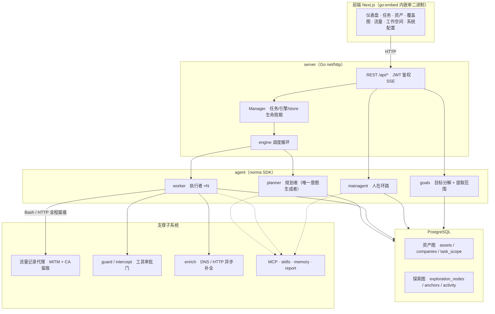
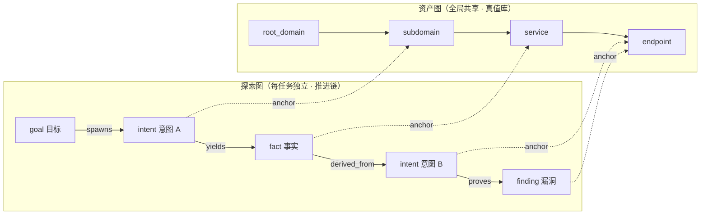
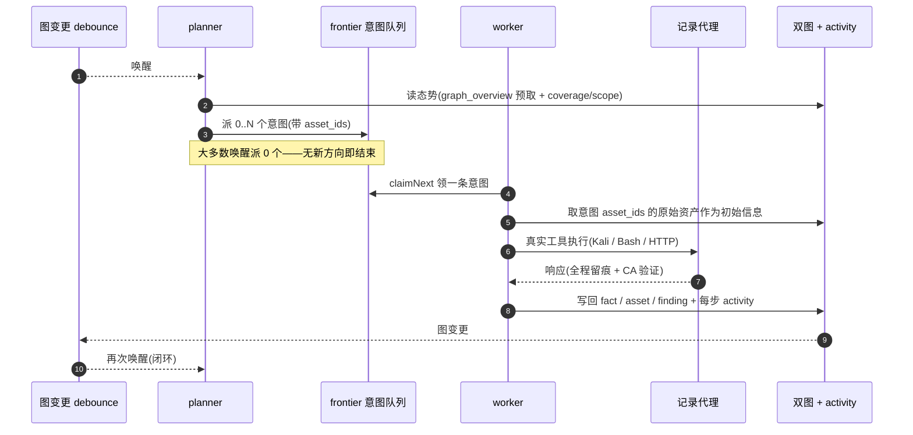
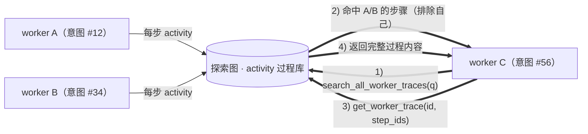
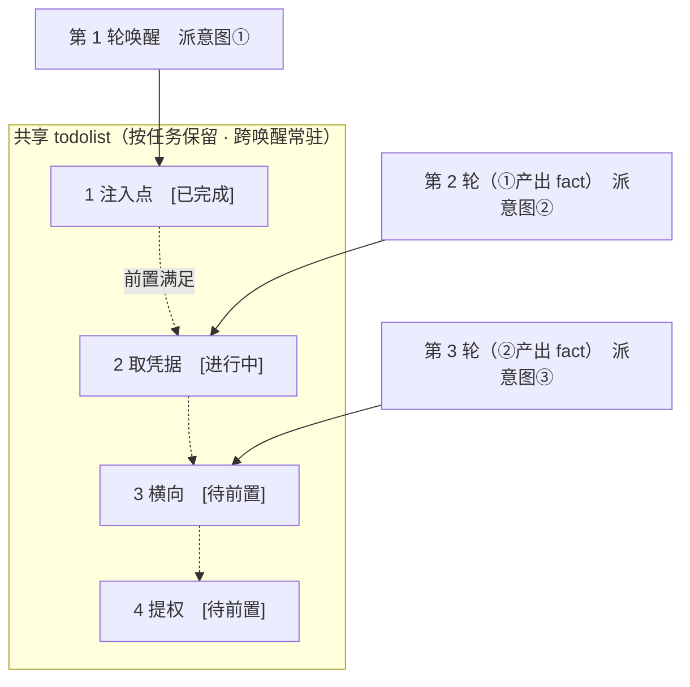

<div align="center">


# 白泽 BaiZe

**AI 自主渗透测试系统 · 从一句话目标到可交付漏洞报告**

> 白泽，上古瑞兽，通万物之情、晓天下鬼神之状。<br/>
> 给出一句话目标，替你把防线测清楚，并把证据摆在你面前。

[](https://github.com/Aqr325/BaiZe/releases)
[](https://github.com/Aqr325/BaiZe/actions/workflows/ci.yml)
[](LICENSE)


[](https://github.com/Aqr325/BaiZe)

**Go 单体后端** · **Next.js 内嵌前端** · **PostgreSQL** · **多 Agent 自主推进** · **全程证据留痕** · **人在环路纠偏**

🌐 [在线 Demo](https://artex-demo-ruoji6.vercel.app/) · 📦 [一条命令安装](#方式一一键安装脚本推荐) · 📸 [界面速览](#界面速览)

</div>

---

## 快速开始

> 依赖 **PostgreSQL**（安装脚本 / Docker Compose 自动处理）；探索需在 UI 里配置 **LLM**
> （Anthropic / OpenAI / 任意兼容网关，多通道）。详细安装、公网部署与升级 → [安装详解](#安装详解)。

**Linux（root 执行，全自动交互安装）：**

```bash
git clone https://github.com/Aqr325/BaiZe.git baize && cd baize
./install.sh
```

**Docker Compose（宿主机零安装，工具链全在镜像里）：**

```bash
git clone https://github.com/Aqr325/BaiZe.git baize && cd baize
cp .env.example .env          # 填 POSTGRES_PASSWORD、可选 ANTHROPIC_API_KEY
docker compose up -d          # 拉取 ruoji6/artex 镜像 + postgres
# → http://localhost:8787
```

**预编译二进制（Releases）：**

```bash
# 下载对应平台 zip，解压得到 artex + start.sh + skills/ + config.example.json
cp config.example.json config.json   # 填好 database 连接
./start.sh                           # → http://localhost:8787
```

**装好之后（3 分钟上手）：**

1. 浏览器打开 `http://<host>:8787` → 首次进入 `/setup` 初始化管理员密码（≥8 位）
2. 「系统配置 → LLM」配模型通道（Anthropic / OpenAI / 兼容网关；多通道轮询更稳）
3. 新建任务，给一句话目标（如「测试 example.com 的外网暴露面」）
4. 人随时可以对话纠偏、暂停意图、人工审批——agent 只推它该推的方向

---

## 目录

| | |
|---|---|
| **🚀 部署** | [安装详解](#安装详解) · [配置速查](#配置速查) · [更新升级](#更新升级) |
| **📸 产品** | [界面速览](#界面速览) · [核心能力](#核心能力) · [系统架构](#系统架构) · [相对上游 ARTEX 的增强](#相对上游-artex-的增强) |
| **🧰 资产与纪律** | [内置资产清单](#内置资产清单技能--mcp--工具) · [实战纪律与安全边界](#实战纪律与安全边界) |
| **👥 参与** | [开发与贡献](#开发与贡献) · [来源声明](#来源声明) · [许可与免责声明](#许可与免责声明) · [参考](#参考) |

---

## 这是什么

BaiZe 是一套 **LLM 多 Agent 自主渗透测试系统**：给一句话目标，它自动完成「目标拆解 → 侦察 → 漏洞挖掘 → 验证 → 报告」全流程，人随时可以插手纠偏。

它不是一个「包一层 API 的扫描器」。BaiZe 的核心设计是**让 AI 像一个守纪律的渗透测试工程师一样干活**：

- **目标闸门**——每个目标必须带可核验的验收标准（如「未授权接口不带凭据返回 200 且含业务数据」「越权请求能读取到非本人对象的完整字段」），全部目标经证明达成才允许任务收官；未完成就标「未完成」，报告里如实呈现，绝不假装跑完了。
- **证据闸门**——critical/high 漏洞必须附可机械复现的证据（HTTP 状态码、命令命中输出、流量对比），纯版本匹配的「可能存在」进不了交付报告。
- **双图推进**——资产图（真值库）× 探索图（推进链）两张独立图靠锚点缝合，「这个发现是从哪条线索推出来的」全程可回溯，这是报告可信度的根基。
- **全程留痕**——所有 HTTP/S 流量过 MITM 代理逐请求留存，发现绑定流量证据，每一步 activity 可回放，「这个结论是怎么得出的」全程可回溯。
- **人在环路**——对话纠偏 / 意图暂停取消 / 人工审批，每步 activity 在 UI 内联可见。

agent 能力由 [`norma`](https://github.com/Autumn-27/norma) SDK 提供（`agentcore` / `tool` / `permission` / `harness` / `memory` / `transcript`）。

---

## 界面速览

> 以下截图来自真实运行实例，目标域名、企业名称、IP 与漏洞细节均已脱敏。

**全局态势**

| 仪表盘总览：任务 / 发现 / Token 消耗 / 活动流一屏可见 |
| :---: |
|  |

**发现与报告**

| 发现：跨任务漏洞汇总，按严重度统计 | 渗透报告：按任务生成 HTML / Markdown 交付报告 |
| :---: | :---: |
|  |  |

**多智能体协作**

| 子代理：delegate_task 拆分 / 调度 / 汇总台账 | 群聊：多 Bot 共享房间，串行发言与 @ 提及 |
| :---: | :---: |
|  |  |

**洞察与复盘**

| 数据洞察：任务 / 发现 / Token 时间趋势 | 任务对比：基线 vs 复测，修复 / 新增 / 复现 |
| :---: | :---: |
|  |  |

**平台配置**

| MCP 服务器：外部工具按 Agent 授权可见 | 记忆库：Agent 共享长期记忆，全局 / 企业 / 任务三级沉淀 |
| :---: | :---: |
|  |  |

| Obsidian 知识库：笔记导入记忆库 | 命令拦截：工具执行前拦截规则（rm -rf / mkfs / dd 等禁用） |
| :---: | :---: |
|  |  |

---

## 核心能力

### 1. 多 Agent 自主推进

- **planner** 是唯一意图生成者，持有一份跨唤醒共享的 todolist——串行利用链记录一次、按依赖逐步派发，不重复不错序。
- **worker** 做完一条意图即停；结果写回双图后自动唤醒 planner。
- **mainagent** 接管对话、报告补写、工具触发的即时任务（如复测提醒）。
- **人在环路**：对话纠偏 / 意图暂停取消 / 人工审批，每步 activity 在 UI 内联可见。
- 事件驱动闭环：图一变就唤醒 planner，planner 派意图，worker 领意图执行并写回，写回又触发下一轮——直到目标被证明（`prove_goal`）。

### 2. 目标管理：完成判定不可被绕过

- `set_goals` 支持每条目标带 `criteria`（可核验验收标准），目标拆解提示词强制产出 criteria，禁止把「发现/验证漏洞」这类过程写成最终目标。
- **`goal_met` 闸门**：还有目标未 `met` 时，整体收官直接被拒绝（附未达成目标 id）。
- **诚实终态**：只有全部目标达成才落 `done`；有未达成目标时，无论超时 / 自动空转 / 覆盖度收尾，终态一律 `timeout`（未完成），列表 / 详情 / 报告三处如实标注 `x/y 目标`。

### 3. 双图架构：资产图 × 探索图

- **资产图**（全局共享）：`root_domain / subdomain / ip / service / app / endpoint` 六类节点的真值库，跨任务复用；公司归属 + 授权边界（task_scope）挂在这里。
- **探索图**（每任务一份）：`goal → intent → fact / finding` 的推进链，五种边构成**血缘**——「这个发现是从哪条线索推出来的」全程可回溯。
- **两图靠锚点缝合**：`exploration_anchors(node_id, asset_id)` 把意图 / 事实 / 漏洞锚定到具体资产上，支撑**资产测试覆盖度**与**资产覆盖图**。

### 4. 全程证据链与交付

- **MITM 记录代理**：worker 的全部 HTTP/S 流量逐请求留存（CA 签发留痕）；
- **发现绑定流量**：finding 绑定 baseline / proof / verification / supporting 四类流量证据，快照版本化（sha256），报告引用可验证；
- **证据附件**：截图 + Word/Excel/PPT/PDF 取样自动转图归档，任务内隔离、可归属漏洞；
- **报告导出**：专业级 Word（封面·目录·页眉页脚·严重度着色·复测记录·流量证据·修复路线图）+ Markdown + 批量「一漏洞一 docx」zip；
- **对抗式自检**：换身份 / 换参数顺序 / 换客户端复现——「确认了才报」。

### 5. 审批与拦截：三层闸门

| 层 | 语义 | 内置规则 |
|---|---|---|
| 明令禁止 `deny` | 任何语境都不可逆且无合法渗透用途——不调模型直接拒 | 10 条 |
| 交 Agent 研判 `judge` | 作用对象取决于上下文——命中后走模型裁决 | 12 条 |
| 人工确认 `ask` | 平台能力边界变更——转人工审批 | 1 条 |

- 规则级 timeout 真生效；模型裁决严格 JSON 解析（解析失败走失败策略，绝不猜）；
- 反注入边界：裁判输入刻意收窄（仅工具名+参数+工作目录），历史不进裁判视野；
- 全局「审批记录」、任务内「拦截审批」及对话中的审批卡片均支持展开查看详情。

### 6. 漏洞去重与合并：一份漏洞一份真相

- **多键去重**：每条 finding 带 cve / root / endpoint / param 强键 + asset_class / name 弱键，新上报自动命中合并目标，`merge_count` 计数、来源 finding 收进 `finding_updates` 时间线，证据与资产锚点保留并集。
- **跨任务去重**：同资产同漏洞在别的任务已报过时，默认不重复打扰（可关）。
- **手动复测**：对已上报漏洞可发起复测，复测请求绑定任务与漏洞，产出可回放的复测记录。

### 7. worker 间的过程级信息交换

- `search_all_worker_traces(q)`：在本任务其他 work 的执行过程里按关键字检索（自动排除自己这条意图的步骤），命中项带 `intent_id`；
- `list_worker_traces` / `get_worker_trace(intent_id, step_ids)`：先看有哪些 work 跑过，再取某个 work 具体几步的完整内容做细节交换。

即便探索图上还没有对应的 fact，后续 worker 也能复用他人过程中的观察——信息以「执行过程」为粒度流动，边界不变（每个 worker 仍只做自己领到的那条意图）。

### 8. planner 多轮共享 todolist → 稳定的攻击链路

真实攻击链往往是**有前后依赖的多步序列**（注入点 → 凭据 → 横向 → 提权），一次性并行派下去只会乱套。planner 因此持有一份**按任务保留、跨唤醒共享的规划待办（todolist）**：

- planner 每次唤醒是全新会话，但共享 todolist 让它把一条串行利用链**记录一次**、然后在后续多轮里**按依赖逐步派意图**；
- 每轮只对「前置步骤已完成、其依赖的 fact 已存在」的下一步派意图，并随进展更新清单。

于是攻击链在「事件驱动 + 无状态会话」的环境下依然**稳定推进、不重复、不错序**。

### 9. 子代理委派（delegate_task） · ➕ 本分支新增

- `delegate_task`：把任务拆解成子意图，worker pool 并行执行，失败级联取消（防孤儿子代理）；
- 生命周期状态机 + 注册表 + 事件 broker（跨 Agent 通信）+ 共享状态（scope + 冻结配置快照）；
- `subagent_runs` 持久化台账 + 崩溃恢复；`runChild` 永不 panic 包装。

### 10. 记忆系统与 Obsidian 同步 · ➕ 本分支新增

- `memories` 表 + 每轮对话自动沉淀（含投毒确定性过滤 + salience 封顶 0.7）；
- Obsidian 同步：frontmatter 边界安全解析 + 实体链接 + 时间感知多信号打分检索；
- `save_memory` / `recall_memories` 工具 + 记忆库管理页面 + 开关。

### 11. 群聊协作与 Fence 授权 · ➕ 本分支新增

- `room` / `discussion` 纯策略包 + `rooms/members/events` 持久化 + member turn 执行 + groups 页面；
- `task_constraints` 结构化字段 + `task_fence_authz` 越界授权表 + guard/fence.go 允许清单。

### 12. 资产同步与任务情报 · 🛠 本分支增强

- **ScopeSentry 资产同步**：从 [ScopeSentry](https://github.com/Autumn-27/ScopeSentry) 直接同步资产数据（域名 / 子域 / IP / 端口 / 站点 / 端点），按项目或任务维度选择，一键导入并按公司资产范围归并；
- **任务情报记录**：`record_intelligence` / `record_fact` 附带 `intelligence` 数组，凭据、重要线索、敏感数据集中查看（系统配置 → 任务情报，默认关闭）。

### 13. LLM 配置与成本 · 🛠 本分支增强

- **多通道轮询**：熔断 + 故障转移 + 用量归因，免费限流通道也能跑完任务；按角色配模型：planner 强推理 / worker 中推理 / judge 便宜档；
- **成本预算闸**：单意图共享成本预算，超限即停，防止失控计费；
- **LLM 调用超时**：单次调用超时保护 + 可配置重试。

---

## 系统架构

### 总体分层



| 层 | 职责 |
| --- | --- |
| **前端** | Next.js 静态导出，`go:embed` 内嵌进单二进制；可视化任务/资产/探索链路/覆盖图，人在环路对话 |
| **server** | `net/http` 路由 + JWT 鉴权 + SSE；`Manager` 托管任务、引擎、DB store 的生命周期 |
| **engine** | 每任务一个 `plannerLoop` + N 个 worker goroutine；意图领取、超时/暂停/drain |
| **agent** | goals / planner / worker / mainagent，`ToolSet` 把双图暴露成 LLM 工具 |
| **db** | 双图的 Postgres 落地（pgx）；schema 随 `go:embed` 每次启动幂等建表 |
| **支撑** | 记录型 MITM 代理、审批门、异步补全、MCP/技能/记忆/报告 |

### 双图架构：探索图 + 资产图



> 分工：**planner** 读探索图态势、判目标、只在有未覆盖的新方向时派**意图**进 frontier；**worker** 领**一条意图**、用真实工具执行、把新资产/事实/漏洞写回两图后即停。资产图是共享事实，探索图是每任务的推进链。

### 引擎与意图生命周期（一次探索的闭环）



### worker 间的过程级信息交换



### planner 多轮共享 todolist → 稳定的攻击链路



---

## 安装详解

> 依赖数据库 **PostgreSQL**；探索需配置 **LLM**（`ANTHROPIC_API_KEY` 或 `OPENAI_API_KEY`，也可在 UI 里配）。

### 方式一：一键安装脚本（推荐）

```bash
git clone https://github.com/Aqr325/BaiZe.git
cd BaiZe
./install.sh
```

脚本会：检测 / 自动安装 Docker → 让你选 **① 全部 Docker** 或 **② 本地编译运行**：

- **① 全部 Docker**：填一个 Postgres 密码（可回车随机）→ 自动写 `.env` → `docker compose up -d`。
- **② 本地运行**：选数据库（连已有 / 用 Docker 起一个）→ 生成 `config.json` → `go` 编译内嵌单二进制 → 启动。

装好后打开 **http://localhost:8787**（首次进入 `/setup` 设置管理员密码）。

### 方式二：Docker Compose（手动）

```bash
git clone https://github.com/Aqr325/BaiZe.git
cd BaiZe
cp .env.example .env          # 填 POSTGRES_PASSWORD、可选 ANTHROPIC_API_KEY
docker compose up -d          # 拉取 ruoji6/artex 镜像 + postgres
# → http://localhost:8787
```

镜像已含常用工具（ripgrep/curl/vim/npm/nmap…）；`./skills` 与 `./data` 以绑定挂载持久化。`.env` 中默认 `ARTEX_IMAGE=ruoji6/artex`、`ARTEX_TAG=latest`。镜像支持 `linux/amd64` 和 `linux/arm64`。初次部署请修改 `POSTGRES_PASSWORD`。

远程 MCP 可在系统设置中选择 `http`（Streamable HTTP）或 `sse`（旧版 SSE）。

### 方式三：下载预编译二进制（Releases）

到本仓库的 [Releases](https://github.com/Aqr325/BaiZe/releases) 下载对应平台的 zip，解压后得到 `artex` + `start.sh`（Windows 为 `start.bat`）+ `skills/` + `config.example.json`。Linux ARM64（包括 ARM64 Kali）选择 `linux-arm64`，x86_64 选择 `linux-amd64`：

```bash
cp config.example.json config.json   # 填好 database 连接
./start.sh                           # → http://localhost:8787
```

> 请用 `start.sh` / `start.bat` 启动，而不是直接跑 `./artex`。它是个守护脚本：程序退出后按退出码决定是否重新拉起，**页面上的[一键更新](#方式一页面一键更新推荐)靠它完成换装**。
> 后台常驻：`nohup ./start.sh >artex.log 2>&1 &`。

### 方式四：从源码编译单二进制

```bash
# 1) 前端静态导出
cd web && npm ci && npm run build:static && cd ..
# 2) 创建内嵌目录
mkdir -p server/webui/dist
# 3) 拷进内嵌目录
cp -r web/out/. server/webui/dist
# 4) 编译（-tags embedui 才内嵌前端）
CGO_ENABLED=0 go build -tags embedui -o artex ./cmd/artex
./start.sh
```

### 方式五：构建跨平台 Release 压缩包

```bash
./build.sh --release
# 产物：dist/artex-0.3.3-*.zip
```

默认生成 Linux amd64/arm64、macOS amd64/arm64 和 Windows amd64 的 zip 包。可用 `ARTEX_TARGETS` 自定义目标；确认目标运行环境兼容时，可显式传入 `--upx` 进一步缩小二进制。

### 公网部署

反向代理（HTTPS / 只开放 443）配置见 [配置速查](#反向代理部署https--只开放-443)。服务默认监听 `:8787`，请勿直接暴露公网；用 Nginx / Caddy 终止 TLS 并反代到本地端口。

### 升级

> 升级只换程序、不动数据：Postgres 数据卷 `pgdata`、`./data`（jwt.key / SQLite 等）、`./skills` 都会保留。**数据库迁移无需手动执行**——`artex` 每次启动会幂等重跑 `schema.sql`，即「重启即迁移」。升级前仍建议先备份 `./data` 与数据库。

#### 方式一：页面一键更新（推荐）

在 **系统配置** 页（`/system/settings`）的**版本与更新**卡片里，可以直接检查并安装新版本，无需登录服务器。点「更新」后：下载当前平台的发布包 → 比对 Release 的 `SHA256SUMS` → 用 `-h` 冒烟测试新二进制 → 暂存为 `artex.new` → 程序退出，由 `start.sh` / `start.bat` 重新拉起并完成换装。

- **失败不会留下坏程序**：校验或冒烟不通过就丢弃暂存件、继续跑当前版本；换装后的新版若连续 3 次启动失败，会自动回滚到 `artex.old`。
- **随时可回退**：上一版本保留为 `artex.old`，卡片上有「回滚到上一版本」。注意数据库结构不会回退。
- **更新会中断正在运行的任务**——更新即重启，请在空闲时进行。
- **Docker 下只换程序、不换镜像**：要连镜像一起升级用 `docker compose pull artex && docker compose up -d artex`。

---

## 配置速查

### LLM 配置

探索需配置 LLM（`ANTHROPIC_API_KEY` 或 `OPENAI_API_KEY`，也可在 UI 里配）。支持多通道：填 Anthropic / OpenAI / DeepSeek 等 OpenAI 兼容端点（`base_url` + `key` + `model`），≥2 个通道 + 开启轮询 = 实战推荐。

### 可选的 HTTP Basic Auth 访问验证

若不想直接暴露管理端，可在反代层加 HTTP Basic Auth（`config.json` 中 `http_auth` 段）。BaiZe 自身也提供 JWT 管理鉴权（首次 `/setup` 初始化管理员密码）。

### MCP 服务端（供外部智能体编排任务）

可开启 MCP 服务端，让外部智能体（如 Claude Code / Cursor）通过 MCP 协议接入，调用任务编排、资产管理、发现查询等工具。支持 Streamable HTTP（`http`）与旧版 SSE（`sse`）。配置时设置来源白名单、权限范围与令牌限制项，开启审计日志。

### 反向代理部署（HTTPS / 只开放 443）

用 Nginx / Caddy 终止 TLS 并反代到 `http://127.0.0.1:8787`，同时转发 `/api`、`/sse`、`/mcp` 等路径。请务必在反代层抹除 URL 中的 `?token=` 参数（SSE 鉴权用），避免进入访问日志。

### 更新代理（可选）

与全局代理共用「地址输入框 + 保存」。支持 `http://`、`https://`、`socks5://`、`socks5h://` 及用户名密码认证。清空并保存即为直连。更新只从 GitHub 域名下载并强制 HTTPS。

---

## 内置资产清单：技能 / MCP / 工具

- **技能库（skills/）**：方法论技能按需加载，agent 按任务类型选用。仓库内置 **7 个技能**：
  - **原生**：`pentest-assistant`（渗透方法学）、`src-vuln-scanner`（源码漏洞扫描）、`api-recon`（API 侦察，puppeteer 运行时）、`scopesentry`（资产测绘）、`playwright-cli`（浏览器自动化）；
  - **新增能力库（整树注册一个根技能 + `${SKILL_DIR}` 桥接，单读即用）**：`anthropic-cybersecurity`（**818 个结构化子技能**，覆盖 29 安全域，映射 MITRE ATT&CK / NIST CSF 2.0 / MITRE ATLAS / D3FEND / NIST AI RMF / MITRE F3 六大框架，Apache-2.0）、`agentic-detections`（**agentic 攻击框架检测规则库**，覆盖 ARTEX / Cairn / PentAGI / HexStrike / CyberStrikeAI / Strix / Hermes / Agent Zero / RedAmon / Xalgorix / Pentest Swarm 共 11 框架，572 个受源指标 + KQL / Sigma / Suricata / YARA / Zeek / STIX 2.1 规则，MIT）；
- **MCP 预设**：常用外部 MCP（Playwright、FOFA 测绘、Burp 等）可一键接入，也可在系统设置中配置自定义 MCP 服务器（Streamable HTTP / SSE）；
- **领域工具**：`http_request`（原生 HTTP 执行器，自动过 MITM 留痕）、`session_login`（五形态登录 + 任务级 cookie jar）、`record_fact` / `report_finding` / `insert_assets`、`set_goals` / `prove_goal`、`search_all_worker_traces`、`save_memory` / `recall_memories`、`delegate_task`、`record_intelligence` 等。

> 完整工具清单与开关见「系统配置 → 领域工具」页。

---

## 相对上游 ARTEX 的增强

> BaiZe 是 [RuoJi6/ARTEX](https://github.com/RuoJi6/ARTEX) 的**增强分支**——保留上游全部能力，在此之上**本地新增 / 加固 / 增强了以下内容**，这是本分支与上游原版**不一样**的地方。

| 维度 | ARTEX 上游 | **BaiZe 本分支（我们的增强）** |
|---|---|---|
| 记忆与上下文 | 无 | ➕ **记忆系统** + Obsidian 同步 + 投毒确定性过滤 + 记忆库页面 |
| 任务拆解 | 单 agent 串行 | ➕ **子代理委派**（worker pool + 事件 broker + 竞态修复） |
| 协作模式 | 单会话 | ➕ **群聊协作**（room / discussion + groups 页面） |
| 授权边界 | 仅 task_scope | ➕ **Fence 授权**（task_constraints + fence_authz + guard/fence） |
| 数据洞察 | 无 | ➕ **数据洞察** + 任务对比/复盘 + 渗透报告页 + 子代理 / 记忆 / Obsidian 视图 |
| 认证与密钥 | 基础 JWT | 🔒 认证限流 + **JWT 版本撤销** + 请求体上限 + 配置原子化 + CORS 白名单 |
| 网络防护 | 基础 | 🔒 **SSRF 逐跳防护** + 符号链接防护 + 反代 token 清洗 |
| 提示词安全 | 无 | 🔒 **记忆投毒确定性过滤**（不依赖 LLM 软约束） |
| 稳定性 | 基础 | 🔒 goroutine panic 恢复 + 生命周期 ctx 收敛 + worker 池竞态修复（`-race` 全绿） |
| 工具链 | 基础工具 | 🛠 **httpx / katana / nuclei** 集成 + 断点恢复 + 渐进式披露 Skill + MCP 模板库 |
| 成本控制 | 单通道 | 🛠 LLM **多通道轮询** + 单意图成本预算闸 + 调用超时重试 |
| 技能库 | 少量原生技能 | ➕ **Anthropic Cybersecurity Skills（818 子技能 / 29 安全域 / 6 框架）** + **agentic-attack-detections（11 攻击框架检测规则）** |
| 供应链安全 | 无 | 🔒 **依赖钉版**（api-recon 4 漏洞清零）+ **MCP 工具描述 hash pinning**（投毒 / Rug Pull 检测）+ SkillSpector 准入体检 |
| 身份指纹 | 固定 ARTEX | 🔒 **MCP 身份可改名**（clientInfo / serverInfo `name` 可配）+ **登录用户名可配置**（消除 ARTEX 强指纹） |

### ➕ 新增能力（上游没有）

- **记忆系统**：`memories` 表 + 每轮对话自动沉淀（投毒过滤 + salience 封顶 0.7）→ 跨会话记住目标与上下文；**Obsidian 同步**落到本地知识库，frontmatter 边界安全解析 + 时间感知多信号检索。
- **子代理委派**：`delegate_task` 把任务拆成子意图并行执行，生命周期状态机 + 注册表 + 事件 broker（跨 Agent 通信）+ 崩溃恢复；失败级联取消，防孤儿子代理。
- **群聊协作**：`room` / `discussion` 纯策略 + `rooms/members/events` 持久化 + member turn 执行，多 Bot 共享房间串行发言、@ 提及控制发言权。
- **Fence 授权**：`task_constraints` 结构化约束 + `task_fence_authz` 越界授权表，agent 只在明确允许范围内动作。
- **前端多视图**：数据洞察（任务 / 发现 / Token 趋势）、任务对比/复盘（基线 vs 复测）、渗透报告页、子代理 / 记忆 / Obsidian / 群聊 / 命令拦截 / MCP 管理页。

### 🔒 安全加固（比上游更稳）

- **认证与密钥**：认证限流 + JWT 版本撤销（改密即旧 token 失效）+ 请求体上限 + putSettings 原子化 + CORS 白名单；
- **网络防护**：SSRF 逐跳防护（`CheckRedirect` 每跳校验字面 / 解析后 IP）+ 符号链接防护 + 反代 token 清洗；
- **提示词安全**：记忆投毒**确定性过滤**——不可信数据沉淀前做凭据 / 指令正则过滤 + 数据边界标记，不依赖 LLM 软约束；
- **稳定性**：后台 goroutine panic 恢复、生命周期 ctx 收敛、worker 池竞态修复（`-race` 全绿）；
- **智能体攻击面防御**：MCP 工具描述 **hash pinning**（投毒 / Rug Pull 检测）+ MCP 身份改名 + 登录用户名可配置 + 依赖钉版（详见下节「🛡 智能体攻击面防御」）。

### 🛡 智能体攻击面防御（对照 33 真实案例 + 自指纹审计落地）

对照《[智能体攻击典型事例深度剖析：33 个真实案例的攻击链、影响与防御映射](https://mp.weixin.qq.com/s/KIdQsEJRx0InZ4rdycTeww)》与 agentic-attack-detections 自指纹审计，白泽已落地以下防御（**B 类：让一次错误无法变成一次事故**）：

| 落地项 | 说明 | 类别 |
|---|---|---|
| **MCP 工具描述 pinning + 阻断批准** | 描述 sha256 基线存 settings；变更时默认**阻断**（工具从模型上下文移除，快照入隔离区），管理员在面板批准后基线推进、下次装配自动恢复。`mcp_pin_enforce` 可关（仅告警）；首次连接/读库失败 fail-open 避免误伤 | 🔒 供应链 / Rug Pull 防御 |
| **外部内容不可信标记** | WebFetch 网页 / MCP 工具返回的成功文本统一包成 `<untrusted_external_data>` 数据块：加来源与内容 sha256、`<`/`>` 边界转义（防伪造闭合标签逃出围栏）、剥离零宽/双向控制字符（防隐藏 IPI）；系统提示词尾部注入可信边界声明（代码拥有、DB 改不掉）。`untrusted_marking` 默认开启，可在设置页关闭 | 🔒 上下文层 / 间接提示注入 |
| **反蜜罐外泄防护** | 对照凌度安全《Artex 二开系列：反蜜罐》：① Bash 子进程屏蔽 `ARTEX_PG_DSN`/`ARTEX_MASTER_KEY`/LLM Key（os/exec dedup last-wins，无需改 SDK），被诱导 `env` 也无密可泄；② Guard 补 7 条外泄拦截规则（下载执行/身份外发/dev-tcp 反弹→deny；编码加密/凭据字段/C2 心跳→ask），可在拦截规则页逐条关停。复用「平台管控·非目标防御」定框 | 🔒 运行时 / 反制型蜜罐 |
| **拦截配置变更审计** | 对照云鼎实验室 AI 攻防挑战赛复盘「自主防御本身成为新攻击面，必须可审计」：拦截规则 CRUD / 判官配置 / 工具范围 6 类写操作全部结构化留痕（`[intercept-config]` JSON：op/actor/来源IP/target/detail/degrade/why），走既有日志管线落库；关判官、`fail_action=allow`、删/禁内置安全规则自动标 `[安全基线降级]` WARN。单用户系统不强制禁改，但防御基线削弱全程可追溯 | 🔒 管理面 / 可审计 |
| **无人值守模式** | 对照 sapper-v2「8 小时无人值守」：`unattended_mode` 一键开关。开启后判官 fail/ask 超时策略**强制收敛为 deny**（`convergeUnattended` 运行时叠加层，不改写用户配置）——即使有人把 `fail_action`/`ask_timeout_action` 降级为 allow，无人看管时也绝不自动放行破坏性操作（无人值守但可控）。默认关闭；设置页可开关 | 🔒 运行时 / 无人值守安全边界 |
| **Finding 证据来源分级** | 对照反蜜罐「外部自述/本地效果/远端独立验证」三分：`findings.evidence_grade` 列（默认 `self_claim`）。模型入口 `report_finding` 不暴露该参数——模型只能落默认 `self_claim`，**无法把自述伪证据升级为「已独立验证」**；`remote_verified` 唯一合法来源是复测独立复现（`reproduced`/`fixed`）。列表/详情/报告/CSV 分级标注（外部自述灰 / 本地效果橙 / 远端验证绿），只有 `remote_verified` 作为已独立验证结论 | 🔒 证据层 / 伪证据反制 |
| **MCP 命名空间隔离** | 工具全名 `mcp__<server>__<tool>`（stdio/http 同方案）；装配时维护全名 owner，跨 server 碰撞记 `[mcp-shadow]` 告警并拒绝后者（防同名 server 工具静默遮蔽 / 串台） | 🔒 工具层 |
| **MCP 安全事件可观测** | `[mcp-pin]` / `[mcp-shadow]` 事件结构化落 `mcp_security_events`（含 server/tool/哈希摘要/时间，保留 500 条）；`GET /api/security/mcp-events` 只读查询；Settings→MCP 页「安全事件」面板可视化 | 🔒 供应链 / 事后归因 |
| **MCP 身份改名** | `clientInfo` / `serverInfo` `name:"artex"→"baize"`、`title:"白泽"`，消除 ARTEX 家族强指纹（MCP 握手检测） | 🔒 身份指纹 |
| **登录用户名可配置** | `auth.go` 读 `settings(auth_username)` 覆盖默认 ARTEX；保留时序侧信道防护一致性；新增 `GET /api/auth/config`，前端登录页 / 改密弹窗从配置读显示 | 🔒 身份指纹 |
| **依赖钉版** | `api-recon` 的 `puppeteer-core ^23.11.1→25.18.1`（`--save-exact`），`ip-address`/`basic-ftp`/`extract-zip` 移出依赖树、`zod 3.23.8→4.6.7`；`npm audit` = **0 vulnerabilities** | 🔒 供应链 |
| **双技能库** | `anthropic-cybersecurity`（818 子技能）+ `agentic-detections`（11 攻击框架检测，含 ARTEX 家族→可检测白泽自身） | ➕ 检测能力 |
| **准入体检** | SkillSpector 非递归扫描 skills/，核对依赖漏洞与投毒；第三方无 LICENSE 库（cyber-monster）不入公开仓库 | 🔒 供应链准入 |

> ⚠️ 自指纹审计结论：白泽已规避前端 / UA / 信封类指纹，仍保留服务端核心指纹（登录名、MCP clientInfo、工具函数名）——本分支将 **MCP 身份与登录名改为可配置** 后，剩余可观察指纹进一步收敛。

### 🛠 工程增强

- **工具链集成**：httpx / katana / nuclei 接入，断点恢复，渐进式披露 Skill，MCP 模板库；
- **LLM 成本控制**：多通道轮询（熔断 + 故障转移 + 用量归因）+ 单意图成本预算闸 + 调用超时重试。

---

## 实战纪律与安全边界

- **目标闸门**：只有全部目标达成才允许收官；未完成如实标注，绝不假装跑完了。
- **证据闸门**：critical/high 必须附可机械复现证据；换身份 / 换参数顺序 / 换客户端复现——「确认了才报」。
- **写回守卫**：`record_fact` / `report_finding` 锚定非本任务自有范围的资产时直接拒绝（own / source / foreign 三分类）。
- **审批闸门**：`deny` 明令禁止、`judge` 模型裁决、`ask` 人工确认，三层规则级 timeout 真生效。
- **成本闸**：单意图共享成本预算，超限即停。
- **授权边界**：task_scope 挂资产图，agent 只在授权范围内推进。

> ⚠️ **合规红线**：BaiZe 仅供**个人学习、代码研究与本地隔离环境技术验证**使用，**严禁对任何线上系统或网站发起实际测试**（详见[许可与免责声明](#许可与免责声明)）。请务必先获得合法授权再用于任何授权测试。

---

## 开发与贡献

### 本地运行与测试

```bash
# 后端（需 PostgreSQL + 配置 LLM）
go build ./... && go vet ./...
go test ./agent/ ./server/ ./db/ ...

# 前端
cd web && npm ci && npm run build

# 端到端
go build -tags embedui -o artex ./cmd/artex && ./start.sh
```

### 开发指南

- **同一漏洞归并与统一报告**：finding 多键去重自动合并，`merge_count` 计数、来源收进时间线。
- **手动漏洞复测**：复测请求绑定任务与漏洞，产出可回放记录。
- **自定义 IP 探测服务**：可接入外部 IP 探测，补充资产画像。
- **CI 质量门禁**：PR 与 main 推送跑 Go 全量测试（PostgreSQL 16 + 真实 `ARTEX_PG_DSN`）。
- **提交规范**：修复配回归测试，构建 / vet / 专项测试通过再合入。

---

## 来源声明

本仓库为独立维护的 [RuoJi6/ARTEX](https://github.com/RuoJi6/ARTEX) 增强分支，保留 [Autumn-27/ARTEX](https://github.com/Autumn-27/ARTEX) 的原始提交历史与 AGPL-3.0 许可证。上游官方仓库见 [RuoJi6/ARTEX](https://github.com/RuoJi6/ARTEX)。

---

## 许可与免责声明

### 开源协议

本项目采用 **GNU Affero General Public License v3.0（AGPL-3.0）** 授权，完整条款见仓库根目录的 [LICENSE](LICENSE) 文件。

这意味着任何人都可以自由使用、修改和分发本项目，但**衍生作品必须同样以 AGPL-3.0 开源**；特别地，**若你修改本项目并通过网络（如部署为在线服务）向用户提供，也必须向这些用户公开对应的完整源码**。

> ⚠️ **重要提示**：开源协议本身不限制软件的使用用途。以下的「使用限制」与「免责声明」是作者对使用者的额外约定与郑重声明，请务必遵守。

**BaiZe 仅供个人学习、代码研究与本地技术验证使用，不得用于对任何线上系统或网站发起实际测试。**

### 允许使用范围

- 仅可用于**阅读、学习与研究本项目源码**，以及在**本地隔离环境**中进行技术原理验证；
- 适用于个人学习、学术研究、代码审阅等非攻击性用途。

### 禁止事项

- **严禁使用本工具对任何网站、线上服务或联网系统发起扫描、探测、利用或攻击**（无论是否获得授权、是否为自有资产）；
- 严禁将本工具用于任何实际的渗透测试、攻防对抗或生产环境；
- 严禁将本工具用于非法入侵、数据窃取、勒索、拒绝服务或任何破坏性、犯罪性活动；
- 严禁利用本工具从事违反所在国家/地区法律法规的行为。

### 合规责任

使用者须自行遵守所在国家/地区关于网络安全、数据保护与计算机犯罪的全部法律法规（在中国大陆包括但不限于《网络安全法》《数据安全法》《个人信息保护法》及相关司法解释）。**因使用本工具产生的一切法律责任与后果，均由使用者自行承担。**

### 免责声明

本项目按“现状（AS IS）”提供，不附带任何明示或默示的担保。作者及贡献者不对使用本工具（无论使用方式是否得当）所导致的任何直接或间接损失、数据丢失、系统损坏或法律纠纷承担责任。**下载、安装或使用本项目，即表示你已阅读、理解并同意上述全部条款。**

---

## 参考

- [Cairn](https://github.com/oritera/Cairn) — 同类 AI 渗透测试参考项目
- [norma](https://github.com/Autumn-27/norma) — agent SDK
- [ScopeSentry](https://github.com/Autumn-27/ScopeSentry) — 资产测绘数据源
