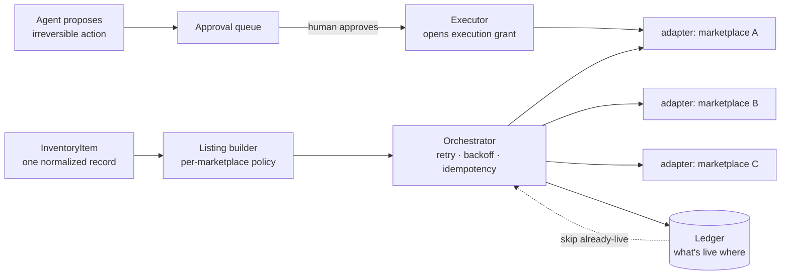

# Sales Agent — Multi-Marketplace Resale Automation (Showcase)

[](https://github.com/ArtJack/sales-agent-showcase/actions/workflows/ci.yml)

**A sanitized showcase of a system running in production for a live, revenue-generating resale business.**

Resellers sell the *same* inventory across many marketplaces at once. Doing that
by hand — re-typing each item into every platform, then keeping prices and "is it
still listed?" in sync — is slow and error-prone. This system lists an item
**once**, cross-posts it everywhere unattended without double-posting, and puts a
human in front of anything it cannot take back.

> ### ⚠️ This is a clean-room showcase, not the product
> The production code is **private**. The real marketplace integrations are
> proprietary client work and stay out of this repo. Everything here is a
> **re-implementation of the architecture** with **fake adapters** (no network,
> no credentials) and **synthetic data**. See [`NOTICE`](./NOTICE).

---

## What it does

Describe an item once in a marketplace-agnostic shape, hand it to the
orchestrator, and it renders a per-marketplace listing and publishes to each —
with retries, fast-fail on rejections, and idempotency so re-running never
double-posts. Anything irreversible stops and waits for a human. Run it yourself:

```bash
python3 demo.py     # pure stdlib, no install needed
```

```text
PASS 1 — fresh inventory
SKU-1002  Marlowe Leather Crossbody Bag  →  3 live · 0 skipped · fully listed
    marketplace-alpha    ✓ marketplace-alpha-131d3f72ca  (2 attempts, 46ms)   ← retried a transient error
    marketplace-beta     ✓ marketplace-beta-fb55be4eb5   (1 attempt, 142ms)
    marketplace-gamma    ✓ marketplace-gamma-bfb20cd96a  (1 attempt, 188ms)

SKU-1005  Velocity Running Sneakers  →  2 live · 0 skipped · 1 failed
    marketplace-gamma    ✗ permanent: rejected SKU-1005 (failed listing validation)   ← reported, not retried

PASS 2 — idempotent re-run (everything already live is skipped)
SKU-1002  ...  →  0 live · 3 skipped · fully listed     ← no double-posting

PASS 3 — irreversible action, human-gated
  agent → change_price(SKU-1001, $57.80) directly
    ✗ refused: change_price requires an approved approval; no execution grant is active
    price unchanged: $68.00
  agent → submits for review: #1 change_price SKU-1001 — $68.00 -> $57.80 (15% markdown, 60 days unsold)
  human → approves #1
    ✓ applied: $68.00 -> $57.80  (authorized by approval #1)
  agent → replays approval #1
    ✗ refused: approval #1 is executed; only an approved approval may be executed
```

Full transcript: [`docs/sample-output.txt`](./docs/sample-output.txt). The demo
runs three **fake** adapters; the production system spans eight real marketplaces.

## Architecture



One **normalized domain model** (`InventoryItem`) is the single source of truth.
A **listing builder** turns it into each marketplace's required shape under a
`ListingPolicy` (title length, tag count, etc.). The **orchestrator** publishes
through a uniform `MarketplaceClient` adapter interface — so it never knows which
marketplace it's talking to — and records results in a **ledger** that makes
re-runs idempotent. Actions that cannot be undone do not travel that path at all:
they go through an **approval queue** and an **execution grant**.

## Engineering decisions (and the trade-offs behind them)

- **Irreversible actions are human-gated, structurally.** Publishing a new listing
  is safe to retry; repricing a listing a buyer is already looking at is not. So
  `change_price` calls `assert_execution_grant()` as its *first statement* — the
  refusal lives inside the adapter, not in its caller. There is no second code
  path to the write: a stray script, a retry loop, or an agent that reasoned its
  way there all hit the same gate. The grant is a `ContextVar` scoped to one
  `(action, approval_id)` pair, so it is released on exit (including on
  exception) and never authorizes a sibling action. An approval is authority to
  act **once**; replaying it is refused.
- **Deterministic listings — an LLM never touches a field a buyer pays against.**
  Titles, prices, and tags are generated by pure, tested rules, not a model
  improvising on the numbers a sale depends on. (Production adds an *optional* LLM
  pass for description prose only, behind review.) In a market full of
  "AI-does-everything" demos, this restraint is the point.
- **Adapter pattern, marketplace-agnostic core.** Every marketplace hides behind
  one tiny `publish(listing) -> id` protocol, so the pipeline never knows which
  platform it's talking to. Adding a marketplace is a new adapter, not a change to
  the pipeline. (In production each adapter is proprietary client work; here
  they're fakes.)
- **Bounded retries with backoff, fast-fail on permanent errors.** Transient
  failures (rate limits, timeouts) are retried with exponential backoff;
  validation rejections fail immediately and are reported. Partial failure is a
  first-class outcome, not a crash.
- **Idempotency via a ledger.** The ledger is keyed on `(sku, marketplace)`, so an
  UPSERT can't create a duplicate and a re-run only posts what isn't already live
  — the property that makes "run it on a schedule, unattended" safe.
- **Tested.** 30 tests cover the retry/backoff state machine, permanent-vs-
  transient handling, idempotent skips, partial-failure reporting, the
  deterministic listing rules, and the approval gate — including that a refused
  call mutates nothing and that a failed execution leaves the approval actionable.

## Project layout

```
src/sales_showcase/
  models.py        # InventoryItem, Listing, PublishResult
  listing.py       # deterministic, policy-driven listing generation
  marketplace.py   # MarketplaceClient protocol + FakeMarketplaceClient (stub)
  orchestrator.py  # cross_post: retry, backoff, idempotency, reporting
  ledger.py        # SQLite ledger of what's live where
  grants.py        # execution grants — the gate on irreversible actions
  approvals.py     # approval queue + the executor that opens grants
demo.py            # runnable end-to-end demo on synthetic data
examples/          # synthetic inventory
tests/             # pytest suite (30 tests)
scripts/scan.sh    # secret/leak scan (run before pushing)
```

## Run it

```bash
python3 demo.py                     # end-to-end demo (stdlib only, no install)

# Tests — use a virtualenv (modern macOS/Linux mark the system Python "externally managed"):
python3 -m venv .venv && . .venv/bin/activate
pip install -e '.[dev]'
pytest                              # 30 tests
```

## The production system (private)

The real system runs a live resale business across **eight** marketplaces. eBay is
the only integration named here — it has a public API; the rest stay unnamed along
with every endpoint and credential. Scale and shape:

- **115k lines of Python, 1,519 automated tests across 153 files.**
- **The runtime lives on an Oracle Cloud VM** as three long-running systemd
  services — the scheduler, a read-only web ops console, and a Telegram channel
  for approvals — plus timer units for integrity-checked backups, database
  maintenance, a heartbeat that alerts if the scheduler stalls, and a drift check
  that alerts if the box diverges from `origin/main`. It pulls through a
  **read-only deploy key**, so production can fetch but never push. Migrations
  run backup-before-migrate with staged restarts and a single-head check against
  an Alembic-migrated SQLite database.
- **The operator console is a separate machine.** A tmux-held Textual TUI is that
  box's primary display, rendered by kmscon straight onto the Linux virtual
  console — no desktop, no browser. Nine keyboard-driven tabs (overview,
  inventory, metrics, approvals, actions, audit, reports, signals, hot items);
  the approvals tab is where a human releases queued work. `dry_run` is the
  default path across 248 call sites.
- **Measurement beats the model.** The fee model assumed eBay took 13.25%. Pulling
  a real payout showed **25.4% all-in** — Promoted Listings ad fees were not
  modelled at all, making every margin gate ~11 points optimistic; an item the
  system believed netted $22 could net below zero. Fixed the model, then added a
  discount brake for high-value items.

This repo is that architecture, rebuilt clean-room and runnable, so you can read
exactly how it's engineered.

## License

[MIT](./LICENSE) — covers this clean-room showcase code only.

---

Built by **[ArtJeck Technology](https://artjeck.com)** — AI automation and
product engineering. Showcases are runnable and tested.
