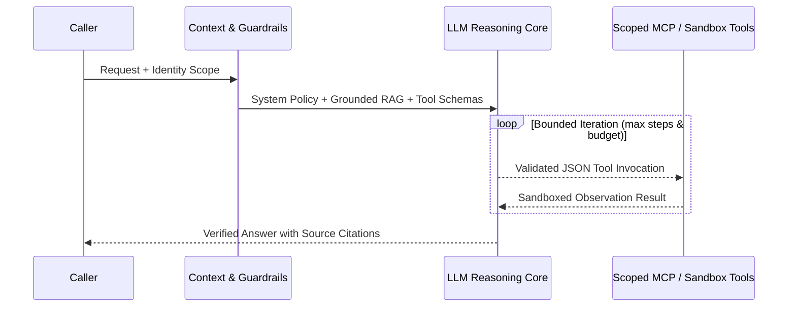

<p align="center">
  
</p>

<h1 align="center">AI Agent Hub</h1>

<p align="center">
  <strong>The standalone, primary-sourced, visual knowledge base for AI agents — types, concepts, architectures, patterns, open protocols, tooling, safety risks, evaluations, and guided learning paths.</strong>
</p>

<p align="center">
  
  <a href="LICENSE"></a>
  <a href="LICENSE-DATA.md"></a>
  <a href="docs/index.md"></a>
</p>

<p align="center">
  
</p>

<p align="center">
  <a href="docs/architecture-of-an-agent.md">Agent Anatomy</a> ·
  <a href="docs/agent-types.md">Agent Types</a> ·
  <a href="docs/concepts.md">136 Concepts</a> ·
  <a href="docs/patterns.md">35 Patterns</a> ·
  <a href="docs/protocols.md">Open Protocols</a> ·
  <a href="docs/frameworks.md">55 Frameworks</a> ·
  <a href="docs/security.md">Safety & Risks</a> ·
  <a href="docs/learning-paths.md">Learning Paths</a> ·
  <a href="site/index.html">Interactive Explorer</a>
</p>

---

## What Is AI Agent Hub?

AI Agent Hub is an open, standalone, vendor-neutral engineering reference curated around one goal: providing a **verifiable single map** connecting how autonomous AI agents reason, invoke tools, maintain memory, interoperate over open protocols, fail safely, and get evaluated in production.

✅ Every conceptual definition, risk mitigation, framework license, and enterprise use case is backed by explicit `SRC-*` citations in [`data/sources.csv`](data/sources.csv), continuously verified against live links and strict schema validation as of **2026-11-11**.

> **Important Scope Guarantee**: This repository is 100% standalone. It contains no external workflow-vendor lock-in and makes zero references to any sister repository.


## Live Knowledge Base Statistics

All counts and metrics below are regenerated deterministically from the 13 normalized CSV tables in [`data/`](data/README.md) via `scripts/build_docs.py` and `scripts/build_charts.py`:

<!-- STATS:START -->
| Dataset | Rows | Target |
|---|---|---|
| `sources.csv` | 272 | 150+ |
| `concepts.csv` | 136 | 120-160 |
| `agent_types.csv` | 40 | 35-45 |
| `patterns.csv` | 35 | 30+ |
| `protocols_standards.csv` | 16 | 12+ |
| `frameworks_tools.csv` | 55 | 50+ |
| `use_cases.csv` | 83 | 70+ |
| `risks_security.csv` | 42 | 40+ |
| `evaluation.csv` | 32 | 30+ |
| `learning_paths.csv` | 105 | 100+ |
| `resources.csv` | 267 | 150+ |
| `relationships.csv` | 922 | 600+ |
| `glossary_aliases.csv` | 60 | 1+ |
<!-- STATS:END -->

<p align="center">
  
  
</p>


## Agent Anatomy & Execution Loop

A modern agent separates **probabilistic model reasoning** from **deterministic software orchestration, schema enforcement, sandbox isolation, and audit telemetry**.

<p align="center">
  
</p>

<p align="center">
  
</p>



Full walkthrough in [docs/architecture-of-an-agent.md](docs/architecture-of-an-agent.md).


## Taxonomy of AI Agents

Agents are categorized through **three independent lenses** in [`data/agent_types.csv`](data/agent_types.csv) (`AT-001` to `AT-040`) so classical control theory, user domain roles, and runtime coordination architectures remain cleanly separated.

<p align="center">
  
</p>

Browse all 40 per-type dossiers in [docs/agent-types.md](docs/agent-types.md).


## Should You Build an Agent? (Engineering Decision Tree)

Before deploying multi-turn autonomous loops, match system complexity strictly to determinism, latency, and blast-radius requirements.

<p align="center">
  
</p>


## Core Concept Pillars (`CP-001` to `CP-136`)

Every concept carries an acyclic prerequisite chain, failure pitfalls, primary papers or official documentation, and typed directed edges in the knowledge graph.

| Pillar | Visual Domain | Quick Link |
|---|---|---|
| Foundations & Prompting |  | [docs/concepts.md](docs/concepts.md) |
| Models & Inference Optimization |  | [docs/concepts.md](docs/concepts.md) |
| Deliberate Reasoning & Search |  | [docs/concepts.md](docs/concepts.md) |
| Tools, Schemas & Code Sandboxes |  | [docs/concepts.md](docs/concepts.md) |
| Memory Systems & Hybrid RAG |  | [docs/concepts.md](docs/concepts.md) |
| Orchestration & Durable Execution |  | [docs/concepts.md](docs/concepts.md) |
| Wire & Agent Protocols |  | [docs/protocols.md](docs/protocols.md) |
| Security & Governance Controls |  | [docs/security.md](docs/security.md) |
| Evals, Tracing & Operations |  | [docs/evaluation.md](docs/evaluation.md) |
| Multimodal, Browser & Voice UIs |  | [docs/concepts.md](docs/concepts.md) |
| Enterprise Commerce & Compliance |  | [docs/use-cases.md](docs/use-cases.md) |

<p align="center">
  
</p>


## Design Patterns & Multi-Agent Topologies

Compare all **35 cataloged patterns** ([docs/patterns.md](docs/patterns.md)) from single-turn structured calls and corrective RAG up to centralized supervisors, decentralized swarm handoffs, and durable checkpointing.

<p align="center">
  
</p>


## Open Protocols & Interoperability Stack

Modern agent stacks converge on **MCP (`PS-001`)** for model-to-tool connectivity, **A2A (`PS-002`)** for cross-vendor agent collaboration, **OAuth 2.1 + PKCE + RFC 9728 (`PS-006`/`PS-014`)** for delegated authorization, **JSON Schema / OpenAPI (`PS-004`/`PS-003`)** for action contracts, and **OpenTelemetry (`PS-007`)** for portable traces.

<p align="center">
  
</p>

Full specification matrix in [docs/protocols.md](docs/protocols.md).


## Memory, Retrieval (RAG), Frameworks & Industry Adoption

<p align="center">
  
</p>

<p align="center">
  
  
</p>

Explore all 55 audited libraries in [docs/frameworks.md](docs/frameworks.md) and 83 sector workloads in [docs/use-cases.md](docs/use-cases.md).


## Safety, Security, Evaluation & Freshness

Agent security demands defense-in-depth across prompt boundaries, OAuth delegation scopes, microVM sandboxes, memory provenance, and continuous red-teaming ([docs/security.md](docs/security.md), [docs/evaluation.md](docs/evaluation.md)).

<p align="center">
  
</p>

<p align="center">
  
  
</p>


## Guided Learning Paths & Interactive Explorer

Follow structured roadmaps across **5 role tracks** (`Foundations`, `Builder`, `Architect`, `Security and Governance`, `Team Lead`) backed by **267 verified resources** ([docs/learning-paths.md](docs/learning-paths.md)), or open [`site/index.html`](site/index.html) offline to search every dataset and navigate the interactive relationship graph.

<p align="center">
  
</p>


## Quick Local Commands (Zero Third-Party Dependencies)

Every validation, integrity, link check, chart generation, and site bundling script runs with Python `3.10+` standard library only:

```bash
# Validate all 13 CSV schemas, confidence rules, dates, and qualitative standards
python scripts/validate_data.py

# Verify cross-references, DAG acyclicity, zero orphan sources, and graph connectivity
python scripts/check_integrity.py

# Regenerate all 8 SVG charts and the data-driven risk heatmap
python scripts/build_charts.py --with-risk-heatmap

# Regenerate marker-managed tables, README stats, and 176 concept/type pages
python scripts/build_docs.py

# Build offline JSON/JS graph and search bundles for site/
python scripts/build_site_data.py
```


## Repository Map & Governance

```text
ai-agent-hub/
├── assets/          # Logo, banner, divider, social card, 11 icons, 6 badges
├── charts/          # 8 deterministic data-driven SVG charts
├── data/            # 13 relational CSV datasets + Draft 2020-12 JSON Schemas
├── diagrams/        # 13 master architectural & risk-matrix SVGs
├── docs/            # Topic guides, 136 concept pages, 40 type pages, methodology
├── reports/         # Reserved ID audit & live HTTP link verification reports
├── scripts/         # 10 Python 3.10+ stdlib validation, link & build scripts
└── site/            # Offline interactive knowledge browser & graph explorer
```

- **Evidence & Citation Rules**: [docs/methodology.md](docs/methodology.md)
- **Review Policy & Maintenance**: [docs/maintenance.md](docs/maintenance.md)
- **Contributing Guide**: [CONTRIBUTING.md](CONTRIBUTING.md)
- **Security Policy**: [SECURITY.md](SECURITY.md)
- **Governance & Ownership**: [GOVERNANCE.md](GOVERNANCE.md) — Maintained by `@ayushcmd` ([Automate Workflow](GOVERNANCE.md), `ayush_24a12res897@iitp.ac.in`)

## Licensing

This repository applies clean dual licensing:

- **Code** (`scripts/`, CI workflows, and `site/` code): [MIT License](LICENSE)
- **Data & Documentation** (`data/*.csv`, `docs/`, `diagrams/`, `charts/`, `assets/`, and README prose): [Creative Commons Attribution 4.0 International (CC BY 4.0)](LICENSE-DATA.md)
